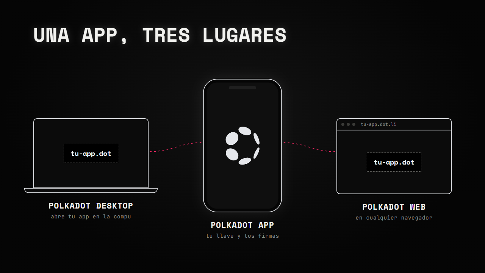
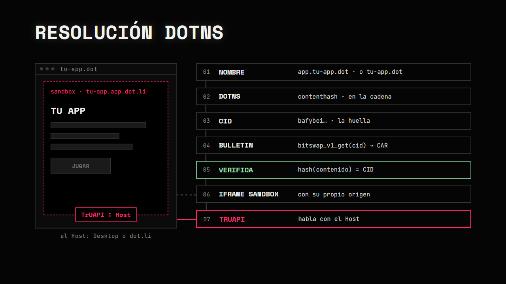

# Capítulo 1 · Cómo funciona una app de Polkadot

## 1. El Triángulo de Polkadot

Tu app se escribe una vez y se abre en tres lugares. En los tres, la firma siempre la das tú desde tu teléfono.

| Host | Dónde | Qué hace |
|---|---|---|
| Polkadot App | Tu celular | Guarda tu llave, aprueba cada firma y corre la prueba de personhood |
| Polkadot Desktop | Tu computadora | Abre apps por su nombre `.dot` y te manda las firmas al teléfono |
| Polkadot Web (`dot.li`) | Cualquier navegador | Abre apps sin instalar nada, con un cliente ligero dentro del navegador |

<b>Por dentro</b>

- **Hosts y Products.** A estas tres aplicaciones se les llama Hosts, y juntas forman el Triángulo
  de Polkadot. Lo que tú construyes es un Product: una SPA (HTML, JS y CSS) que se abre con un
  nombre como `tu-app.dot`, corre en un sandbox y nunca ve tu llave privada
  ([docs](https://docs.polkadot.com/apps/)).
- **TrUAPI.** Es el protocolo entre Host y Product (*Triangle User-Agent API*). Su contrato se
  define una sola vez en Rust, y de ahí se genera el cliente TypeScript `@parity/truapi`. Los Hosts
  de web, Android e iOS comparten ese mismo núcleo
  ([trinity-user-agents](https://github.com/paritytech/trinity-user-agents)).
- **Product SDK.** Tú no usas `@parity/truapi` directo: usas `@parity/product-sdk`, que lo envuelve
  con funciones más cómodas.
- **Once grupos.** TrUAPI agrupa lo que el Host le ofrece a tu app: cuentas, firmas, permisos,
  almacenamiento local, chat, Statement Store, preimágenes, cadenas, pagos, entropía y las propias
  llamadas de TrUAPI ([referencia](https://docs.polkadot.com/reference/apps/)).
- **Desktop.** No guarda tu llave: reenvía cada petición de firma a la Polkadot App que emparejaste.
- **People.** Tu identidad vive en la cadena People; tu llave privada, en la Polkadot App
  ([docs](https://docs.polkadot.com/apps/get-started/)).

---

## 2. Cómo se abre una app `.dot`

Nadie te "sirve" la app: tu dispositivo la busca en la cadena, la descarga por su huella y la encierra.

1. **Resuelve el nombre.** El [cliente ligero](../recursos/conceptos/cliente-ligero.md) calcula el
   *namehash* del nombre y lo busca en los contratos de [DotNS](../recursos/conceptos/dotns.md).
   Primero prueba `app.tu-app.dot` y, si no existe, `tu-app.dot`.
2. **Obtiene el CID.** El registro `contenthash` del nombre se convierte en un
   [CID](../recursos/conceptos/cid.md), la huella del contenido de la app.
3. **Descarga la app.** Le pide ese CID a [Bulletin](../recursos/conceptos/bulletin.md) con
   `bitswap_v1_get`. Como la app son varios archivos, llegan juntos en un
   [CAR](../recursos/conceptos/car.md).
4. **La encierra.** La pinta en un `<iframe>` con [*sandbox*](../recursos/conceptos/sandbox.md). En dot.li cada app tiene su propio
   origen (`tu-app.app.dot.li`), así que no puede leer el almacenamiento de otra.
5. **Habla con el Host.** A partir de ahí su única salida es TrUAPI: mensajes binarios en
   [SCALE](../recursos/conceptos/scale.md) que viajan por
   [`postMessage`](https://developer.mozilla.org/es/docs/Web/API/Window/postMessage).

### Qué es el sandbox

Un sandbox es un entorno aislado donde un código corre con capacidades limitadas: puede
funcionar, pero no puede tocar lo que está fuera de él.

En Polkadot el sandbox lo impone el Host, y tu app no puede saltárselo
([sandbox](https://docs.polkadot.com/reference/apps/protocol/truapi/sandbox/)):

- **Aislada.** El Host carga tu app en un `<iframe>` con sandbox. En dot.li cada app tiene su
  propio origen (`tu-app.app.dot.li`), así que no puede leer el almacenamiento de otra.
- **Una sola salida.** Todo lo que tu app hace fuera de sí misma pasa por la Host API, a través de
  TrUAPI: red, cadenas, almacenamiento y firmas. Tu app pide y el Host decide; los permisos se
  aplican en ese único punto. La app no tiene red propia: ni `fetch` ni `WebSocket` directos.
- **Una cuenta para cada dominio.** Tu app recibe una cuenta derivada para su dominio, no tu
  identidad raíz: la misma persona ve una cuenta distinta en `app-a.dot` y en `app-b.dot`, y las
  apps no pueden ligarlas sin un permiso explícito. Tu app nunca ve tu llave privada
  ([docs](https://docs.polkadot.com/apps/)).
- **Permisos.** Se declaran en el manifest de la app. La primera vez que el usuario la abre en
  Polkadot Desktop, Desktop le muestra cada permiso y él lo concede o lo niega; la decisión se
  guarda. `ExternalRequest`
  abre solo las URLs que coinciden con el patrón declarado. `ChainSubmit` solo deja pedir firmas:
  cada transacción se aprueba aparte en la Polkadot App de tu teléfono. Si un permiso se niega, la llamada responde `PermissionDenied` y
  tu app debe mostrar por qué
  ([permisos en Desktop](https://docs.polkadot.com/reference/apps/hosts/polkadot-desktop/permissions/)).
  La documentación marca esta lista de permisos como provisional.

| Lo que tu app hace | Cómo lo hace dentro del sandbox |
|---|---|
| Llamar a una URL externa | La declara como `ExternalRequest` y el usuario la aprueba |
| Leer o escribir en una cadena | Se lo pide al Host |
| Firmar una transacción | El Host manda la petición a tu teléfono |
| Guardar datos locales | Se lo pide al Host |

**Por qué importa.** Para el usuario: una app no puede espiar a otra ni firmar por él. Para quien
programa: en vez de las APIs web normales, usas el Product SDK (`@parity/product-sdk`) para
pedirle cada cosa al Host.

<b>Por dentro</b>

- **Por qué es seguro.** El cliente ligero no confía en un servidor: comprueba cada respuesta con
  pruebas Merkle contra los encabezados de bloque. Y como el CID es un hash del contenido, si
  alguien cambia un byte de tu app ya no coincide y se descarta.
- **El escudo de dot.li.** Verde: lo verificó tu cliente ligero. Naranja: vino de un RPC o gateway
  externo sin verificar ([dotli-community](https://github.com/paritytech/dotli-community)).
- **Las rutas relativas.** dot.li desempaqueta el CAR y un Service Worker sirve cada archivo como si
  fuera un servidor local. Por eso tu `vite.config` lleva `base: './'`.
- **Nombres con `manifest`.** Si el nombre tiene un `manifest` (icono y descripción), la app se
  publica en el subnombre `app.<nombre>.dot`, con su propio `contenthash` y un registro
  `executable`. Por eso el Host prueba primero ese subnombre
  ([DotNS](../recursos/conceptos/dotns.md)).

> **Pruébalo tú:** abre cualquier app en dot.li y agrega `?debug=true` a la URL. El panel de
> depuración muestra cada paso de arriba (resolución, descarga, render) y los mensajes TrUAPI entre
> el Host y la app ([dotli-community](https://github.com/paritytech/dotli-community#debug-panel)).

---

👉 [Capítulo 2](./02-entorno.md)
