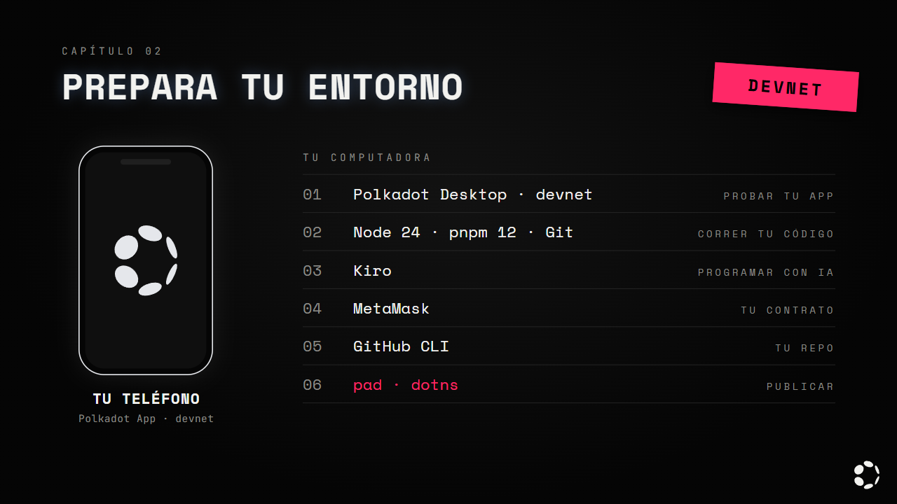
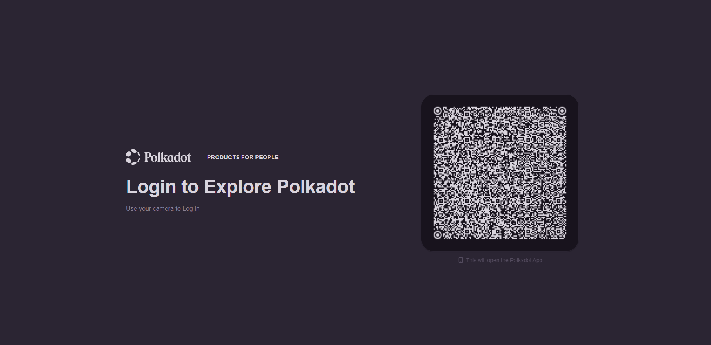
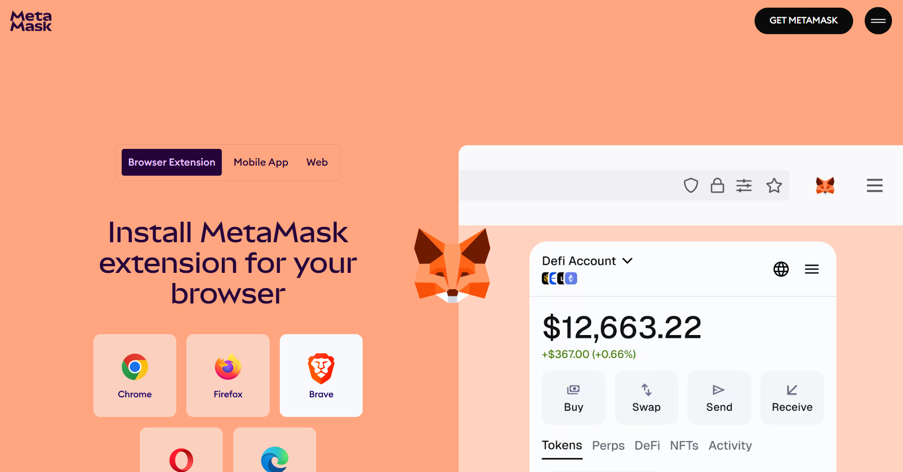
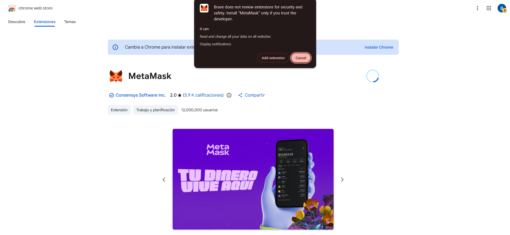
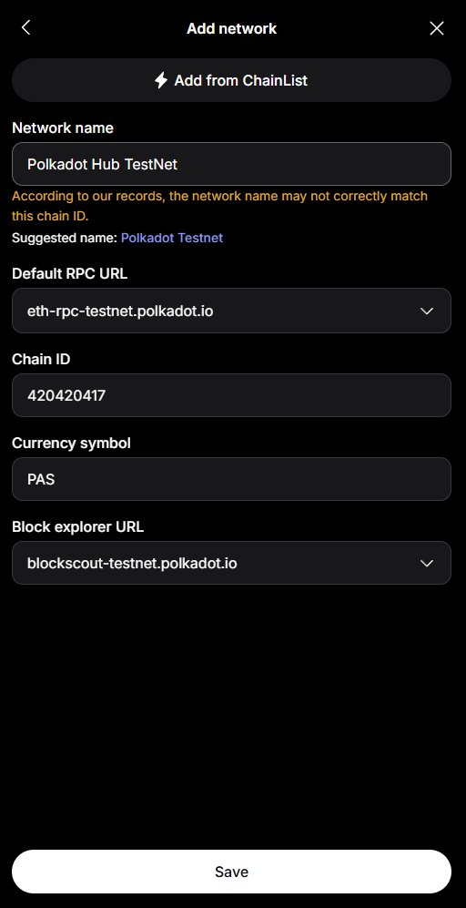
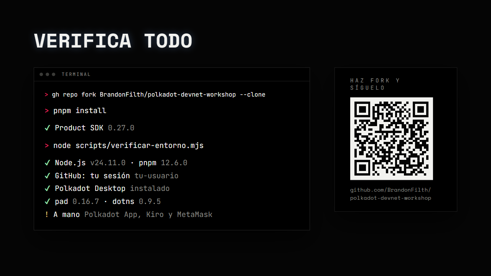

# Capítulo 2 · Prepara tu entorno

Aquí instalas todo lo que vas a usar en el resto del tutorial. Toma unos 40 minutos, casi todo de
descargas: deja que se instale mientras sigues con el capítulo 3.

Todo funciona en la red de pruebas de los Polkadot Products, operada por la
[Polkadot Community Foundation](https://docs.polkadotcommunity.foundation/reference/networks/). Nada
de lo que hagas aquí cuesta dinero real.

---

## Qué vas a instalar



| Herramienta | Dónde | Para qué |
|---|---|---|
| Polkadot App (versión devnet) | Teléfono | Tu cuenta, tu llave y tus firmas |
| Polkadot Desktop 0.1.3 | Computadora | Abrir y probar tu app publicada en su `.dot` (no se conecta a `localhost`) |
| Node.js, pnpm y Git | Computadora | Correr, construir y guardar tu código |
| Kiro | Computadora | El editor con IA con el que vas a programar |
| MetaMask | Navegador | Desplegar tu smart contract desde Remix |
| Product SDK | En cada proyecto | Que tu app hable con el Host |
| GitHub CLI (`gh`) | Computadora | Conectar tu terminal con tu cuenta de GitHub |
| `pad` y `dotns` | Se ejecutan sin instalar | `pad` sube tu app a Bulletin ([capítulo 5](./05-el-juego.md#probar-dentro-del-host-publica-en-tu-dot)); tu nombre `.dot` se compra y se apunta desde la Polkadot App (`dotns.dot`) |

---

## Paso 1 · La Polkadot App en tu teléfono

Usa las versiones de prueba (devnet). Las de Google Play y App Store se conectan a otra red y no
sirven para este tutorial ([PCF](https://docs.polkadotcommunity.foundation/reference/resources/)).

| Teléfono | Cómo instalarla |
|---|---|
| Android | Únete al grupo de testers o baja `app-polkadot-devnet.apk` del [último release](https://github.com/Polkadot-Community-Foundation/polkadot-android-community/releases/latest). Si tu teléfono no tiene servicios de Google, usa `app-polkadot-devnet-nogms.apk` |
| iPhone | Por TestFlight: el enlace para unirte viene en las notas del [último release](https://github.com/Polkadot-Community-Foundation/polkadot-ios-community/releases/latest) |

En Android te va a pedir permiso para instalar apps de fuentes desconocidas: dáselo solo al navegador
o al gestor de archivos con el que bajaste el APK.

---

## Paso 2 · Crea tu cuenta y guarda tu frase

**Paso a paso:**

1. Abre la app. Te pide un nombre de usuario y con eso crea tu cuenta.
2. Ve a **Settings → Security & privacy → Backup** y anota tu frase de recuperación en papel.
3. Guárdala fuera de tu computadora y de tu teléfono.

> **Tu frase es tu cuenta.** Quien la tenga controla tu cuenta, y si la pierdes la pierdes para
> siempre. Nunca la pegues en una página, en un chat ni en un formulario de soporte. Ni la app ni
> nadie del equipo te la va a pedir. En el capítulo 3 vas a ver por qué.

---

## Paso 3 · Polkadot Desktop

Desktop es donde vas a abrir tu app, publicada en su `.dot`, mientras la programas. No guarda tu llave: se empareja con tu
teléfono y te manda ahí cada firma
([docs](https://docs.polkadot.com/apps/get-started/)).

**Paso a paso:**

1. Baja la versión 0.1.3 para tu sistema desde
   [polkadot-desktop-community v0.1.3](https://github.com/Polkadot-Community-Foundation/polkadot-desktop-community/releases/tag/v0.1.3):

   | Sistema | Archivo |
   |---|---|
   | Windows | `polkadot-desktop-0.1.3-x64.exe` |
   | macOS (Apple Silicon) | `polkadot-desktop-0.1.3-arm64.dmg` |
   | macOS (Intel) | `polkadot-desktop-0.1.3-x64.dmg` |
   | Linux | `polkadot-desktop-0.1.3-x86_64.AppImage` |

2. Instálala. En Windows, si aparece "Windows protegió tu PC", toca **Más información → Ejecutar de
   todas formas**. En macOS la app aparece en *Aplicaciones* como **Polkadot Desktop Dev**.
3. Ábrela. Te muestra un código QR.
4. En la Polkadot App abre el escáner, apunta al QR y toca **Link**.
5. Espera a que Desktop pase de *Completing pairing…* al tablero principal.



> Usa la 0.1.3 aunque veas versiones más nuevas marcadas como *rc* (*release candidate*). Son de
> prueba y pueden no ser compatibles con el SDK que vamos a usar.

---

## Paso 4 · Node.js, pnpm, Git, GitHub CLI y Kiro

Node corre tu código, pnpm instala sus dependencias, Git guarda su historial, GitHub CLI (`gh`)
conecta tu terminal con tu cuenta de GitHub y Kiro es el editor con IA. En este tutorial solo
usamos pnpm: npm y yarn no.

Abre el bloque de tu sistema y copia todo de una vez.

<details>
<summary><b>Windows</b> · PowerShell</summary>

```powershell
winget install -e --id OpenJS.NodeJS.LTS
winget install -e --id pnpm.pnpm
winget install -e --id Git.Git
winget install -e --id GitHub.cli
winget install -e --id Amazon.Kiro
```

`winget` viene con Windows 10 y 11. El instalador de Node puede pedirte permisos de
administrador.

</details>

<details>
<summary><b>macOS</b> · Homebrew</summary>

```bash
# Si no tienes Homebrew: https://brew.sh
brew install node@24 pnpm git gh
brew link --overwrite --force node@24
brew install --cask kiro
```

Va `node@24` y no `node` porque la fórmula `node` ya instala una versión más nueva, y aquí
queremos la 24 LTS. El `brew link` la deja disponible como `node`.

</details>

<details>
<summary><b>Debian / Ubuntu</b></summary>

```bash
# Node 24 LTS (el de los repos de la distro suele estar muy viejo)
curl -fsSL https://deb.nodesource.com/setup_24.x | sudo -E bash -
sudo apt-get install -y nodejs git curl

# pnpm, sin pasar por npm
curl -fsSL https://get.pnpm.io/install.sh | sh -

# GitHub CLI, desde el repositorio oficial de GitHub
curl -fsSL https://cli.github.com/packages/githubcli-archive-keyring.gpg | sudo dd of=/usr/share/keyrings/githubcli-archive-keyring.gpg
echo "deb [signed-by=/usr/share/keyrings/githubcli-archive-keyring.gpg] https://cli.github.com/packages stable main" | sudo tee /etc/apt/sources.list.d/github-cli.list
sudo apt-get update && sudo apt-get install -y gh

# Kiro: no hay repositorio, se instala el paquete
curl -fLO https://prod.download.desktop.kiro.dev/releases/stable/linux-x64/signed/1.3.0/deb/kiro-ide-1.3.0-stable-linux-x64.deb
sudo apt install -y ./kiro-ide-1.3.0-stable-linux-x64.deb
```

Si tu máquina es ARM, cambia `linux-x64` por `linux-arm64` en las dos últimas líneas. Las versiones
nuevas de Kiro están en [kiro.dev/downloads](https://kiro.dev/downloads/).

</details>

Cierra y vuelve a abrir la terminal (y Kiro, si ya lo tenías abierto) para que reconozca los
comandos nuevos. Luego comprueba:

```bash
node -v
pnpm --version
git --version
```

```
v24.11.0
12.6.0
git version 2.51.0
```

- `node` debe ser 24.x, o al menos 22.19.
- `pnpm` debe ser 12.x.
- Cualquier versión reciente de Git sirve.

---

## Paso 5 · Conecta tu terminal con GitHub

Esto es lo que te deja guardar tu código en tu cuenta. Lo vas a usar todo el hackatón: el
repositorio en GitHub es uno de los entregables.

Si no tienes cuenta, créala en [github.com/signup](https://github.com/signup).

**Paso a paso:**

1. Inicia sesión desde la terminal:

   ```bash
   gh auth login
   ```

   Te hace cuatro preguntas. Responde:

   | Pregunta | Respuesta |
   |---|---|
   | What account do you want to log into? | **GitHub.com** |
   | What is your preferred protocol? | **HTTPS** |
   | Authenticate Git with your GitHub credentials? | **Yes** |
   | How would you like to authenticate? | **Login with a web browser** |

2. La terminal te muestra un código de 8 caracteres como `A1B2-C3D4`. Cópialo, pulsa Enter y se
   abre el navegador. Pega el código y autoriza.

   Si tu cuenta tiene verificación en dos pasos, se resuelve ahí mismo, en el navegador. La
   terminal no te la vuelve a pedir.

3. Comprueba que quedó:

   ```bash
   gh auth status
   ```

   ```
   github.com
     ✓ Logged in to github.com account tu-usuario (keyring)
     - Active account: true
     - Git operations protocol: https
   ```

4. Dile a Git quién eres. Es el nombre que va a aparecer en cada commit:

   ```bash
   git config --global user.name "Tu Nombre"
   git config --global user.email "tu@correo.com"
   ```

   Usa el mismo correo de tu cuenta de GitHub. Si no te acuerdas de cuál es:

   ```bash
   gh api user --jq .email
   ```

> La respuesta **Yes** del paso 1 es la importante: hace que Git use tu sesión de `gh` para subir
> código. Sin eso, `git push` te pide una contraseña que GitHub ya no acepta.
>
> Tu código lo sigues guardando con `git` (`git add`, `git commit`, `git push`). `gh` solo se usa
> para iniciar sesión y para lo que pasa del lado de GitHub, como el fork o crear un repo.

---

## Paso 6 · Ajustes de Windows

Si usas macOS o Linux, sáltate este paso.

```powershell
Set-ExecutionPolicy -Scope CurrentUser RemoteSigned
git config --global core.longpaths true
```

- La primera línea deja correr los scripts de las herramientas. Sin ella, `pnpm` y otros comandos
  fallan con "la ejecución de scripts está deshabilitada".
- La segunda deja que Git maneje rutas de más de 260 caracteres, que aparecen en las dependencias.

Y trabaja en una carpeta con ruta corta y sin espacios, como `C:\dev`:

```powershell
mkdir C:\dev
cd C:\dev
```

---

## Paso 7 · Inicia sesión en Kiro

Ya lo instalaste en el paso 4. Ábrelo e inicia sesión con tu cuenta de GitHub o de Google.

Tienes dos formas de usarlo sin pagar:

- **Kiro Students.** Si tu universidad está en el programa, tienes un año gratis con 1,000 créditos
  al mes. Entra con tu correo institucional y, si eres elegible, aparece un aviso para verificarte
  ([Kiro Students](https://kiro.dev/blog/students-2026/)).
- **Promoción de Kiro Plus.** El primer mes gratis para probarlo.

> **POR VERIFICAR:** condiciones y enlace de la promoción de Kiro Plus.

---

## Paso 8 · MetaMask

MetaMask es una wallet del navegador. La vas a usar en el capítulo 3 para desplegar tu smart
contract desde Remix. Es una cuenta distinta a la de tu teléfono, y en ese mismo capítulo vas a ver
por qué.

**Paso a paso:**

1. Instala la extensión desde [metamask.io](https://metamask.io) y crea una cuenta nueva. Guarda su
   frase igual que la del paso 2.

   En *Browser Extension* elige tu navegador:

   

   Te lleva a la tienda de extensiones. Toca **Add extension** (Agregar extensión):

   

2. Agrega la red de pruebas: **Redes → Agregar red → Agregar una red manualmente**.

   | Campo | Valor |
   |---|---|
   | Nombre | Polkadot Hub TestNet |
   | URL de RPC | `https://eth-rpc-testnet.polkadot.io` |
   | ID de cadena | `420420417` |
   | Símbolo | `PAS` |
   | Explorador | `https://blockscout-testnet.polkadot.io` |

   Si MetaMask sugiere otro nombre para la red, puedes ignorarlo. Toca **Save**.

   

> Remix ofrece en su lista una red llamada "Paseo PassetHub (420420422)". Ya no existe: usa la de la
> tabla.

---

## Paso 9 · Haz fork, clónalo y verifica todo

Haz una copia del tutorial en tu cuenta (un *fork*) y bájala a tu computadora. Así puedes seguir
los pasos en tu propia pantalla, a tu ritmo, sin depender del proyector. El fork es para seguir el
curso y correr el proyecto de muestra; tu juego va en un repo nuevo que creas en el
[capítulo 5](./05-el-juego.md#4-crea-tu-repo).

```bash
gh repo fork BrandonFilth/polkadot-devnet-workshop --clone
cd polkadot-devnet-workshop
pnpm install
node scripts/verificar-entorno.mjs --completo
```

> **POR VERIFICAR:** URL definitiva del repo.

En Windows hazlo dentro de `C:\dev`, la carpeta del paso 6.

Ese comando hace tres cosas: copia el repo a tu cuenta, lo descarga y deja la copia original como
`upstream`. Si durante el evento actualizamos el tutorial, lo pones al día con:

```bash
git pull upstream main
```

`pnpm install` baja las dependencias del proyecto, entre ellas el **Product SDK**
(`@parity/product-sdk`), que es con lo que tu app habla con el Host. No se instala en tu
computadora: vive en cada proyecto.

La verificación tarda uno o dos minutos la primera vez, porque descarga `pad` y `dotns`. Si todo
está bien, verás algo así:

```
Tu entorno

✔ Node.js                          v24.11.0
✔ pnpm                             12.6.0
✔ Git                              2.51.0.windows.1
✔ Git: tu nombre y correo          Tu Nombre
✔ Git: rutas largas                activadas
✔ PowerShell: política de scripts  RemoteSigned
✔ Carpeta de trabajo               C:\dev\polkadot-devnet-workshop
✔ Polkadot Desktop                 instalado
✔ Product SDK                      0.27.0
✔ pad                              0.16.7
✔ dotns                            0.9.5
! A mano                           Polkadot App en el teléfono, Kiro y MetaMask
  → Revisa la lista del final del capítulo 2.

Todo lo que se puede revisar desde aquí está listo.
```

- `✔` está listo.
- `✘` falta algo: debajo te dice cómo arreglarlo.
- `!` es un aviso o algo que tienes que revisar tú.



---

## Lista final

Lo que el script no puede revisar:

- [ ] La Polkadot App (devnet) está instalada y tienes tu frase en papel.
- [ ] Polkadot Desktop 0.1.3 está emparejado con tu teléfono.
- [ ] Kiro abre y ya iniciaste sesión.
- [ ] MetaMask tiene la red Polkadot Hub TestNet.

---

## Tu primer commit

Esto es lo que vas a repetir cada vez que avances en tu app. Practícalo ahora en tu fork; tu
proyecto lo entregas en su propio repo:

```bash
git add .
git commit -m "Mi primer commit"
git push
```

```
[main 3f8a2c1] Mi primer commit
 1 file changed, 1 insertion(+)
Enumerating objects: 4, done.
To https://github.com/tu-usuario/polkadot-devnet-workshop.git
   9adc9f3..3f8a2c1  main -> main
```

- `git add .` marca todo lo que cambiaste.
- `git commit -m "…"` lo guarda en tu computadora, con un mensaje de qué hiciste.
- `git push` lo sube a tu cuenta de GitHub. Si no te pide contraseña, el paso 5 quedó bien.

Cuando empieces tu propio proyecto en el hackatón, créalo así desde su carpeta
([capítulo 5, sección 4](./05-el-juego.md#4-crea-tu-repo)):

```bash
gh repo create mi-juego --public --source=. --push
```

---

<details>
<summary><b>Problemas comunes</b></summary>

- **"pnpm (o gh, o node) no se reconoce" justo después de instalarlo.** La terminal todavía tiene
  el PATH viejo. Abrir otra terminal en Kiro no basta: hereda el PATH del editor. Cierra Kiro por
  completo y vuelve a abrirlo. En Windows también puedes actualizar la terminal actual con:
  `$env:Path = [Environment]::GetEnvironmentVariable('Path','Machine') + ';' + [Environment]::GetEnvironmentVariable('Path','User')`
- **`pnpm --version` dice 10 o 11.** Tienes otro pnpm, instalado antes con npm. En Windows,
  `where.exe pnpm` te dice cuál se está usando; desinstala el viejo con `npm uninstall -g pnpm`.
- **`ERR_PNPM_NO_PKG_MANIFEST` o `Cannot find module …verificar-entorno.mjs`.** Estás fuera de la
  carpeta del proyecto. Entra con `cd polkadot-devnet-workshop` primero.
- **`gh auth status` dice que no tienes sesión, pero `git push` sí funciona.** Son dos sesiones
  distintas: Git puede tener la suya (por ejemplo, de GitHub Desktop) y `gh` guarda la propia. Corre
  `gh auth login`; no borra la de Git.
- **`git push` te pide usuario y contraseña, y la rechaza.** GitHub ya no acepta contraseñas en la
  terminal. Corre `gh auth login` otra vez (paso 5) y responde **Yes** a *Authenticate Git with
  your GitHub credentials?*.
- **`git push` dice `Permission denied` o `403`.** Estás apuntando al repo original, no a tu fork.
  Revisa con `git remote -v` que `origin` tenga tu usuario.
- **Iniciaste sesión con otra cuenta.** `gh auth logout` y repite el paso 5.
- **Desktop no muestra el QR o no termina de emparejar.** Revisa que el teléfono y la computadora
  tengan internet, cierra Desktop por completo y vuelve a abrirlo.
- **En Windows, Desktop se pone lento y el disco se llena.** La versión 0.1.3 no logra rotar su
  archivo de log en Windows y lo deja crecer sin límite. Corre el guardián, que lo vacía antes de
  que crezca:
  `powershell -NoProfile -ExecutionPolicy Bypass -File .\scripts\desktop-log-guard.ps1 -Watch`

</details>

---

👉 [Capítulo 3](./03-smart-contracts.md)
