# Capítulo 3 · Smart contracts

Tu contrato lo va a escribir la IA. Este capítulo es para que entiendas cada parte de lo que te
entrega: qué guarda, quién lo puede usar, qué se rechaza y por qué. Así sabes qué pedirle y qué
revisar.

El ejemplo es el contrato del juego, [`contrato/Leaderboard.sol`](../contrato/Leaderboard.sol):
guarda el mejor puntaje de cada jugador y, si el jugador quiere, un username único. Al final lo
despliegas en Remix; toma unos 5 minutos.

---

## 1. Una app normal vs. un contrato

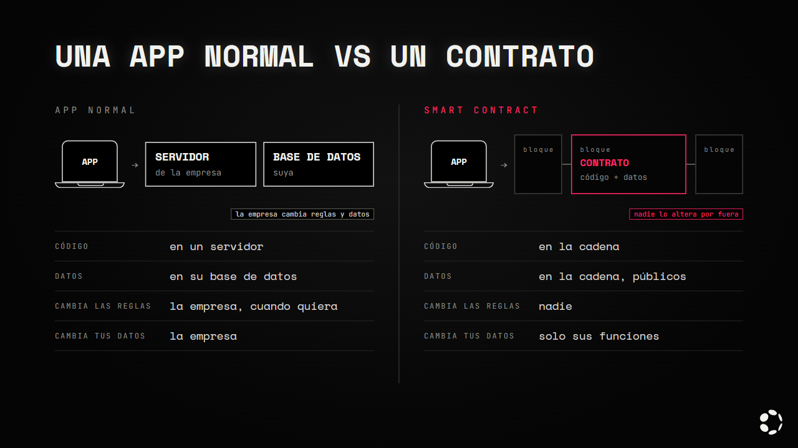

| | App normal | Smart contract |
|---|---|---|
| El código vive en | Un servidor de la empresa | La cadena |
| Los datos viven en | Su base de datos | La cadena, a la vista de todos |
| Quién puede cambiar las reglas | La empresa, cuando quiera | Nadie: el código no cambia después de desplegarlo |
| Quién puede cambiar tus datos | La empresa | Solo las funciones del contrato, con las reglas que trae |

Un smart contract es un programa que vive en la cadena. Cualquiera puede leer su código y sus datos,
y nadie puede alterarlos por fuera de las reglas que el propio contrato define.

---

## 2. Cuándo sí y cuándo no

Usa un contrato cuando **varias personas tienen que confiar en un dato** sin tener que confiar en
quien hizo la app:

- Un marcador que nadie puede trucar a mano.
- Una votación donde cada persona vota una vez.
- Constancias o diplomas que no se pueden falsificar.
- El fondo compartido de un club, con reglas para retirar.

No lo uses para:

- **Lo que solo le importa a una persona.** Preferencias, tema o borradores: guárdalos en la app.
- **Datos privados.** Todo lo que guarda un contrato es público.
- **Archivos grandes.** Para eso está [Bulletin](../recursos/conceptos/bulletin.md); el contrato
  guarda solo el [CID](../recursos/conceptos/cid.md).
- **Lo que cambia a cada instante.** La posición de Pac-Man vive en el juego; al contrato solo va el
  puntaje final. Cada escritura pide una firma y paga gas.

---

## 3. Guardar datos | Tipos de datos

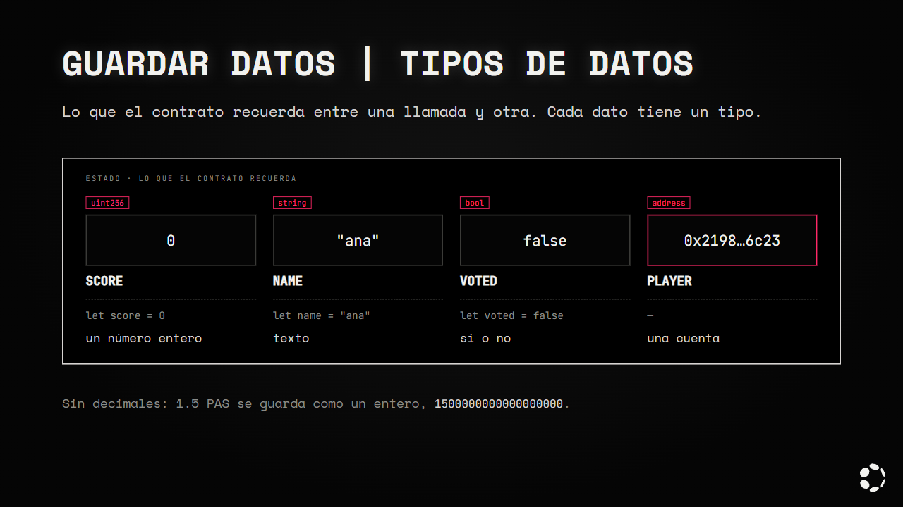

Lo que un contrato recuerda entre una llamada y otra se llama **estado**. Cada dato tiene un tipo,
igual que en otros lenguajes, pero más estricto:

| JavaScript | Solidity | Qué guarda |
|---|---|---|
| `let score = 0` | `uint256 score;` | Un número entero positivo |
| `let name = "ana"` | `string name;` | Texto |
| `let voted = false` | `bool voted;` | Sí o no |
| — | `address player;` | Una cuenta, como `0x2198…6c23` |

Solidity no tiene decimales: los montos se guardan como enteros (por ejemplo, 1.5 PAS se guarda como
`1500000000000000000`, con 18 ceros de decimales).

> **Pídeselo a la IA así:** *"Guarda el mejor puntaje de cada jugador como `uint256`."*

---

## 4. Listas

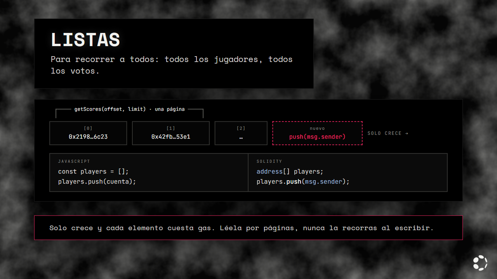

Usa una lista cuando necesites **recorrer a todos**, por ejemplo, para mostrar a todos los
jugadores.

```js
// JavaScript
const players = [];
players.push(cuenta);
```

```solidity
// Solidity
address[] players;
players.push(msg.sender);
```

Ten cuidado con dos cosas:

- **Las listas solo crecen.** Cada elemento que agregas se queda guardado para siempre y cuesta gas.
- **Recorrer una lista muy larga dentro de una función que escribe** puede costar tanto gas que la
  transacción falle. Por eso `Leaderboard` la lee por páginas (`getScores(offset, limit)`), y solo
  en funciones de lectura.

> **Pídeselo a la IA así:** *"Guarda en una lista a cada jugador la primera vez que envía un
> puntaje, y agrega una función de lectura que la devuelva por páginas."*

---

## 5. Mappings

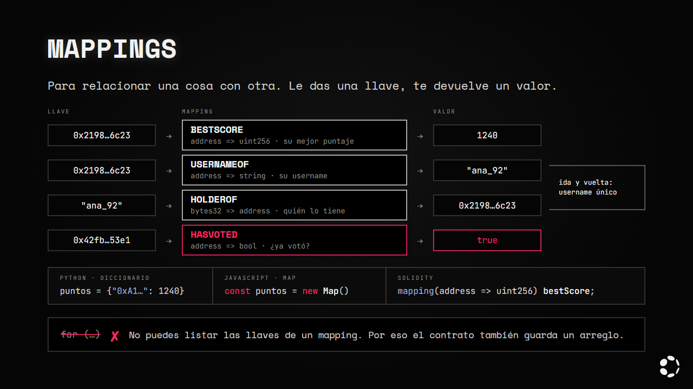

Usa un `mapping` cuando quieras **relacionar una cosa con otra**: le das una llave y te devuelve un
valor. Es como un diccionario o un `Map` de JavaScript.

| Para saber… | Mapping |
|---|---|
| El mejor puntaje de cada jugador | `mapping(address => uint256) bestScore;` |
| El username de cada jugador | `mapping(address => string) usernameOf;` |
| Qué jugador tiene un username | `mapping(bytes32 => address) holderOf;` |
| Si una cuenta ya votó | `mapping(address => bool) hasVoted;` |

```js
// JavaScript
const bestScore = new Map();
bestScore.set(cuenta, 1240);
```

```solidity
// Solidity
mapping(address => uint256) bestScore;
bestScore[msg.sender] = 1240;
```

Un mapping tiene un límite importante: **no se puede recorrer** ni saber cuántos elementos tiene.
Si preguntas por una llave que nunca se guardó, devuelve el valor vacío (`0`, `""`, `false`). Por
eso `Leaderboard` usa las dos cosas: el mapping para buscar rápido el puntaje de alguien, y la lista
para saber quiénes han jugado.

### Wallet → username

Con dos mappings, uno en cada sentido, el contrato funciona como un registro de nombres:

- **Wallet → username** (`usernameOf`): la app pregunta "¿esta cuenta tiene username?". Si no tiene,
  muestra la dirección corta.
- **Username → wallet** (`holderOf`): es lo que lo hace único. Si otra cuenta ya lo tiene, el
  contrato lo rechaza.
- **Si lo cambias,** el anterior queda libre para otro jugador.

> **Pídeselo a la IA así:** *"Agrega un username opcional y único por cuenta, con un mapping de
> address a username y otro de username a address."*

---

## 6. Leer y escribir

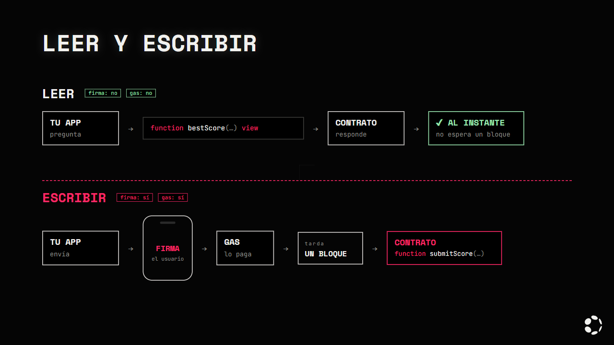

| | Leer | Escribir |
|---|---|---|
| Ejemplo | `bestScore(jugador)` | `submitScore(1240)` |
| En Solidity | `function … view` | `function …` (sin `view`) |
| ¿Pide firma? | No | Sí |
| ¿Cuesta gas? | No | Sí |
| ¿Cuánto tarda? | Al instante | Lo que tarda en entrar en un bloque |

Es parecido a un *getter* contra una función que cambia algo. Si una función solo consulta, debe ser
`view`: así la app la puede llamar sin pedirle una firma al usuario.

> **Pídeselo a la IA así:** *"Las funciones que solo consultan datos deben ser `view`."*

---

## 7. Quién llama

`msg.sender` es la cuenta que llama a la función. Se parece al usuario con sesión iniciada en un
backend, con una diferencia: aquí no hay sesión que robar, porque lo prueba la firma.

```solidity
bestScore[msg.sender] = score;   // solo cambia TU puntaje
```

Lo importante es esto: **cualquiera puede llamar cualquier función** de un contrato, desde tu app,
desde Remix o desde un script. Tu app no protege nada; el contrato es el que decide qué se permite.
Por eso `submitScore` usa `msg.sender` y no recibe la cuenta como parámetro: si la recibiera,
cualquiera podría cambiar el puntaje de otro.

> **Pídeselo a la IA así:** *"Cada jugador solo puede cambiar su propio puntaje: usa `msg.sender`,
> no recibas la cuenta como parámetro."*

---

## 8. Reglas y eventos

**`revert` rechaza la llamada.** Es como `throw new Error()`, con una garantía extra: si una función
revierte, no se guarda nada de lo que hizo, ni siquiera lo que alcanzó a cambiar antes.

```solidity
error ScoreNotHigher(uint256 current, uint256 submitted);

if (score <= bestScore[msg.sender]) revert ScoreNotHigher(bestScore[msg.sender], score);
```

**`emit` avisa que algo pasó.** El evento queda en el historial de la cadena y cualquier app lo
puede escuchar. Guardar un evento cuesta mucho menos que guardar estado, pero el contrato no lo
puede leer después: es solo para afuera.

```solidity
event NewHighScore(address indexed player, uint256 score);

emit NewHighScore(msg.sender, score);
```

> **Pídeselo a la IA así:** *"Usa errores personalizados con nombre, no textos en `require`, y
> emite un evento cada vez que cambie un puntaje."*

---

## 9. Todo es público y para siempre

- **Nada es secreto.** Las variables `private` solo impiden que otros contratos las lean; cualquiera
  puede leer el almacenamiento de la cadena. Nunca guardes contraseñas, llaves ni datos personales.
- **No se puede corregir.** Si encuentras un error después de desplegar, despliegas un contrato
  nuevo, con otra dirección, y los datos del anterior se quedan ahí. Por eso se prueba antes.
- **Guardar cuesta.** Cada dato que escribes paga gas, y los textos cuestan más que los números.
  Guarda lo mínimo; lo demás puede ir en eventos o en Bulletin.

---

## 10. Lo que un contrato no puede saber

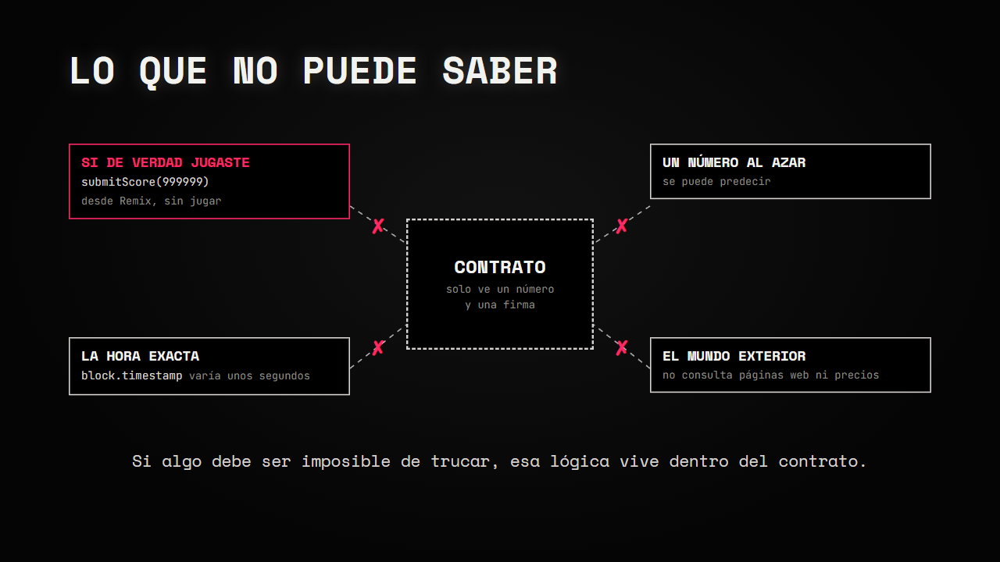

- **No sabe si de verdad jugaste.** Cualquiera puede abrir Remix y llamar `submitScore(999999)` sin
  jugar: el contrato solo ve un número y una firma. Es una limitación real de este marcador. Para el
  hackatón está bien; si algo tiene que ser imposible de trucar, esa lógica tiene que vivir dentro
  del contrato.
- **No tiene azar seguro.** Un "número aleatorio" calculado en el contrato se puede predecir. Si tu
  juego reparte premios por sorteo, eso importa.
- **La hora es aproximada.** `block.timestamp` lo pone quien produce el bloque y puede variar unos
  segundos. Sirve para plazos de días u horas, no para cronometrar.
- **No ve el mundo exterior.** Un contrato no puede consultar una página web ni el precio de algo
  por su cuenta.

---

## 11. Recetas por track y OpenZeppelin

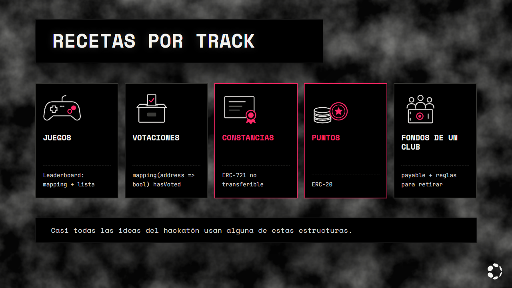

Casi todas las ideas del hackatón usan alguna de estas estructuras:

| Track | Qué suele llevar el contrato |
|---|---|
| Juegos | Un marcador, como `Leaderboard` |
| Votaciones | `mapping(address => bool) hasVoted` y un conteo por opción |
| Constancias y diplomas | Un token único y no transferible (estándar **ERC-721**) |
| Puntos y recompensas | Un token que se puede repartir (estándar **ERC-20**) |
| Fondos de un club | Funciones que reciben PAS y reglas para retirarlo (sección 12) |

Para los tokens no hace falta que la IA invente nada. [OpenZeppelin](https://docs.openzeppelin.com/contracts)
es la librería estándar de contratos para Solidity: trae ERC-20, ERC-721, control de permisos y más,
ya escritos y auditados. Tu contrato los importa y solo agrega lo propio.

```solidity
import {ERC20} from "@openzeppelin/contracts/token/ERC20/ERC20.sol";

contract Puntos is ERC20 {
    constructor() ERC20("Puntos", "PTS") {
        _mint(msg.sender, 1000 * 10 ** decimals());
    }
}
```

Remix descarga los `import` de OpenZeppelin solo, sin instalar nada. Probamos en Polkadot Hub dos
ejemplos con OpenZeppelin 5.6.1 y el compilador 0.8.28: un ERC-20 (3,554 bytes) y una constancia
ERC-721 no transferible (8,523 bytes). Los dos se desplegaron y funcionaron.

> **Pídeselo a la IA así:** *"Usa el ERC-721 de OpenZeppelin 5 para las constancias y hazlas no
> transferibles."*

---

## 12. Contratos que mueven dinero

Si tu contrato recibe o reparte PAS, el riesgo sube: un error ya no cambia un puntaje, se lleva
dinero.

- Una función que recibe PAS se marca `payable`, y el monto llega en `msg.value`.
- **Primero actualiza el estado, después manda el dinero.** Si lo haces al revés, otro contrato
  puede volver a llamar a tu función antes de que termine y retirar dos veces. A este ataque se le
  llama *reentrancy*.
- Prefiere que cada quien **retire lo suyo** con una función, en vez de que el contrato le mande
  dinero a muchos en un ciclo.

Si tu contrato guarda dinero, pide que alguien lo revise antes de usarlo, y usa la skill de
seguridad del capítulo 4.

---

## 13. El contrato del juego

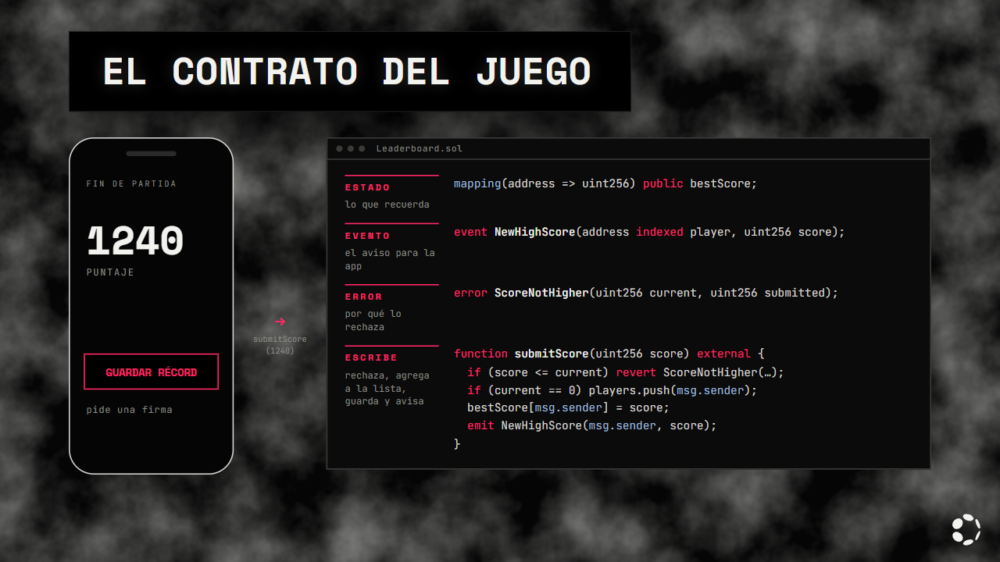

Abre [`contrato/Leaderboard.sol`](../contrato/Leaderboard.sol). Ya conoces cada parte:

| Parte | En el contrato | Para qué |
|---|---|---|
| Estado | `bestScore`, `usernameOf`, `holderOf`, `players` | Lo que recuerda |
| Eventos | `NewHighScore`, `UsernameSet` | Los avisos para la app |
| Errores | `ScoreNotHigher`, `InvalidUsername`, `UsernameTaken` | Por qué rechaza algo |
| Escribe | `submitScore`, `setUsername` | Piden firma |
| Lee | `bestScore`, `usernameOf`, `playerOf`, `playerCount`, `getScores` | Gratis |

```solidity
function submitScore(uint256 score) external {
    uint256 current = bestScore[msg.sender];
    if (score <= current) revert ScoreNotHigher(current, score);
    if (current == 0) players.push(msg.sender);
    bestScore[msg.sender] = score;
    emit NewHighScore(msg.sender, score);
}
```

Lee tu récord, rechaza si el nuevo no es mayor, te agrega a la lista la primera vez, guarda y avisa.

El username lleva de 3 a 16 caracteres, solo `a-z`, `0-9` y `_`. Así no hay nombres vacíos, con
espacios o con mayúsculas que parezcan otro ("Ana" y "ana").

---

## 14. La ABI

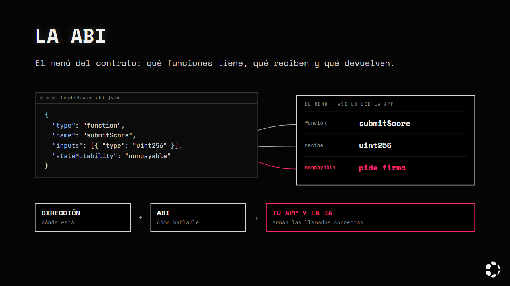

Tu app no lee el código del contrato. Para llamarlo necesita dos cosas:

- **La dirección:** dónde está el contrato en la cadena.
- **La ABI:** el "menú" del contrato. Dice qué funciones tiene, qué recibe cada una, qué devuelve y
  qué eventos y errores puede lanzar. Es un JSON que sale al compilar.

```json
{
  "type": "function",
  "name": "submitScore",
  "inputs": [{ "name": "score", "type": "uint256" }],
  "outputs": [],
  "stateMutability": "nonpayable"
}
```

Con la ABI, la app sabe convertir `submitScore(1240)` en los bytes que entiende el contrato, y
convertir la respuesta de vuelta. En el juego la usas con el Product SDK:

```js
const leaderboard = createContract(runtime, DIRECCION, abi);
```

**Para el vibe coding es clave:** si le das la ABI a la IA, escribe las llamadas correctas. Sin ella,
inventa nombres de funciones o tipos que no existen.

> **Pídeselo a la IA así:** *"El contrato está en `0x…` y su ABI está en `src/contract/leaderboard.abi.json`.
> Usa solo las funciones de esa ABI."*

---

## 15. Simular antes de enviar

Antes de pedirle una firma al usuario, la app puede **probar la llamada sin enviarla**. Si va a
fallar, se entera antes y no le hace firmar algo que el contrato va a rechazar.

```js
// 1. Simula: no pide firma ni cuesta gas
const prueba = await leaderboard.submitScore.query(1240);
// 2. Solo si pasa, envía la transacción de verdad
if (prueba.success) await leaderboard.submitScore.tx(1240);
```

Así, si el puntaje no supera el récord, la app muestra "ese puntaje no supera tu récord" en vez de
una firma fallida.

> **Pídeselo a la IA así:** *"Antes de enviar cada transacción, simúlala con `.query()` y muestra el
> error del contrato si va a fallar."*

---

## 16. Tus tres cuentas

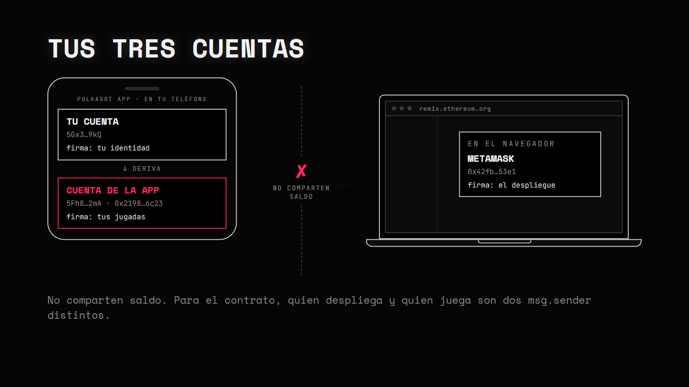

Una cuenta es un par de llaves. La **llave privada** firma y nunca se comparte; la **llave pública**
es tu dirección, la que todos ven. La frase de 12 palabras es una forma de escribir la llave privada
para que puedas respaldarla.

| Cuenta | Dónde vive | Se ve como | Para qué la usas |
|---|---|---|---|
| Tu cuenta principal | Polkadot App, en tu teléfono | `5Gx…` (SS58) | Tu identidad |
| La cuenta de cada app | Se deriva de la principal, también en tu teléfono | `5Fh…` y `0x…` | Firmar lo que hace esa app, como guardar tu puntaje |
| MetaMask | Extensión del navegador | `0x…` (H160) | Desplegar el contrato desde Remix |

Las tres son cuentas distintas y **no comparten saldo**. Si fondeas una y firmas con otra, la
transacción falla.

Por eso, para el contrato, quien despliega (MetaMask) y quien juega (la cuenta del juego en tu
teléfono) son `msg.sender` distintos, cada uno con su propio récord.

<details>
<summary><b>Por dentro</b></summary>

- **Dos formatos, una sola cadena.** Polkadot Hub usa cuentas de 32 bytes (SS58), pero también
  entiende las direcciones de 20 bytes de Ethereum (H160). `pallet-revive` convierte entre las dos
  ([docs](https://docs.polkadot.com/smart-contracts/for-eth-devs/accounts/)).
- **De MetaMask a Polkadot.** A la dirección `0x…` se le agregan doce bytes `0xEE` al final. Es
  reversible, así que tu cuenta de MetaMask también tiene una dirección SS58 y es la misma cuenta,
  con el mismo saldo.
- **De una cuenta de Polkadot a `0x…`.** Una cuenta nativa (la de tu teléfono) no cabe en 20 bytes.
  La cadena calcula su `0x…` con un hash Keccak-256 y toma los últimos 20 bytes. Para usarla con
  herramientas de Ethereum hay que registrar esa relación con `map_account`, que deja un depósito.
- **MetaMask no necesita registrarse.** Su llave es del mismo tipo que las de Ethereum (secp256k1),
  así que ya nace compatible.
- **Los decimales.** La cadena maneja PAS con 10 decimales, pero la capa de Ethereum los muestra con
  18, porque MetaMask y Remix esperan 18. Es el mismo saldo, solo cambia cómo se escribe.

</details>

---

## 17. Despliégalo

Toma unos 5 minutos. Necesitas MetaMask con la red **Polkadot Hub TestNet** (capítulo 2, paso 8).

**Paso a paso:**

1. **Pide PAS para tu cuenta de MetaMask.** Copia tu dirección `0x…`, abre el
   [faucet](https://faucet.polkadot.io), elige **Paseo** y **Asset Hub (1000)**, pega la dirección y
   pide los tokens.

   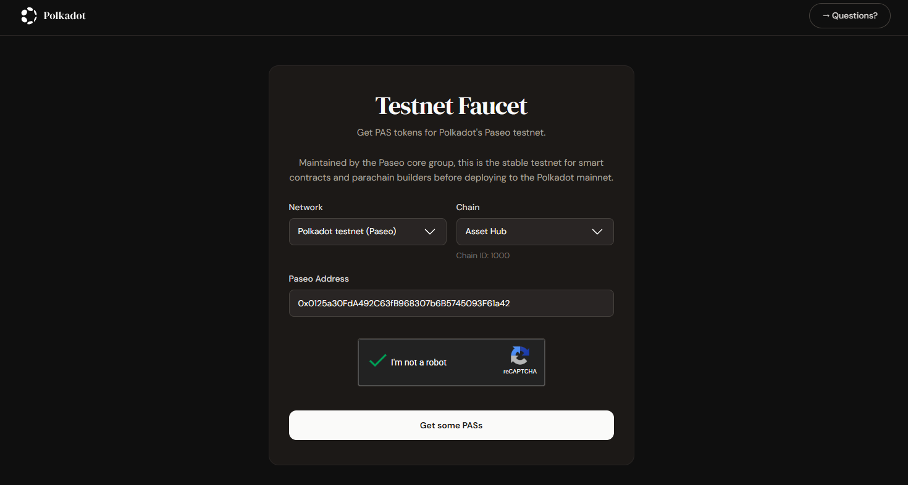

2. **Abre Remix** en [remix.ethereum.org](https://remix.ethereum.org), crea `Leaderboard.sol` y pega
   el contrato.

   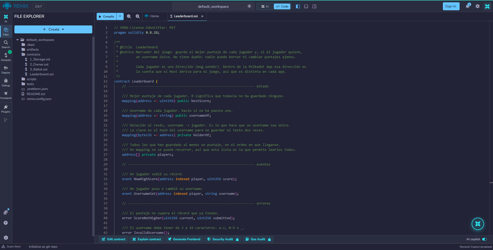

3. **Compila** en *Solidity compiler* con la versión **0.8.28**. No toques la optimización.

   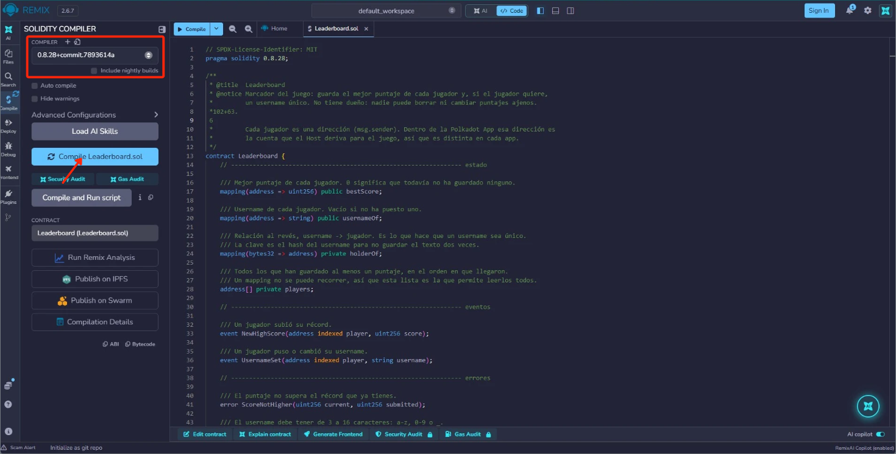

4. **Despliega.** En *Deploy & run transactions* elige **Injected Provider - MetaMask**, revisa que
   la red sea la 420420417, pulsa **Deploy** y confirma en MetaMask.

   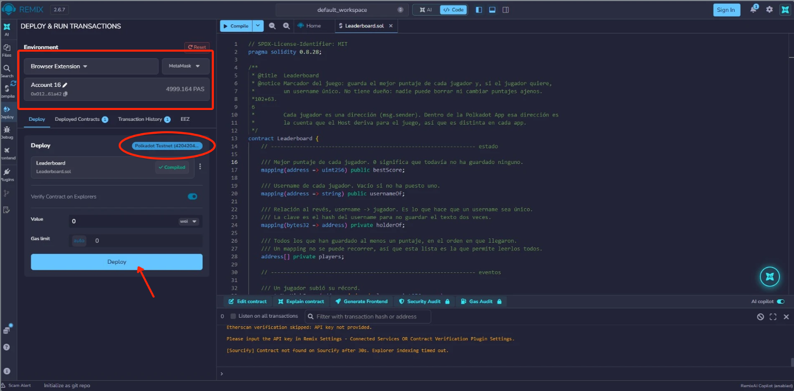

5. **Guarda la dirección y la ABI.** Copia la dirección del contrato desde *Deployed Contracts*, y la
   ABI con el botón **ABI** de la pestaña del compilador. Las vas a usar en el capítulo 4.

   

Para probarlo, en *Deployed Contracts* los botones **naranjas** escriben (piden firma) y los
**azules** solo leen. Llama `submitScore` con `1240` y luego `bestScore` con tu dirección.

> Si en Remix aparece "Paseo PassetHub (420420422)", no la uses: esa red ya no existe.

---

## 18. De Solidity a Polkadot Hub

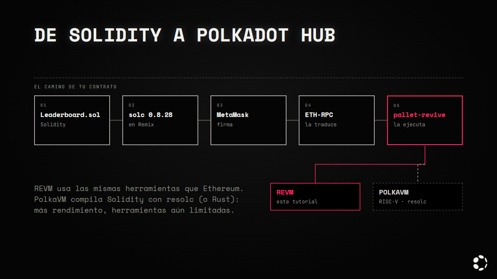

Los contratos viven en **Polkadot Hub** (Asset Hub), y los ejecuta `pallet-revive`. Polkadot Hub
tiene dos máquinas para correrlos
([docs](https://docs.polkadot.com/smart-contracts/for-eth-devs/dual-vm-stack/)):

| Máquina | Qué ejecuta | Compilador | Cuándo |
|---|---|---|---|
| **REVM** | Bytecode de la EVM, el mismo de Ethereum | `solc` | Para empezar: funciona con Remix, MetaMask, Hardhat y Foundry sin cambiar nada |
| **PolkaVM** | Bytecode RISC-V | `resolc` (Solidity) o Rust | Cuando necesitas más rendimiento; sus herramientas aún son limitadas |

REVM significa *Rust Ethereum Virtual Machine*: la máquina está escrita en Rust, pero tus contratos
siguen siendo Solidity. `solc` es el compilador de Solidity: convierte el `.sol` en bytecode (lo que
se despliega) y en la ABI (lo que usa tu app). Remix lo usa por dentro al compilar.

En este tutorial usas **REVM** con `solc` 0.8.28. PolkaVM no se cubre aquí, pero está en la
documentación.

<details>
<summary><b>Por dentro</b></summary>

- **Cómo entra una transacción de MetaMask.** MetaMask habla con un servidor ETH-RPC
  (`eth-rpc-testnet.polkadot.io`). Ese servidor recibe la transacción de Ethereum, la empaqueta como
  una transacción de Polkadot y `pallet-revive` la ejecuta. Por eso las herramientas de Ethereum
  funcionan sin cambios.
- **El límite de tamaño.** REVM acepta hasta 24,576 bytes de código por contrato. `Leaderboard`
  ocupa 5,686: no necesitas el optimizador.

</details>

<details>
<summary><b>Correr las pruebas del contrato</b></summary>

El contrato trae 21 pruebas que corren en una EVM local, sin red:

```bash
cd contrato
pnpm install
pnpm test        # las 21 reglas del contrato
pnpm run size    # cuánto ocupa contra el límite de 24,576 bytes
```

</details>

---

👉 [Capítulo 4](./04-vibe-coding.md)
