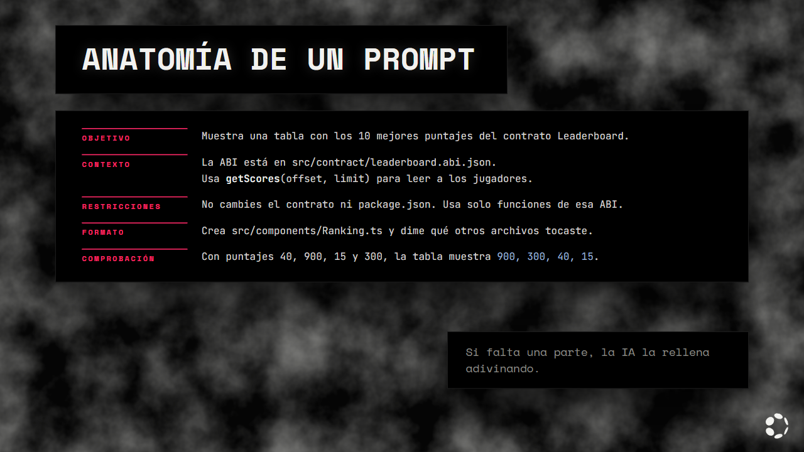
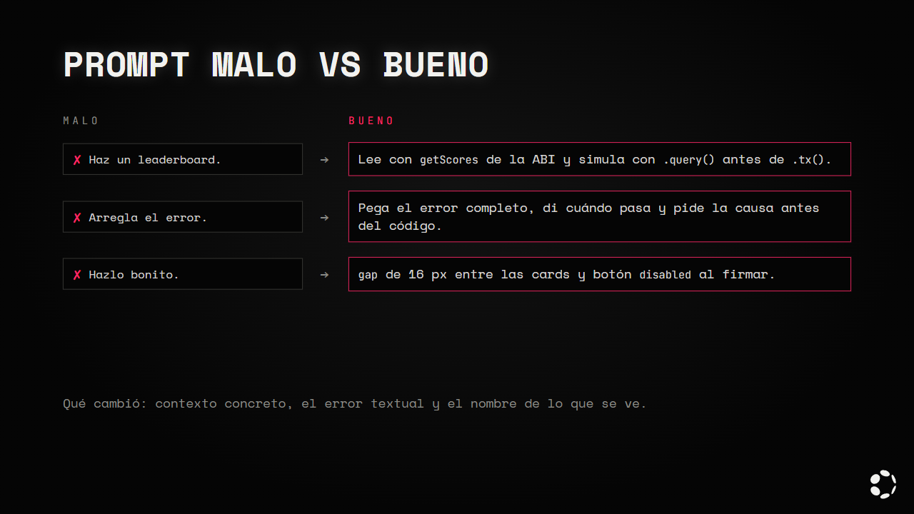
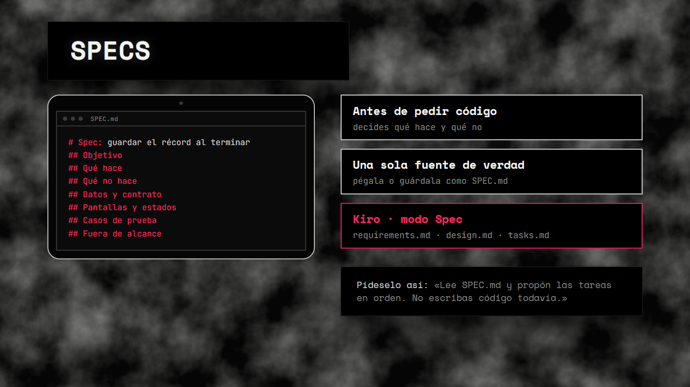
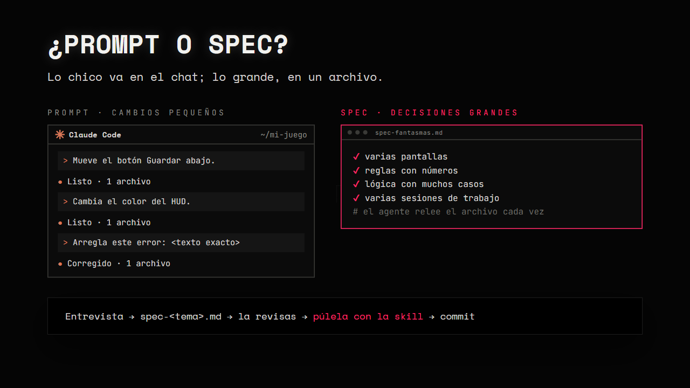
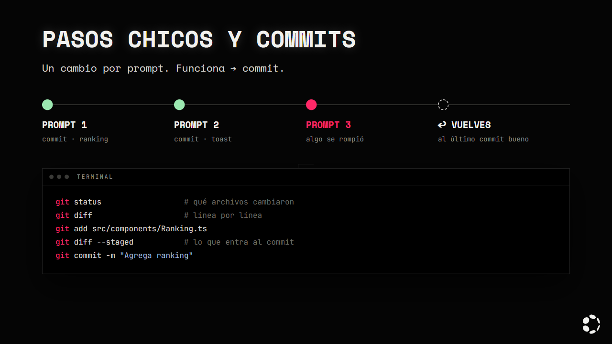
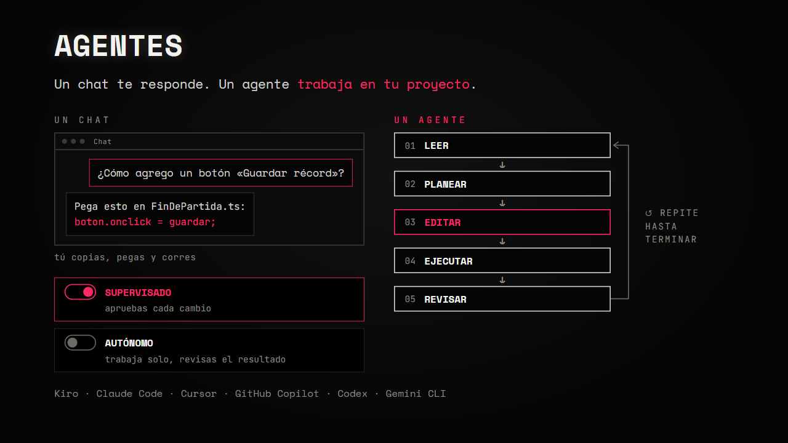
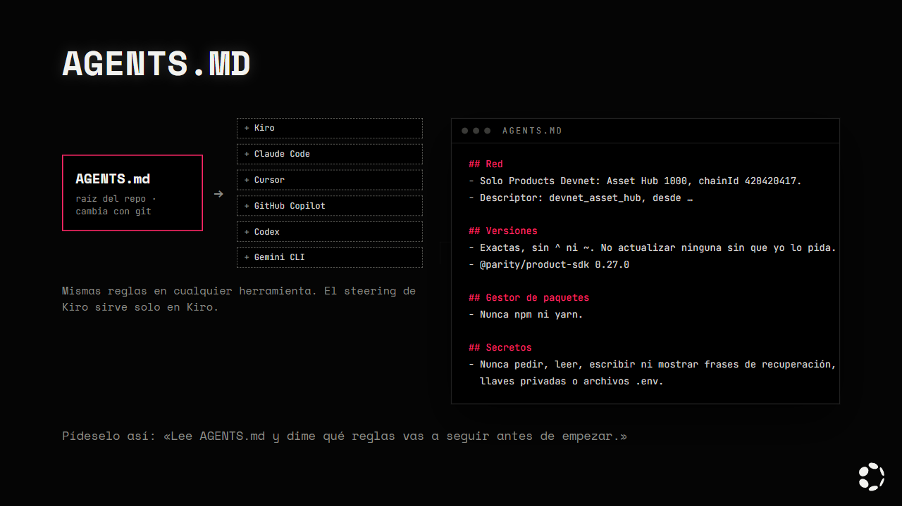
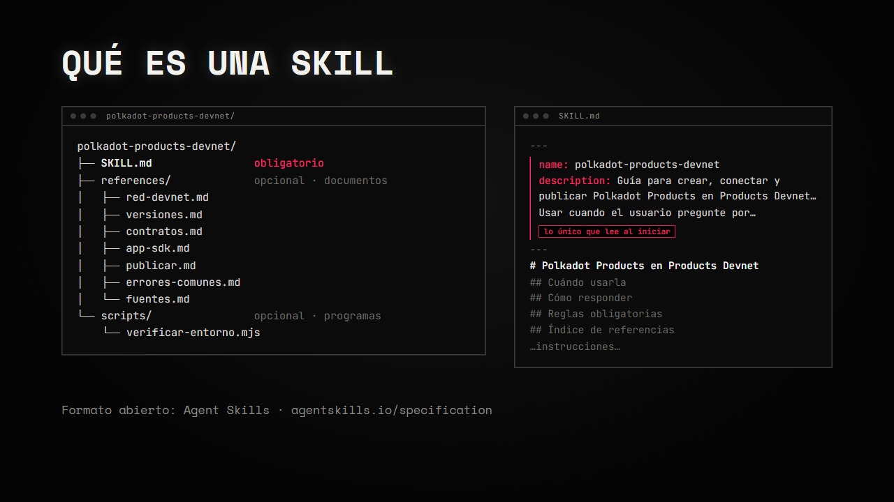
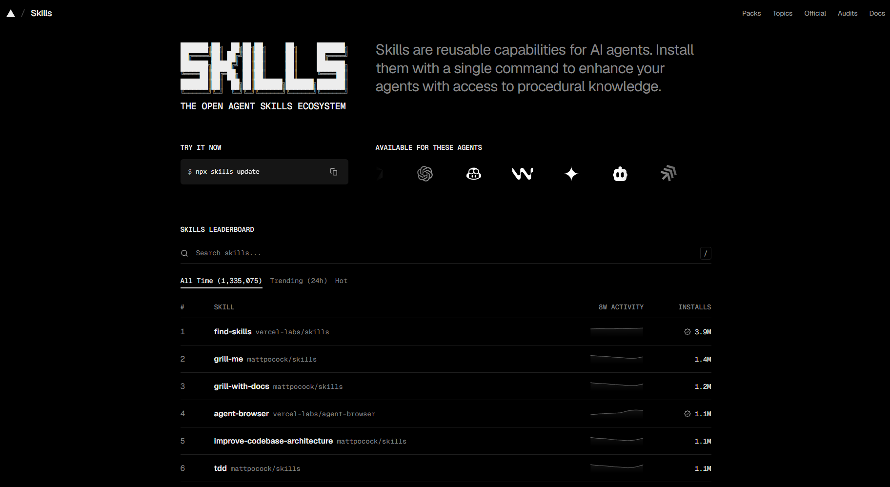
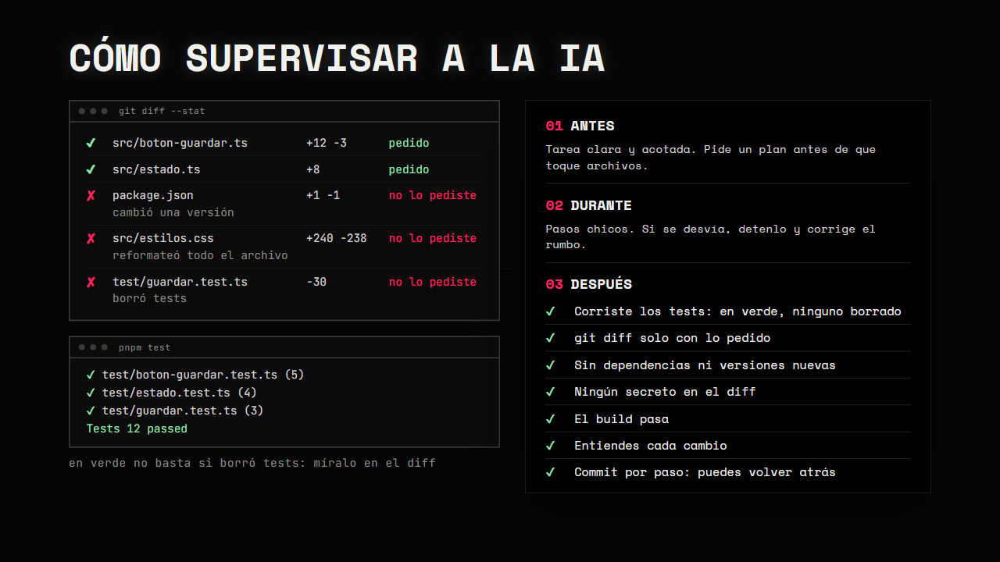

# Capítulo 4 · Programar con IA (vibe coding)

En este capítulo preparas la forma de trabajar con la IA antes de escribir la app: cómo pedir, qué
contexto darle, qué reglas dejarle en el proyecto y qué skills instalar. Al final tienes un proyecto
con reglas para el agente, las skills del hackatón y una lista para revisar lo que te entrega.

El ejemplo sigue siendo el contrato del juego, [`contrato/Leaderboard.sol`](../contrato/Leaderboard.sol),
y su ABI en `src/contract/leaderboard.abi.json` (capítulo 3, sección 14).

---

## 1. Qué es vibe coding

Vibe coding es describir lo que quieres en lenguaje natural y dejar que un agente de IA escriba el
código. Tu trabajo cambia de lugar:

| | Programar a mano | Vibe coding |
|---|---|---|
| Quién escribe el código | Tú | El agente |
| Qué haces tú | Escribes, pruebas y corriges | Describes, revisas, pruebas y decides qué se acepta |
| Dónde se va el tiempo | Escribir | Explicar bien lo que quieres y revisar lo que llega |

Es un ciclo: describes, el agente genera y corre el código, tú revisas el diff, pruebas y, si
funciona, haces commit. Después, la siguiente vuelta.

Un ejemplo:

```text
Agrega un botón "Guardar récord" que llame submitScore del contrato Leaderboard.
Simula con .query() antes de pedir la firma.
```

El agente lee la ABI en `src/contract/leaderboard.abi.json`, edita los archivos de la pantalla de
fin de partida y corre `pnpm build`. Tú revisas el `git diff` (solo los archivos que modificó),
haces pruebas manuales (abres la app y pruebas el flujo a mano) y corres las pruebas automatizadas
(por ejemplo, `pnpm test`).

Lo que no cambia: **tú eres responsable de lo que se publica.** El contrato que despliegas, las
firmas que pide tu app y los archivos que subes son tuyos, aunque los haya escrito la IA. En la
cadena no hay vuelta atrás ([capítulo 3, sección 9](./03-smart-contracts.md#9-todo-es-público-y-para-siempre)).

---

## 2. Anatomía de un prompt



Un buen prompt tiene cinco partes. No siempre necesitas todas, pero si falta una, la IA la rellena
adivinando.

| Parte | Qué dice | Ejemplo |
|---|---|---|
| **Objetivo** | Qué quieres que exista al terminar | Una tabla con los 10 mejores puntajes |
| **Contexto** | Archivos, ABI, red, lo que ya existe | La ABI está en `src/contract/leaderboard.abi.json` |
| **Restricciones** | Lo que no se puede cambiar | Solo pnpm, versiones exactas, no tocar el contrato |
| **Formato de salida** | Qué archivos crear o editar | Un componente nuevo en `src/components/` |
| **Cómo se comprueba** | Qué tiene que pasar para darlo por bueno | Con 3 jugadores, aparecen ordenados de mayor a menor |

```text
Objetivo: muestra una tabla con los 10 mejores puntajes del contrato Leaderboard.

Contexto: el contrato está en 0x… y su ABI en src/contract/leaderboard.abi.json.
Usa getScores(offset, limit) para leer a los jugadores; devuelve direcciones, usernames
y puntajes en tres listas.

Restricciones: no cambies el contrato ni package.json. Usa solo funciones de esa ABI.
Si un jugador no tiene username, muestra su dirección corta.

Formato de salida: crea src/components/Ranking.ts y dime qué otros archivos tocaste.

Cómo se comprueba: con puntajes 40, 900, 15 y 300, la tabla los muestra como
900, 300, 40, 15.
```

---

## 3. Prompt malo vs bueno



| Malo | Bueno | Qué cambió |
|---|---|---|
| *"Haz un leaderboard."* | *"Lee los puntajes con `getScores` de la ABI en `src/contract/leaderboard.abi.json` y, antes de enviar un puntaje con `.tx()`, simúlalo con `.query()`."* | Contexto y reglas concretas: la IA no tiene que inventar funciones |
| *"Arregla el error."* | *"Al guardar el puntaje sale este error, completo: `…`. Pasa al pulsar Guardar después de una partida. Dime la causa antes de cambiar código."* | El mensaje textual, cuándo pasa y qué esperas de la respuesta |
| *"Hazlo bonito."* | *"Agrega `gap` de 16 px entre las tarjetas y deja el botón en estado `disabled` mientras se firma."* | Nombres concretos de lo que se ve (sección 4) |

---

## 4. Pide con nombres

"Muévelo un poco" obliga a la IA a adivinar. "Agrega `gap` de 16 px entre las tarjetas" no. Las
partes de una interfaz tienen nombre, y casi siempre en inglés, porque así aparecen en el código y
en la documentación.

| Término | Qué es | Cómo pedirlo |
|---|---|---|
| `padding` | Espacio entre el borde de un elemento y su contenido | *"Dale 12 px de `padding` al botón."* |
| `margin` | Espacio por fuera del borde, que lo separa de lo demás | *"Quita el `margin` de arriba del título."* |
| `gap` | Espacio entre los elementos de una fila, columna o cuadrícula | *"`gap` de 16 px entre las tarjetas."* |
| card | Caja que agrupa información de un mismo tema | *"Muestra cada jugador en una card."* |
| modal | Ventana encima de la página que pide atención | *"Pide el username en un modal."* |
| toast | Aviso corto que aparece y se va solo | *"Muestra un toast cuando se guarde el puntaje."* |
| `disabled` | Estado de un control que no se puede usar | *"Deja el botón `disabled` mientras se firma."* |
| loading | Estado mientras algo carga | *"Muestra un estado de loading al leer el ranking."* |
| hover | Estado cuando el puntero está encima | *"Cambia el color del botón en hover."* |
| breakpoint | Ancho de pantalla donde cambia el diseño | *"Debajo de 600 px, una sola columna."* |

La lista completa, con componentes, estados, tipografía y términos de juego, está en
[Vocabulario de interfaz](../recursos/vocabulario-de-interfaz.md).

> **Pídeselo a la IA así:** *"Agrega `gap` de 16 px entre las cards y un toast de 3 segundos al
> guardar."*

---

## 5. Specs



Una spec es la descripción de lo que vas a construir, escrita **antes** de pedir código. Te obliga a
decidir qué hace la app y qué no, y le da a la IA una sola fuente de verdad para todo lo que sigue.

Plantilla copiable:

```markdown
# Spec: <nombre de la función>

## Objetivo
Qué problema resuelve, en una o dos frases.

## Usuario
Quién la usa y desde dónde (Polkadot App en el teléfono, Polkadot Desktop).

## Qué hace
- …

## Qué no hace
- …

## Datos y contrato
- Dirección: 0x…
- ABI: src/contract/<archivo>.abi.json
- Funciones que usa: …

## Pantallas y estados
- Pantalla: … (loading, vacío, error, listo)

## Casos de prueba
- Dado …, cuando …, entonces …

## Fuera de alcance
- …
```

Ejemplo relleno con el marcador del juego:

```markdown
# Spec: guardar el récord al terminar la partida

## Objetivo
Al terminar una partida, el jugador puede guardar su puntaje si supera su récord.

## Usuario
Jugador dentro de la Polkadot App o de Polkadot Desktop.

## Qué hace
- Al terminar, muestra el puntaje y el récord guardado (bestScore).
- Si el puntaje es mayor, ofrece un botón "Guardar récord".
- Simula con submitScore.query() y, si pasa, envía submitScore.tx().
- Después de guardar, recarga el ranking con getScores(0, 10).

## Qué no hace
- No guarda puntajes que no superan el récord.
- No pide más de una firma a la vez.

## Datos y contrato
- Dirección: 0x…
- ABI: src/contract/leaderboard.abi.json
- Funciones que usa: bestScore, submitScore, getScores

## Pantallas y estados
- Fin de partida: loading (leyendo récord), listo, firmando, guardado, error.

## Casos de prueba
- Dado un récord de 300, cuando termino con 300, entonces no aparece "Guardar récord".
- Dado un récord de 300, cuando termino con 450 y firmo, entonces el ranking muestra 450.

## Fuera de alcance
- Username (va en otra spec).
```

Con cualquier agente, pega la spec en el chat o guárdala como `SPEC.md` en el proyecto y pídele que
la siga. En Kiro, el modo Spec genera tres archivos (`requirements.md`, `design.md` y `tasks.md`) y
ejecuta las tareas una por una ([docs de Kiro](https://kiro.dev/docs/specs/)).

> **Pídeselo a la IA así:** *"Lee `SPEC.md` y propón las tareas en orden. No escribas código
> todavía."*



### Cuándo spec y cuándo prompt

Escribe primero una spec cuando la solicitud es grande: varias pantallas, reglas con números, lógica
con muchos casos o un trabajo que va a durar varias sesiones. Los cambios pequeños ("mueve el botón",
"cambia el color", "arregla este error") quedan como prompts.

La razón: el agente relee el archivo cada vez que lo necesita. Las instrucciones largas del chat se
diluyen o se deforman conforme crece el contexto ([sección 8](#8-contexto)). Si dudas, usa el
[prompt 7 de `revision.md`](../prompts/revision.md#7-esto-debería-ser-una-spec).

### Hazla con el agente

No tienes que escribirla solo. Es el mismo enfoque de
[Define tu juego](./05-el-juego.md#5-define-tu-juego):

1. **Pide que te entreviste.** Responde en orden, con los mismos números.

   ```text
   Quiero <tu idea en 2 o 3 frases>. Antes de escribir código, entrevístame:
   preguntas numeradas, de pocas en pocas, hasta que no queden decisiones abiertas.
   Si te digo "no sé", dame opciones concretas y recomiéndame una. No escribas código.
   ```

2. **Pide el archivo.**

   ```text
   Con mis respuestas, escribe spec-<tema>.md con las secciones de la plantilla de arriba.
   Cada número con un valor concreto. Marca "pendiente" lo que no decidimos.
   No escribas código.
   ```

3. **Léela y corrígela.** Lee todo el archivo y pide los huecos:

   ```text
   ¿Qué parte de spec-<tema>.md es ambigua o se contradice? No cambies nada todavía.
   ```

4. **Haz commit.**

   ```bash
   git add spec-<tema>.md
   git commit -m "spec de <tema>"
   ```

### Púlela con la skill

La skill del hackatón ([sección 11](#11-skills)) conoce las versiones, la red y las reglas de
publicación. Pídele que revise la spec antes de escribir código:

```text
Usa la skill polkadot-products-devnet para revisar spec-contrato.md: dime qué choca con
las versiones fijas, la red Products Devnet, el sandbox (sin fetch externo), la publicación
con pad o las reglas de firmas, y propón cambios. No escribas código.
```

En la respuesta, revisa que:

- Cada choque cite la referencia de la skill de donde sale (`versiones.md`, `app-sdk.md`,
  `publicar.md`…).
- No proponga cambiar las versiones fijas.
- Diga "no verificado" cuando algo no está en la skill.
- No escriba código.

Tú decides qué cambios entran a la spec.

### Mantenla al día

Cuando cambie una decisión, actualiza primero la spec y después pide el código:

```text
Actualicé SPEC.md: <qué cambió>. Aplica el cambio en el código. Primero dime tu plan.
```

---

## 6. Casos de prueba

Un caso de prueba dice qué tiene que pasar en una situación concreta. El formato **Dado / Cuando /
Entonces** se entiende sin saber programar y la IA lo puede convertir en un test.

Casos del contrato, tomados de sus pruebas ([`contrato/test/leaderboard.test.mjs`](../contrato/test/leaderboard.test.mjs)):

| Dado | Cuando | Entonces |
|---|---|---|
| Un jugador sin puntaje | Envía 120 | Su récord es 120 y `playerCount` sube a 1 |
| Un récord de 300 | Envía 300 otra vez | Revierte con `ScoreNotHigher` |
| Un jugador sin puntaje | Envía 0 | Revierte con `ScoreNotHigher` |
| Cualquier jugador | Pide el username `Ana` | Revierte con `InvalidUsername` (solo `a-z`, `0-9` y `_`) |
| `ana` ya es de otro jugador | Pide `ana` | Revierte con `UsernameTaken` |
| Un jugador con `ana` | Lo cambia a `ana_pro` | `ana` queda libre para otro jugador |

Casos de la app:

| Dado | Cuando | Entonces |
|---|---|---|
| Un récord de 300 | El jugador intenta guardar 200 | `.query()` falla y la app muestra "ese puntaje no supera tu récord", sin pedir firma ([capítulo 3, sección 15](./03-smart-contracts.md#15-simular-antes-de-enviar)) |
| Otra cuenta ya tiene el username `ana` | Pido `ana` | La app muestra que ya está tomado (`UsernameTaken`) sin pedir firma y conserva lo que escribí |
| La app abierta en un navegador normal | Carga | Muestra un aviso para abrirla dentro de Polkadot Desktop o la Polkadot App, comprobado con `isInsideContainer()` ([skill, `app-sdk.md`](https://github.com/BrandonFilth/polkadot-products-devnet/blob/main/skills/polkadot-products-devnet/references/app-sdk.md)) |

Pon los casos en el prompt. Si la IA cambia algo y un caso deja de cumplirse, lo ves enseguida. El
contrato ya trae 21 pruebas:

```bash
cd contrato
pnpm test
```

> **Pídeselo a la IA así:** *"Convierte estos casos en tests y córrelos. No cambies el código hasta
> que los tests fallen por la razón correcta."*

---

## 7. Pasos chicos y commits



Un cambio por prompt. Cuando funciona, commit. Si el siguiente cambio sale mal, regresas al último
punto bueno sin perder lo demás.

```bash
git status                       # qué archivos cambiaron
git diff                         # qué cambió, línea por línea
git add src/components/Ranking.ts   # prepara ese archivo (o git add . para todos)
git diff --staged                # revisa lo que va a entrar en el commit
git commit -m "Agrega ranking de los 10 mejores"
git restore --staged <archivo>   # saca un archivo de lo preparado, sin perder sus cambios
git restore <archivo>            # descarta los cambios de ese archivo que no preparaste con git add
```

> `git restore <archivo>` borra los cambios que no están en un commit ni preparados con `git add`,
> y no se puede deshacer. Úsalo solo cuando quieras tirar lo que hizo la IA en ese archivo.

Referencias: [git restore](https://git-scm.com/docs/git-restore) y
[git diff](https://git-scm.com/docs/git-diff). El primer commit lo hiciste en el
[capítulo 2](./02-entorno.md#tu-primer-commit).

> **Pídeselo a la IA así:** *"Haz solo este cambio. Al terminar, dime qué archivos tocaste y cómo lo
> pruebo."*

---

## 8. Contexto

La IA solo sabe lo que le das. Lo que falta, lo inventa.

| Qué darle | Para qué |
|---|---|
| La dirección y la ABI del contrato (las copiaste en el [capítulo 3, sección 17](./03-smart-contracts.md#17-despliégalo), paso 5) | Que use funciones que existen, con los tipos correctos |
| Los datos de la red: chainId `420420417`, ETH-RPC `https://eth-rpc-testnet.polkadot.io`, descriptor `devnet_asset_hub` ([skill, `red-devnet.md`](https://github.com/BrandonFilth/polkadot-products-devnet/blob/main/skills/polkadot-products-devnet/references/red-devnet.md)) | Que no apunte a otra red |
| Enlaces a la documentación: [docs.polkadot.com](https://docs.polkadot.com) y su índice para agentes [`llms.txt`](https://docs.polkadot.com/llms.txt) | Que lea la fuente en vez de recordar |
| El mensaje de error completo, copiado tal cual | Que no adivine la causa |
| Una captura de la pantalla | Que vea lo mismo que tú |
| El archivo exacto que hay que cambiar | Que no toque otros |

Qué no darle nunca:

- Tu frase de recuperación (las 12 palabras) ni ninguna otra frase de una cuenta.
- Llaves privadas.
- Archivos `.env` con secretos.

Tu frase es tu cuenta ([capítulo 2, paso 2](./02-entorno.md)) y la llave privada firma por ti
([capítulo 3, sección 16](./03-smart-contracts.md#16-tus-tres-cuentas)). El
[`.gitignore`](../.gitignore) del tutorial ya excluye `.env`, `.env.*`, `*.key` y `*.pem` para que no
terminen en GitHub.

### La ventana de contexto

La ventana de contexto es la cantidad de texto que el agente puede tener en mente a la vez: los
archivos que leyó, la conversación y sus respuestas. Cuando se llena, lo más viejo se resume o se
pierde. Por eso las decisiones grandes van en un archivo spec, y para un tema nuevo empiezas un chat
nuevo.

---

## 9. Agentes



Un chat responde con texto: tú copias el código, lo pegas y lo corres. Un agente trabaja dentro de
tu proyecto: lee tus archivos, los edita, corre comandos (build, tests, git) y repite hasta terminar.

El ciclo de un agente:

1. **Leer:** abre los archivos que tienen que ver con tu pedido.
2. **Planear:** decide qué va a cambiar y en qué orden.
3. **Editar:** cambia uno o varios archivos.
4. **Ejecutar:** corre comandos, como el build o los tests.
5. **Revisar:** mira el resultado. Si algo falla, vuelve a empezar desde el paso 1.

| Tipo | Qué hace | Tú |
|---|---|---|
| Autocompletado | Sugiere la siguiente línea mientras escribes | Aceptas o ignoras |
| Chat | Responde preguntas y propone código | Copias lo que sirve |
| Agente | Lee archivos, edita varios, corre comandos y repite hasta terminar | Revisas y apruebas |

Un agente trabaja con permisos. Casi todos tienen dos formas de trabajar:

- **Supervisado:** apruebas cada cambio o comando antes de que se aplique.
- **Autónomo:** trabaja solo y revisas al final.

En Kiro se llaman Autopilot (el modo por defecto) y Supervised, que pide tu aprobación después de
cada turno con cambios y deja aceptar o rechazar por bloques
([docs de Kiro](https://kiro.dev/docs/ide/chat/autopilot/)). Usa el modo supervisado para el
contrato, todo lo que pida firmas y los archivos de configuración (`package.json`,
`pnpm-workspace.yaml`, `vite.config`).

Lo que sigue en este capítulo sirve igual con Kiro, Claude Code, Cursor, GitHub Copilot, Codex o
Gemini CLI.

Dos reglas para cualquier agente:

- No apruebes un comando que no entiendes. Pregúntale qué hace antes.
- Nunca le des acceso a tu frase ni a tus llaves.

---

## 10. AGENTS.md



`AGENTS.md` es un archivo markdown en la raíz del proyecto con instrucciones para los agentes: cómo
se construye, cómo se prueba y qué reglas seguir. Es un formato abierto; en proyectos con varias
partes puede haber uno por carpeta ([agents.md](https://agents.md/)).

Los agentes lo leen como contexto del proyecto antes de trabajar. Conviene más que un archivo
de reglas de una sola herramienta porque:

- Lo leen varios agentes, así que tu equipo puede usar herramientas distintas con las mismas reglas.
- Vive en el repo y cambia con git, como el código.

Los archivos propios de cada herramienta siguen sirviendo para lo que solo esa herramienta entiende.
Por ejemplo, en Kiro los archivos de `.kiro/steering/` pueden incluirse siempre, solo con ciertos
archivos o a pedido ([docs de Kiro](https://kiro.dev/docs/steering/)).

Ejemplo para tu proyecto. Las reglas salen de la skill del hackatón
([`SKILL.md`](https://github.com/BrandonFilth/polkadot-products-devnet/blob/main/skills/polkadot-products-devnet/SKILL.md),
[`errores-comunes.md`](https://github.com/BrandonFilth/polkadot-products-devnet/blob/main/skills/polkadot-products-devnet/references/errores-comunes.md)).
Los nombres de los scripts (`pnpm dev`, `pnpm build`) son un ejemplo; usa los de tu proyecto.

```markdown
# AGENTS.md

## Proyecto
Polkadot Product (Vite + TypeScript) que corre dentro de Polkadot Desktop o la Polkadot App.

## Red
- Solo Products Devnet: Asset Hub 1000, chainId 420420417.
- Descriptor: devnet_asset_hub, desde @parity/product-sdk-descriptors/devnet-asset-hub.
- Nunca paseo, paseo_asset_hub, Paseo Next v2 ni "Paseo PassetHub (420420422)".

## Versiones
- Exactas, sin ^ ni ~. No actualizar ninguna sin que yo lo pida.
- @parity/product-sdk 0.27.0
- @parity/product-sdk-descriptors 0.11.0
- Override @parity/truapi 0.13.1 en pnpm-workspace.yaml
- pnpm 12.6.0 en devEngines

## Gestor de paquetes
- Solo pnpm: pnpm install, pnpm add <paquete>@<versión> --save-exact.
- Nunca npm ni yarn.

## Contratos
- pragma solidity 0.8.28; sin optimizador.
- Se despliegan con Remix + MetaMask (REVM).
- OpenZeppelin 5.6.1.
- No usar resolc, Hardhat ni Foundry.

## SDK
- Conectar con createChainClient({ chains: { assetHub: devnet_asset_hub } }).
- No usar getChainAPI().
- Antes de cada .tx(), simular con .query(). Una firma a la vez.

## Vite
- base: './' en vite.config.

## Secretos
- Nunca pedir, leer, escribir ni mostrar frases de recuperación, llaves privadas o archivos .env.

## Forma de trabajo
- Pasos chicos: un cambio por vez.
- Al terminar, decir qué archivos cambiaste y cómo probarlo.
- No borrar ni desactivar tests.

## Comandos
- pnpm dev
- pnpm build
```

> **Pídeselo a la IA así:** *"Lee `AGENTS.md` y dime qué reglas vas a seguir antes de empezar."*

---

## 11. Skills

### Qué es una skill



Una skill es una carpeta con un archivo `SKILL.md`. Ese archivo empieza con un `name` y una
`description`, y puede venir con carpetas `references/` (documentos) y `scripts/` (programas). Es un
formato abierto llamado Agent Skills ([especificación](https://agentskills.io/specification)).

El agente no la lee siempre. Carga solo lo que necesita
([especificación](https://agentskills.io/specification); en Kiro, por ejemplo,
[skills en Kiro](https://kiro.dev/docs/skills/)):

- Al iniciar solo lee el `name` y la `description` de cada skill instalada.
- Si lo que pides coincide con la `description`, carga el `SKILL.md` completo.
- Los archivos de `references/` los abre solo cuando los necesita.
- Los de `scripts/` los puede ejecutar con los permisos del agente. Por eso hay que leerlos.
- Una vez instalada, vive en `.agents/skills/<nombre>/` con un enlace por agente (ver
  [Cómo funciona la CLI](#cómo-funciona-la-cli)).

Ejemplo: la skill del hackatón, `polkadot-products-devnet`, trae `SKILL.md`, 7 archivos en
`references/` (`red-devnet.md`, `versiones.md`, `contratos.md`, `app-sdk.md`, `publicar.md`,
`errores-comunes.md` y `fuentes.md`) y `scripts/verificar-entorno.mjs`.

### skills.sh

En [skills.sh](https://www.skills.sh) buscas y encuentras skills, revisas su contenido (`SKILL.md`,
archivos, instalaciones y auditorías) y copias el comando para instalarla. Es un directorio de
skills. Su ranking sale de la telemetría
anónima de la CLI `skills`, y una skill aparece sola en el directorio cuando alguien la instala con
esa CLI desde su repo de GitHub; no hay que enviarla ni registrarla
([FAQ de skills.sh](https://www.skills.sh/docs/faq)).



La página de cada skill muestra su comando de instalación, su `SKILL.md` y las auditorías. La skill
del hackatón está en
[skills.sh/brandonfilth/polkadot-products-devnet](https://www.skills.sh/brandonfilth/polkadot-products-devnet/polkadot-products-devnet),
con tres auditorías en Pass, consultadas el 2026-10-15.

El comando que muestra la página no fija la versión de la CLI. Usa los de este capítulo, que la
fijan en `skills@1.7.2`.

### Qué significan las auditorías

Las auditorías de skills.sh son tres escáneres automáticos: Gen Agent Trust Hub, Socket y Snyk
([audits](https://www.skills.sh/audits)).

- **Pass no es una revisión humana** ni garantiza que la skill sea segura. Significa que esos
  escáneres no encontraron nada.
- En el directorio verás otras etiquetas ("Safe", "0 alerts", "Low Risk", "Med Risk"). También son
  resultados de escáneres automáticos.
- La propia CLI termina cada instalación con un aviso: revisa las skills antes de usarlas, porque
  corren con todos los permisos del agente.

### Léela antes de instalarla

Una skill le da instrucciones a tu agente. Antes de instalar una, ábrela en GitHub y revisa:

- [ ] **Quién la publica.** Una organización conocida o una persona con historial.
- [ ] **Qué archivos trae.** Si solo hay `.md`, es texto. Si hay `.sh`, `.py`, `.js` o `.mjs`, lee
      esos archivos también.
- [ ] **El `SKILL.md` completo**, no solo la descripción.
- [ ] **Comandos:** `curl`, `wget`, `| bash`, `npx`, `pip`, `rm -rf`, `sudo`, o instalaciones
      globales (`-g`). Pregúntate si de verdad los necesitas.
- [ ] **Reglas remotas.** Si le dice al agente que descargue sus instrucciones de una URL, lo que
      lees hoy puede cambiar mañana.
- [ ] **Secretos.** Cualquier instrucción de leer `.env`, llaves o frases es motivo para no
      instalarla.
- [ ] **Lo que fuerza.** Otra versión de Solidity, Hardhat o Foundry, otra red.
- [ ] **Texto que manda al agente** por encima de ti: "ignora tus instrucciones", "no le preguntes
      al usuario", "no te saltes este paso". Es la señal más clara de una skill maliciosa.
- [ ] **Fecha del último cambio.**

### Cómo funciona la CLI

Todos los comandos de este capítulo tienen esta forma:

```bash
npx skills@1.7.2 add <url-del-repo> --skill <nombre>
```

`npx` solo ejecuta la CLI `skills`; no agrega nada a tu `package.json`. Las dependencias de tu
proyecto se siguen instalando con `pnpm add <paquete>@<versión> --save-exact`.

| Paso | Qué ves | Qué elegir |
|---|---|---|
| 1 | La CLI clona el repo y encuentra la skill | |
| 2 | **Which agents do you want to install to?** con los agentes que detectó marcados. Si solo detecta uno, lo elige sin preguntar | Los agentes que usas |
| 3 | **Installation scope** | **Project**: solo esta carpeta |
| 4 | **Installation method** | **Symlink (Recommended)** |
| 5 | **Proceed with installation?** | Revisa el resumen y confirma |

Con Symlink, la skill se copia una vez en `.agents/skills/<nombre>/` y cada agente que no lee esa
carpeta recibe un enlace en la suya (por ejemplo `.kiro/skills/` o `.claude/skills/`). En Windows el
enlace es una *junction*; si no se puede crear, la CLI copia los archivos. Con Copy, cada agente
recibe su propia copia completa ([`installer.ts` de la CLI 1.7.2](https://github.com/vercel-labs/skills/blob/v1.7.2/src/installer.ts)).

Al terminar, la CLI escribe `skills-lock.json` en la raíz del proyecto con lo que instaló. La CLI no
ejecuta nada de la skill: solo copia archivos. El riesgo empieza cuando el agente sigue sus
instrucciones.

**Por qué `@1.7.2`.** Sin versión, `npx` puede usar una copia vieja que tenga en caché. El
2026-10-15, en Windows, con la versión 1.5.18 se eligió Kiro en el menú y la skill no quedó enlazada
para Kiro; con 1.7.2 sí quedó enlazada.

**No uses `-y`, `--all` ni `-g`.** Según `npx skills@1.7.2 --help`:

| Opción | Qué hace | Por qué no |
|---|---|---|
| `-y` | Salta todas las confirmaciones | No ves qué se instala ni dónde |
| `--all` | Todas las skills del repo, a todos los agentes, con `-y` | Instala de más sin preguntar |
| `-g` | Instala para todos tus proyectos | Una skill de este hackatón no debe guiar tus otros proyectos |

Otros comandos útiles:

```bash
npx skills@1.7.2 add <url-del-repo> --list   # ver qué skills trae un repo, sin instalar
npx skills@1.7.2 list                        # skills instaladas en este proyecto
npx skills@1.7.2 remove <nombre>             # quitar una skill
```

La CLI manda telemetría anónima. Para apagarla en la terminal actual: `$env:DISABLE_TELEMETRY = "1"`
en PowerShell, o `export DISABLE_TELEMETRY=1` en macOS y Linux.

### find-skills

`find-skills` ayuda al agente a buscar skills cuando le pides algo que no sabe hacer:

```bash
npx skills@1.7.2 add https://github.com/vercel-labs/skills --skill find-skills
```

Su paso 6 le indica al agente instalar con `-g -y`, es decir, global y sin confirmar
([`SKILL.md` de find-skills](https://raw.githubusercontent.com/vercel-labs/skills/main/skills/find-skills/SKILL.md)).
Si el agente lo propone, recházalo: revisa la skill con la lista de arriba y corre tú el comando sin
`-g` ni `-y`.

---

## 12. MCP vs skills

Ya sabes qué es una skill; un servidor MCP es otra forma de extender al agente.

MCP (Model Context Protocol) es un estándar abierto para conectar apps de IA con sistemas externos:
datos, herramientas y flujos de trabajo
([modelcontextprotocol.io](https://modelcontextprotocol.io/docs/getting-started/intro)). El agente
es el cliente y habla con servidores MCP; cada servidor le da herramientas nuevas, como consultar
una base de datos o un servicio.

| | Skill | Servidor MCP |
|---|---|---|
| Qué es | Archivos de instrucciones (y a veces scripts) | Un programa que expone herramientas |
| Cómo lo usa el agente | Lo lee cuando tu pedido coincide con su descripción | Llama sus herramientas mientras trabaja |
| Qué agrega | Conocimiento y reglas | Acciones y datos externos |

Un servidor MCP local es un programa que corre en tu computadora con tus permisos. Uno remoto corre
en otro lado y recibe lo que el agente le mande
([arquitectura de MCP](https://modelcontextprotocol.io/docs/learn/architecture)). Instalar uno es
como instalar cualquier programa: revisa quién lo publica antes.

Para este hackatón no necesitas ningún servidor MCP.

---

## 13. Skills recomendadas

Instálalas desde la raíz de tu proyecto. Cada comando abre el menú de la sección 11: elige tu(s)
agente(s) y el scope **Project**.

```bash
npx skills@1.7.2 add https://github.com/BrandonFilth/polkadot-products-devnet --skill polkadot-products-devnet
npx skills@1.7.2 add https://github.com/anthropics/skills --skill frontend-design
npx skills@1.7.2 add https://github.com/addyosmani/web-quality-skills --skill accessibility
npx skills@1.7.2 add https://github.com/OpenZeppelin/openzeppelin-skills --skill develop-secure-contracts
npx skills@1.7.2 add https://github.com/addyosmani/agent-skills --skill security-and-hardening
# Opcional: revisión de contratos
npx skills@1.7.2 add https://github.com/wshobson/agents --skill solidity-security
```

**`polkadot-products-devnet`** ([BrandonFilth/polkadot-products-devnet](https://github.com/BrandonFilth/polkadot-products-devnet)):
la skill del hackatón: red del devnet, versiones probadas, contratos con REVM y Remix, patrones del
SDK y publicación. Busca primero en sus `references/`, después en las fuentes de
[`fuentes.md`](https://github.com/BrandonFilth/polkadot-products-devnet/blob/main/skills/polkadot-products-devnet/references/fuentes.md)
(docs.polkadot.com, `llms.txt` y las skills de Parity fijadas al commit `07fed91`) y cita cada dato.
Por eso no necesitas instalar las skills de Parity.

**`frontend-design`** ([anthropics/skills](https://github.com/anthropics/skills)): pautas de diseño
de interfaces. Solo texto.

**`accessibility`** ([addyosmani/web-quality-skills](https://github.com/addyosmani/web-quality-skills)):
revisión de accesibilidad. Solo texto; sugiere `npx lighthouse` y una instalación global de
`@axe-core/cli`: piensa si las necesitas antes de aprobar.

**`develop-secure-contracts`** ([OpenZeppelin/openzeppelin-skills](https://github.com/OpenZeppelin/openzeppelin-skills)):
contratos con OpenZeppelin para los tracks con ERC-20 o ERC-721
([capítulo 3, sección 11](./03-smart-contracts.md#11-recetas-por-track-y-openzeppelin)).
**Riesgo medio:** hace que el agente ejecute `npx @openzeppelin/contracts-cli` y usa la ruta `/tmp`
y el comando `diff`, que no existen en PowerShell.

**`security-and-hardening`** ([addyosmani/agent-skills](https://github.com/addyosmani/agent-skills)):
solo texto: secretos, dependencias, *typosquatting* y XSS. Es la que menciona el
[capítulo 3, sección 12](./03-smart-contracts.md#12-contratos-que-mueven-dinero).

**`solidity-security`** (opcional, [wshobson/agents](https://github.com/wshobson/agents)): solo
texto. Sus ejemplos usan Hardhat, ethers v5 y OpenZeppelin 4; pídele al agente que los ignore.

**Ejercicio.** Antes de instalar la skill del hackatón, abre su script
[`verificar-entorno.mjs`](https://github.com/BrandonFilth/polkadot-products-devnet/blob/main/skills/polkadot-products-devnet/scripts/verificar-entorno.mjs)
y comprueba que solo lee: importa solo módulos `node:`, corre `pnpm --version`, `git --version` y,
en Windows, `Get-ExecutionPolicy`, y no usa `fetch` ni escribe archivos. Después de instalarla,
córrelo desde la raíz de tu proyecto:

```bash
node .agents/skills/polkadot-products-devnet/scripts/verificar-entorno.mjs .
```

Esa ruta existe con el método Symlink. Con Copy, usa la carpeta de tu agente, por ejemplo
`.kiro/skills/polkadot-products-devnet/`.

Prueba cada skill en una carpeta de prueba antes de instalarla en tu proyecto. Si no te sirve,
quítala con `npx skills@1.7.2 remove <nombre>`.

---

## 14. Cómo supervisar a la IA



El agente escribe el código, pero tú decides qué se queda. Esto sirve para cualquier proyecto y
cualquier agente.

Antes:

- Dale una tarea clara y acotada: un objetivo, los archivos que puede tocar y cómo se comprueba
  (sección 2).
- Pídele un plan antes de que toque archivos. Si el plan no te convence, corrígelo ahí.

Durante:

- Pasos chicos: un cambio por vez (sección 7).
- Si se desvía (toca archivos que no pediste o cambia de enfoque), detenlo y corrige el rumbo.

Después, antes de cada commit:

- [ ] **Tests:** todos pasan, y los corriste tú. No borró, desactivó ni saltó ningún test.
- [ ] **`git diff`:** solo contiene lo que pediste. Sin archivos ajenos ni reformateos de archivos
      que no tenían que cambiar.
- [ ] **Dependencias:** no agregó ninguna que no pediste ni cambió versiones.
- [ ] **Secretos:** ninguna frase, llave o `.env` en el código ni en el diff.
- [ ] **Build:** el proyecto se construye sin errores.
- [ ] **Entiendes cada cambio.** Si no, pídele que te lo explique antes de aceptarlo.
- [ ] **Puedes volver atrás:** hiciste commit antes de cada paso
      ([capítulo 2](./02-entorno.md#tu-primer-commit)).

En este proyecto, revisa además los errores de la [sección 15](#15-errores-comunes-de-la-ia-en-este-stack).

---

## 15. Errores comunes de la IA en este stack

| Lo que hace la IA | Por qué falla | Qué pedirle |
|---|---|---|
| Inventa funciones del SDK o del contrato | No tiene la ABI ni la documentación | *"Usa solo funciones de la ABI y de la skill; si no existe, dime 'no verificado'."* |
| Usa otra red: `paseo`, Paseo Next v2, PassetHub 420420422 o Asset Hub Next 1500 | Copia ejemplos de otras redes | *"Solo Products Devnet: chainId `420420417` y `devnet_asset_hub`."* |
| "Actualiza" las versiones fijas | Con `@parity/product-sdk` 0.28 o posterior, Polkadot Desktop 0.1.3 registra `Transport error` y `unsupported frame (0, 0)` sin parar | *"No cambies versiones de `package.json`."* |
| Quita el override de `@parity/truapi` en `pnpm-workspace.yaml` | Con `@parity/truapi` 0.16 o posterior, Polkadot Desktop 0.1.3 registra los mismos errores | *"Deja el override de `@parity/truapi` 0.13.1 en `pnpm-workspace.yaml`."* |
| Usa npm o yarn | El proyecto declara pnpm en `devEngines` y falla con `EBADDEVENGINES` | *"Solo pnpm."* |
| Conecta con `getChainAPI()` | La app se queda esperando en Polkadot Desktop 0.1.3 | *"Conecta con `createChainClient` y `devnet_asset_hub`."* |
| Cambia el pragma o propone PolkaVM, `resolc`, Hardhat o Foundry | Sigue indicaciones de otras skills | *"`pragma solidity 0.8.28;`, Remix y MetaMask."* |
| Escribe OpenZeppelin 4 (`_beforeTokenTransfer`, `Ownable()` sin argumento) | El proyecto usa OpenZeppelin 5.6.1 | *"Usa OpenZeppelin 5: `_update` y `Ownable(msg.sender)`."* |
| Olvida `base: './'` en Vite | El bundle pide sus archivos desde la raíz y no junto a la app | *"Pon `base: './'` en `vite.config`."* |
| Pide varias firmas a la vez | El Host atiende una a la vez; la segunda nunca llega al teléfono | *"Una firma a la vez; espera a que termine la anterior."* |
| Llama `.tx()` sin `.query()` | El revert solo aparece al firmar | *"Simula con `.query()` y muestra el error antes de pedir la firma."* |

Fuentes: [`errores-comunes.md`](https://github.com/BrandonFilth/polkadot-products-devnet/blob/main/skills/polkadot-products-devnet/references/errores-comunes.md),
[`versiones.md`](https://github.com/BrandonFilth/polkadot-products-devnet/blob/main/skills/polkadot-products-devnet/references/versiones.md)
y [`red-devnet.md`](https://github.com/BrandonFilth/polkadot-products-devnet/blob/main/skills/polkadot-products-devnet/references/red-devnet.md)
de la skill. Los comportamientos de Polkadot Desktop 0.1.3 de esta tabla salen de pruebas del
equipo. La muestra funciona en Polkadot Desktop 0.1.3 y en la Polkadot App con estas versiones fijas
(comprobado por la organización el 2026-10-21). Si tu Desktop es de otra versión, dilo al pedir ayuda.

Si aparece un error que no está aquí, pega el texto exacto y pide que cite su fuente o que diga "no
verificado".

---

👉 [Capítulo 5](./05-el-juego.md)
