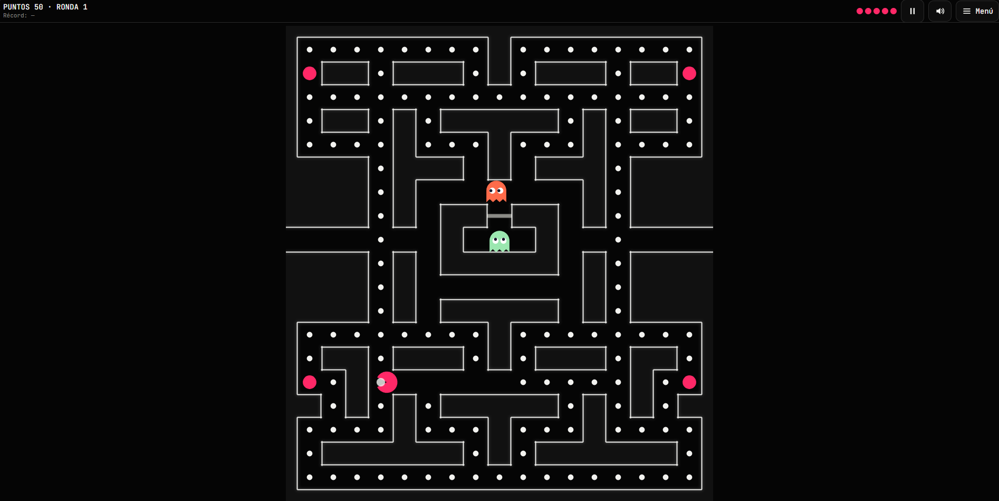
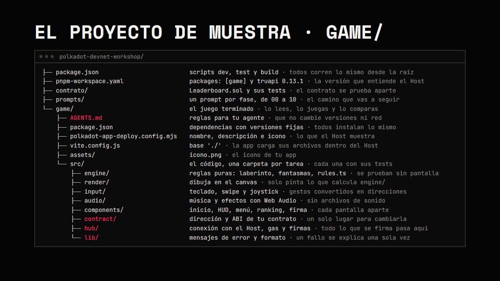
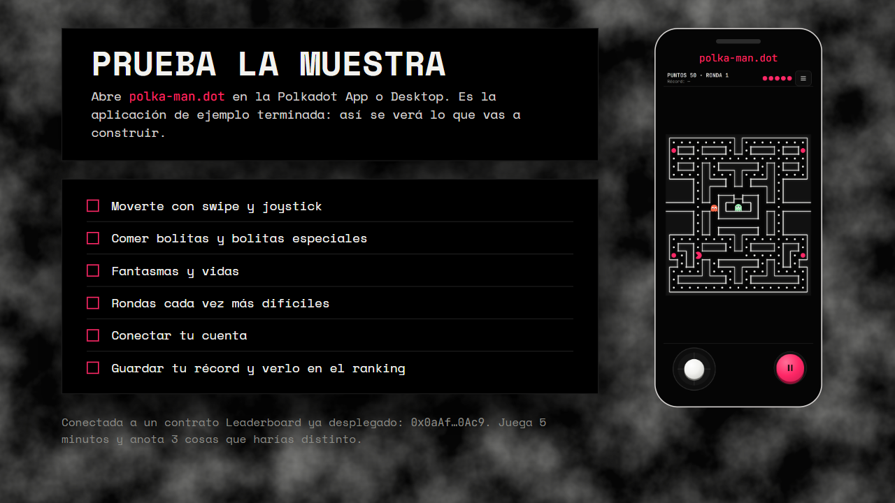
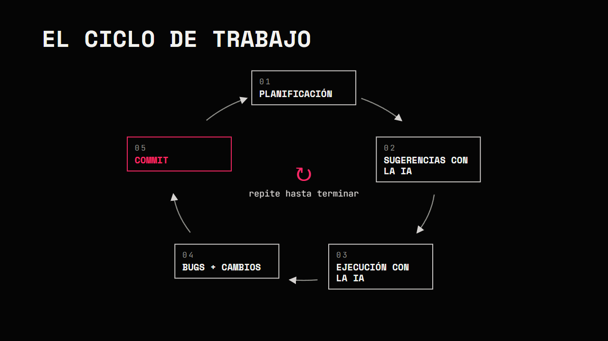
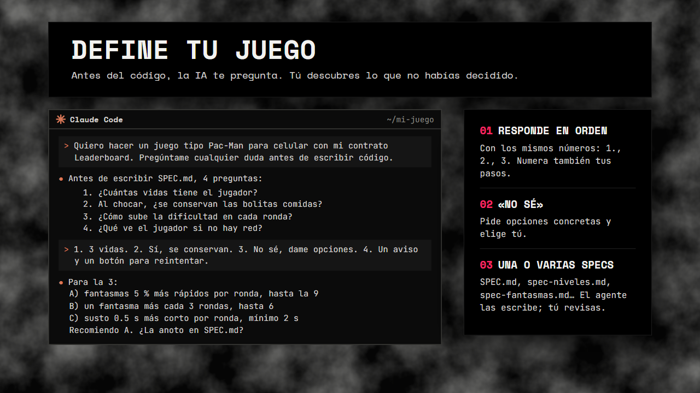
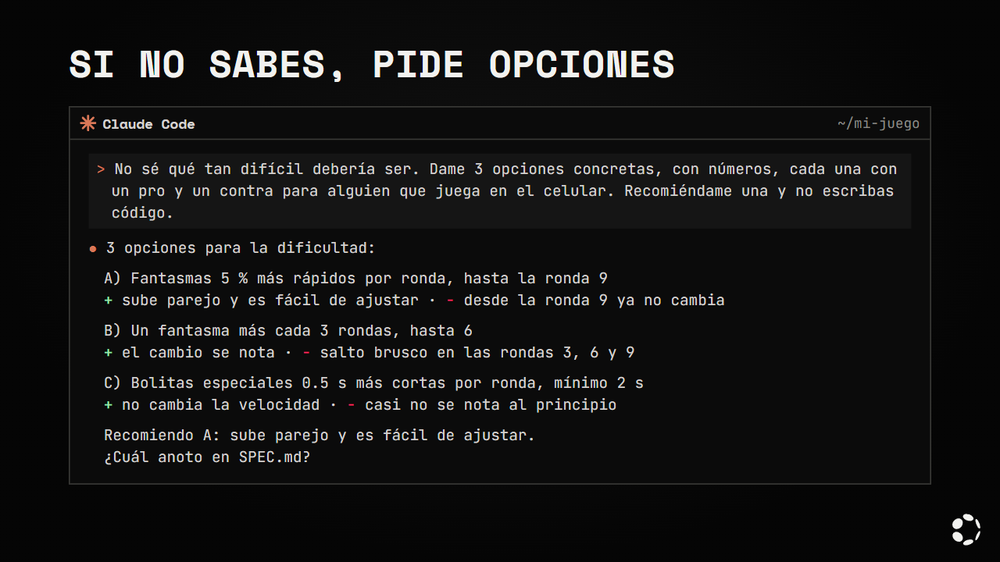
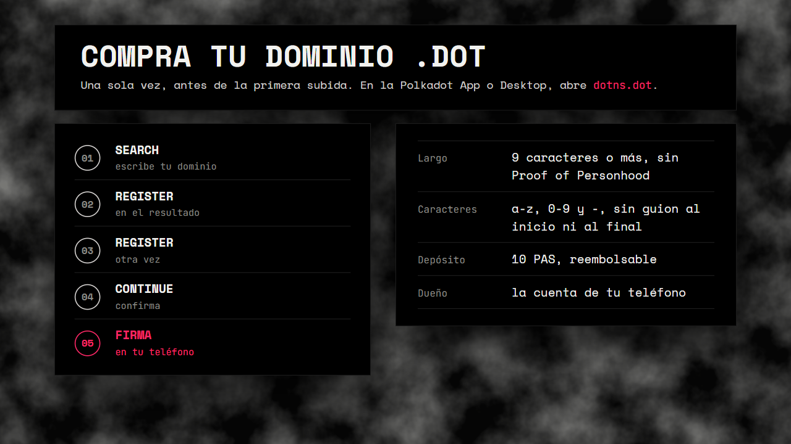
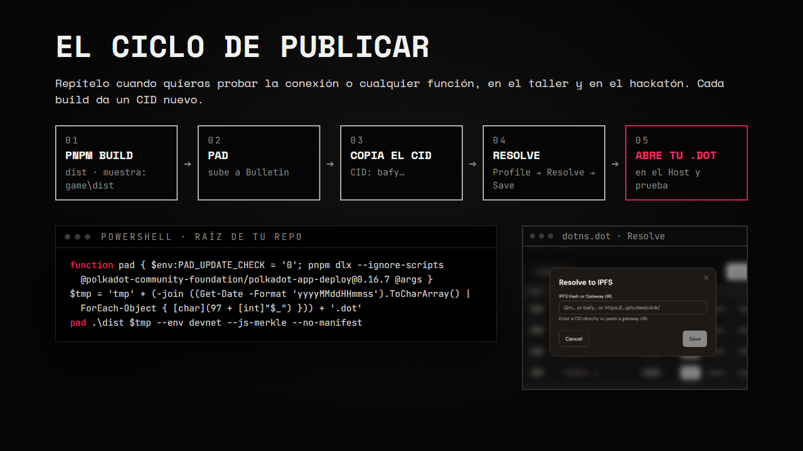
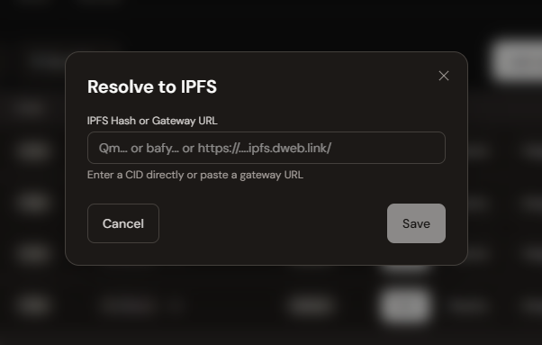
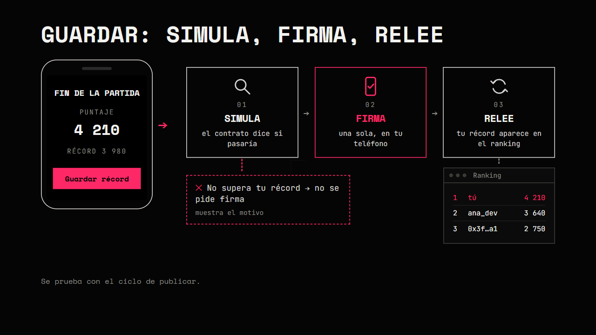

# Capítulo 5 · Tu primera app en Polkadot

En este capítulo construyes tu primera app en Polkadot: un juego de laberinto para celular que corre dentro de Polkadot Desktop
o de la Polkadot App y guarda el mejor puntaje en un contrato. Es **tu** versión, en **tu** repo,
con **tu** contrato `Leaderboard`. Este capítulo es la práctica del [capítulo 4](./04-vibe-coding.md):
vas a pedirle cada parte a tu agente con prompts cortos, una fase a la vez.

---

## 1. Qué vas a construir



Una app y un smart contract dentro de Polkadot, construidos con IA, en tu propio dominio `.dot`.
La app es un juego tipo Pac-Man para el celular, a tu manera.

- **Tu app:** un juego tipo Pac-Man que corre dentro de la Polkadot App.
- **Tu smart contract:** guarda el mejor puntaje; lo despliegas tú.
- **Con IA:** lo construyes en tu repo, fase por fase.
- **Tu dominio `.dot`:** lo publicas en tu propio dominio.

Las reglas las decides tú en la [fase 0](#5-define-tu-juego); la muestra tiene las suyas
([Las decisiones de la muestra](#las-decisiones-de-la-muestra)).

Qué es una app en el Host y por qué corre en un `.dot`: [capítulo 1](./01-como-funciona-polkadot.md).

---

## 2. El proyecto de muestra



Es solo una muestra de un proyecto terminado. Úsalo como ejemplo para construir el tuyo: sigue su
estructura, sus versiones compatibles y sus reglas para el agente (`game/AGENTS.md`). No lo copias;
construyes el tuyo en tu repo. El juego terminado, Polka-Man, vive en la carpeta `game/` del curso:
lo lees, lo juegas y lo comparas con el tuyo.

```text
polkadot-devnet-workshop/
├── package.json            scripts dev, build, test y test:red (llaman a game/)
├── pnpm-workspace.yaml     packages: [game] y el override de @parity/truapi 0.13.1
├── contrato/               Leaderboard.sol y sus pruebas (capítulo 3)
├── prompts/                prompts de ejemplo, de 00-define-tu-juego.md a revision.md
└── game/
    ├── AGENTS.md           reglas para el agente
    ├── index.html, vite.config.js
    └── src/
        ├── engine/         lógica del juego sin pantalla: laberinto, reglas, fantasmas
        ├── render/         dibuja en el canvas
        ├── input/          teclado, swipe y joystick
        ├── audio/          música y efectos con Web Audio, sin archivos
        ├── components/     inicio, HUD, menú, ranking, fin de partida, username y estados de firma
        ├── contract/       dirección, ABI y lecturas del contrato
        ├── hub/            conexión con el Host: cuenta, gas y firmas
        └── lib/            mensajes de error y formato
```

Por qué está así:

- **La lógica no toca la pantalla.** `engine/` solo calcula; así se prueba con tests sin abrir el
  navegador.
- **Todos los números en un archivo.** Vidas, velocidades y puntaje viven en `engine/rules.ts`.
  Cambiar la dificultad es cambiar una línea.
- **El laberinto es texto.** Un arreglo de filas con `#` para paredes, `.` para bolitas y `o` para
  bolitas especiales. Se lee a ojo, la IA lo edita sin errores y el diff se entiende. Un test revisa
  que no haya callejones sin salida, porque los fantasmas no dan media vuelta.
- **La dificultad sube por ronda con tope.** Los fantasmas van 5 % más rápido cada ronda, pero
  nunca tan rápido como el jugador: con control táctil sería imposible escapar en una recta.
- **El contrato va aparte y con tests.** `contract/`, `hub/` y `lib/` tienen sus propias pruebas con
  datos falsos, sin red.

`game/AGENTS.md` le dice al agente qué puede tocar en la muestra
([capítulo 4, sección 10](./04-vibe-coding.md#10-agentsmd)). Tu `AGENTS.md` lo arma tu agente en la
fase 1; el de la muestra es un ejemplo, no se copia.

### Las decisiones de la muestra

Son las decisiones de la muestra; tú tomas las tuyas en la fase 0.

| Regla | Así lo decidió la muestra |
|---|---|
| Vidas | 5. Pierdes una al chocar con un fantasma; con 0, fin de la partida |
| Bolita | 10 puntos |
| Bolita especial (las 4 rosas de las esquinas) | 50 puntos y los fantasmas se asustan: te los puedes comer |
| Fantasmas comidos en un mismo susto | 200, 400, 800 y 1600 puntos |
| Ronda | Termina al vaciar el laberinto; las bolitas vuelven y empieza la siguiente |
| Velocidad de los fantasmas | +5 % cada ronda, con tope por debajo de la del jugador |
| Número de fantasmas | Empieza en 2 y sale uno más cada 3 rondas, hasta 6 |
| Fantasmas | Se distinguen solo por color: rojo, verde, amarillo, azul, morado y cian. Todos siguen la misma regla: en cada cruce van por el camino que más los acerca a ti, sin dar media vuelta |
| Para no amontonarse | En cada cruce, 1 de cada 4 veces (25 %) eligen un camino al azar |
| Susto | Huyen al azar a media velocidad; 6 s en la ronda 1, 0.5 s menos cada ronda, mínimo 2 s |
| Salida de la casa | Uno cada 3 s |
| Fantasma comido | Vuelve a la casa como ojos y espera 5 s antes de salir; 0.5 s menos cada ronda, mínimo 2 s |
| Controles | Joystick flotante con diagonales (aparece donde tocas abajo y sigue al dedo; al soltar se desvanece y sigues recto; vibra un poco al cambiar de dirección si el teléfono puede) y botón redondo de pausa; swipe; flechas o WASD |
| Sonido | Efectos 8 bits y música original hechos en código (Web Audio, sin archivos); empiezan con el primer toque; Música y Efectos se silencian por separado y se recuerdan en el dispositivo |
| Marcador | El mejor puntaje se guarda en el contrato `Leaderboard` |

### Prueba la muestra



Abre **polka-man.dot** en la Polkadot App o en Polkadot Desktop y juega. Es la aplicación de ejemplo
terminada: así se verá lo que vas a construir. La aplicación de ejemplo está conectada a un contrato
ya desplegado: `0x0aAf511a454c6A522b37210ca6931Cde1c400Ac9`.

Puedes ver el contrato en [Blockscout](https://blockscout-testnet.polkadot.io/address/0x0aAf511a454c6A522b37210ca6931Cde1c400Ac9?tab=index).

La muestra abre en una **pantalla de inicio**: Jugar, Conectar cuenta, Ranking y, ya con cuenta, tu
Username. Conectar es opcional: si tocas Jugar sin cuenta, un aviso te recuerda una sola vez que sin
cuenta no se guarda tu récord, y puedes jugar igual. Arriba a la derecha están los dos botones de
sonido: la nota es la **Música** (canción de fondo) y el altavoz son los **Efectos** (los sonidos del
juego al comer, al comerte un fantasma y al morir). En la partida los encuentras en el botón de sonido
del HUD.

Prueba:

- Conectar tu cuenta desde la pantalla de inicio.
- Moverte con el joystick: toca en la zona de abajo y arrastra. Aparece bajo tu dedo y lo sigue
  si te alejas; también en diagonal (arriba y a la derecha gira a la derecha en el primer cruce
  donde se pueda). Al soltar, Polka-Man sigue hasta la pared. También con swipe o con las flechas.
- Comer bolitas y bolitas especiales, y comerte a los fantasmas asustados.
- Chocar con un fantasma y perder vidas hasta el fin de la partida.
- Vaciar el laberinto y ver que cada ronda se pone más difícil.
- Guardar un récord con una firma: los pasos salen en un popup aparte, encima del fin.
- Ver el ranking en su propia pestaña (Ver ranking en el fin, Ranking en el inicio o en el menú).
- Elegir tu username desde el menú, aunque todavía no tengas récord.
- Escuchar la música y los efectos, y silenciar cada uno con su botón.
- Ver que los fantasmas se distinguen por color y te persiguen todos igual.

Juega 5 minutos y anota 3 cosas que harías distinto. Después armas la tuya con los prompts, fase por
fase ([sección 3](#3-cómo-vas-a-trabajar)).

---

## 3. Cómo vas a trabajar



Trabajas con un ciclo que sirve para este juego y para tu app del hackatón:

**Planificación → Ronda de sugerencias con la IA → Ejecución del plan con la IA → Corrección de bugs + cambios → Commit**, y repites hasta terminar.

| Paso | Qué haces | Dónde se explica |
|---|---|---|
| 1. Planificación | Decides qué quieres en esta parte y piensas escenarios: celular, pestaña en segundo plano, doble toque, red lenta. Lo grande queda en un spec | [Capítulo 4, sección 5](./04-vibe-coding.md#5-specs) |
| 2. Ronda de sugerencias con la IA | Pegas el prompt corto; el agente pregunta lo que falta y propone. Si no sabes, pides opciones concretas con pros y contras y una recomendación. Tú decides y lo anotas en el spec | [Sección 5](#5-define-tu-juego) |
| 3. Ejecución del plan con la IA | El agente te dice su plan, lo revisas y lo ejecuta en modo supervisado | [Sección 2](./04-vibe-coding.md#2-anatomía-de-un-prompt), [sección 9](./04-vibe-coding.md#9-agentes) |
| 4. Corrección de bugs + cambios | Pruebas a mano, el prompt de tests y casos raros, `git diff`. Bugs y cambios pequeños van como prompts cortos; si cambia una decisión grande, actualizas el spec | [Sección 6](./04-vibe-coding.md#6-casos-de-prueba), [sección 14](./04-vibe-coding.md#14-cómo-supervisar-a-la-ia) |
| 5. Commit | Un commit y `git push`; luego la siguiente vuelta | [Sección 7](./04-vibe-coding.md#7-pasos-chicos-y-commits) |

En este juego, cada vuelta del ciclo es una fase de [`prompts/`](../prompts/) ([sección 6](#6-las-fases-1-a-5)).

Casi todos los prompts llevan tres frases. Son el hábito que practicas:

1. "Lee `SPEC.md` (y el spec de esta parte si existe) y `AGENTS.md`." El contexto vive en archivos, no en el prompt.
2. "Si te falta algún dato o hay que decidir algo que no está en `SPEC.md`, pregúntame antes de
   escribir código." La IA no decide por ti.
3. "Primero dime tu plan." Revisas antes de que toque archivos.

Cada archivo de [`prompts/`](../prompts/) tiene cuatro partes:

- **Antes de pedir:** 2 a 4 decisiones que te tocan a ti, con un ejemplo de respuesta.
- **El prompt:** 12 líneas o menos. Los números del juego no van en el prompt: están en tus specs.
- **Si no sabes:** un prompt para pedir opciones concretas, con números, cada una con un pro y un
  contra, sin código.
- **Al terminar, revisa:** pruebas a mano, el prompt de tests y el commit.

Si no sabes algo, no lo dejes al azar: pídele opciones. Y después de cada fase, usa los prompts de
[`revision.md`](../prompts/revision.md), sobre todo "¿Qué decidiste tú que no estaba en SPEC.md ni
en mi prompt?" ([capítulo 4, sección 3](./04-vibe-coding.md#3-prompt-malo-vs-bueno)).

Un ejemplo de este juego:

```text
Malo: Haz que haya fantasmas.

Bueno: Lee SPEC.md (y spec-fantasmas.md si existe) y AGENTS.md. Agrega los fantasmas que
dice el spec, todos con la misma regla para perseguir. Si uno toca al personaje, se pierde
una vida. Si te falta algún dato o hay que decidir algo que no está en el spec, pregúntame
antes de escribir código. Primero dime tu plan.
```

El malo deja que la IA decida cuántos fantasmas, cómo persiguen y qué pasa al chocar. El bueno le da
dónde leerlo y le pide preguntar lo que falte.

---

## 4. Crea tu repo

Tu juego va en un repo nuevo, no en el clon del curso. Desde una terminal (igual en PowerShell,
macOS y Linux):

```bash
cd polkadot-devnet-workshop      # donde lo clonaste en el capítulo 2
cd ..
mkdir mi-juego
cd mi-juego
git init
```

`mi-juego` debe quedar junto a `polkadot-devnet-workshop`, en la misma carpeta. Así tus prompts
pueden decir "el proyecto de muestra está en `../polkadot-devnet-workshop/game`". Abre `mi-juego` en
Kiro.

Instala la skill del hackatón ([capítulo 4, sección 12](./04-vibe-coding.md#12-skills) y
[sección 13](./04-vibe-coding.md#13-skills-recomendadas)) y haz tu primer commit:

```bash
npx skills@1.7.2 add https://github.com/BrandonFilth/polkadot-products-devnet --skill polkadot-products-devnet
git add .
git commit -m "skill del hackatón"
gh repo create mi-juego --public --source=. --push
```

`gh repo create` crea el repo en tu cuenta de GitHub y sube el commit
([capítulo 2, paso 5](./02-entorno.md#paso-5--conecta-tu-terminal-con-github) y
[tu primer commit](./02-entorno.md#tu-primer-commit)). Puedes usar otro nombre en lugar de
`mi-juego`; tu juego no tiene que llamarse Polka-Man.

Pendientes **POR VERIFICAR**:

- Que el agente pueda leer `../polkadot-devnet-workshop/game` fuera de tu carpeta. Si no puede, abre
  las dos carpetas en el mismo workspace de Kiro o pégale la URL del archivo en GitHub.
- Cómo trata Git en Windows la carpeta de enlace `.kiro/skills/`. Si aparece duplicada o da error,
  agrégala a `.gitignore`.
- Que `npx skills` no deje `node_modules/` en la carpeta. Si `git status` lo muestra antes del
  `git add .`, crea primero un `.gitignore` con la línea `node_modules`.

---

## 5. Define tu juego



Antes de escribir código, le pides a tu agente que **te haga preguntas**: todo lo que
necesita saber para no dejar puntos vacíos ni decisiones arbitrarias. Es la parte que más cambia el
resultado.

Qué esperar:

- Preguntas de pocas en pocas: cuántas vidas, qué pasa al chocar, qué ve el jugador sin red.
- Preguntas que no habías pensado. Esa es la idea: descubrir lo que no habías decidido.
- Cuando no sepas, responde "no sé" y pídele opciones concretas, con números, cada una con un pro y
  un contra. Tú eliges.
- Responde en orden, con los mismos números que usó el agente (1., 2., 3.), y numera tus pasos
  cuando le pidas varias cosas.



### Una o varias specs

No todo tiene que vivir en un solo archivo. Puedes tener varios:

- `SPEC.md`: lo general del juego.
- `spec-niveles.md`, `spec-fantasmas.md`, `spec-contrato.md`: una parte con mucho detalle.

Las decisiones grandes, los prompts largos y la lógica completa van en un archivo. En una sesión
larga, la ventana de contexto del agente puede malinterpretar o deformar lo que decidiste al inicio;
el archivo no cambia. Los cambios pequeños pueden ir solo como prompt
([cuándo spec y cuándo prompt](./04-vibe-coding.md#cuándo-spec-y-cuándo-prompt)).

### Cómo la escribes

1. Pega el prompt de [`prompts/00-define-tu-juego.md`](../prompts/00-define-tu-juego.md) y responde
   la entrevista en orden.
2. El agente escribe `SPEC.md` y, si hace falta, uno o más `spec-*.md`
   ([hazla con el agente](./04-vibe-coding.md#hazla-con-el-agente)).
3. La lees, le pides los huecos y la corriges.
4. La pules con la skill ([púlela con la skill](./04-vibe-coding.md#púlela-con-la-skill)).
5. Haces commit.

### Qué lleva `SPEC.md`

El resultado es `SPEC.md` (y, si hace falta, uno o más `spec-*.md`), con las secciones del [capítulo 4, sección 5](./04-vibe-coding.md#5-specs)
y los casos de la [sección 6](./04-vibe-coding.md#6-casos-de-prueba), más dos nuevas:

- **Reglas y números:** una tabla con cada regla y su valor (vidas, puntaje por bolita,
  velocidades, tiempos, tope). Los prompts no llevan números: el agente los lee de aquí.
- **Decisiones por fase:** una línea por decisión que tomes en cada fase ("Fase 4: al chocar se
  conservan las bolitas"). Si una decisión cambia un número, actualiza también la tabla.

Prompt y revisión: [`prompts/00-define-tu-juego.md`](../prompts/00-define-tu-juego.md). Al terminar,
`git add SPEC.md` (y cada `spec-*.md` que hayan creado, por nombre), commit y `git push`.

---

## 6. Las fases 1 a 5

Así se reparte este juego en fases. Cada fase es una vuelta del ciclo de la
[sección 3](#3-cómo-vas-a-trabajar).

| # | Fase | Qué tienes al terminar | Se prueba en | Tiempo |
|---|---|---|---|---|
| 0 | [Define tu juego](../prompts/00-define-tu-juego.md) | `SPEC.md` sin huecos | — | 15–20 min |
| 1 | [Tu proyecto](../prompts/01-proyecto.md) | Proyecto que arranca, `AGENTS.md`, un canvas y un test | Navegador | 20–25 min |
| 2 | [Laberinto y movimiento](../prompts/02-laberinto.md) | Laberinto y personaje con teclado, swipe y joystick flotante con diagonales, con pausa | Navegador | 30–35 min |
| 3 | [Bolitas, puntaje y rondas](../prompts/03-puntos.md) | Comer bolitas, HUD y nueva ronda al vaciar | Navegador | 20–25 min |
| 4 | [Fantasmas y vidas](../prompts/04-fantasmas.md) | Fantasmas por color con una sola regla, vidas y pantalla de fin | Navegador | 30–40 min |
| 5 | [Bolitas especiales y dificultad](../prompts/05-poder-y-dificultad.md) | Fantasmas asustados, espera en la casa y dificultad por ronda con tope | Navegador | 25–35 min |
| 6 | [Tu contrato y el ranking](../prompts/06-tu-contrato.md) | Top 10 de tu contrato en su propia pestaña | Navegador | 25–30 min |
| 7 | [Publica en tu .dot](../prompts/07-publica.md) | Tu dominio `.dot` y tu juego publicado en él, abierto desde el Host | Host | 15–20 min |
| 8 | [Guarda tu récord](../prompts/08-guarda-tu-record.md) | Conectar, permiso de gas y guardar con una firma, con los pasos en un popup | Host | 30–40 min |
| 9 | [Pantalla de inicio y menú](../prompts/09-pantalla-de-inicio.md) | Inicio con Jugar, Conectar y Ranking; menú con pestañas | Navegador y Host | 25–35 min |
| 10 | [Sonido, música y animaciones](../prompts/10-sonido-y-animaciones.md) | Animaciones, efectos 8 bits y música original con Música y Efectos | Navegador | 30–40 min |

En total, de 4.5 a 5.5 horas (estimado; la suma de la tabla). Un commit y un `git push` por fase.
Los errores típicos de la IA en este stack están en el
[capítulo 4, sección 15](./04-vibe-coding.md#15-errores-comunes-de-la-ia-en-este-stack).

### Fase 1 · Tu proyecto

Proyecto Vite + TypeScript en tu carpeta, con las versiones de la skill y tu `AGENTS.md`
([prompt](../prompts/01-proyecto.md)). Piensa: tu carpeta ya tiene `SPEC.md` y la skill; ¿qué pasa si
el agente la "limpia"? Error típico: crea el proyecto encima y borra lo que ya tenías, o sube
`node_modules/` a GitHub. `git status` te lo muestra antes del commit.

### Fase 2 · Laberinto y movimiento

El laberinto en el canvas y el personaje que se mueve con teclado, swipe y un joystick flotante:
aparece donde pones el pulgar, lo sigue si te alejas y entiende diagonales; si el teléfono puede,
vibra un poco al cambiar de dirección. Con un botón redondo de pausa
([prompt](../prompts/02-laberinto.md)). Piensa: ¿qué pasa si el jugador pide girar justo antes del
cruce, o arrastra casi arriba y un poco a la derecha? Error típico: el joystick queda fijo y el
pulgar se sale de él, al soltar el personaje se detiene, la página se mueve al arrastrar o la
pausa se quita sola al volver a la pestaña.

### Fase 3 · Bolitas, puntaje y rondas

Comer bolitas, sumar puntaje, el HUD y la nueva ronda ([prompt](../prompts/03-puntos.md)). Piensa:
¿qué pasa si el jugador pasa dos veces por el mismo lugar? Error típico: borra las bolitas del
laberinto original y la ronda 2 empieza vacía.

### Fase 4 · Fantasmas y vidas

Fantasmas que se distinguen por color y persiguen todos con la misma regla, vidas y pantalla de
fin ([prompt](../prompts/04-fantasmas.md)). Piensa: ¿qué pasa si dos fantasmas te tocan al mismo
tiempo, o si todos van por el mismo pasillo? Error típico: les da a cada fantasma una forma
distinta de perseguir y los tests no la cubren, usa un azar sin semilla y los tests fallan a veces
sí y a veces no, o pinta un fantasma del mismo color que el personaje.

### Fase 5 · Bolitas especiales y dificultad

Fantasmas asustados que te puedes comer y dificultad que sube por ronda
([prompt](../prompts/05-poder-y-dificultad.md)). Piensa: ¿qué pasa si comes una segunda bolita
especial mientras los fantasmas siguen asustados? Error típico: la velocidad crece sin tope y en la
ronda 10 los fantasmas son más rápidos que tú.

---

## 7. Tu contrato y el ranking

Fase 6 ([prompt](../prompts/06-tu-contrato.md)). Tu juego lee el top 10 de **tu** contrato
`Leaderboard`, el del [capítulo 3, sección 13](./03-smart-contracts.md#13-el-contrato-del-juego).

- **Reusar o desplegar otro.** Puedes usar el que desplegaste en el capítulo 3 o desplegar uno nuevo
  con Remix ([capítulo 3, sección 17](./03-smart-contracts.md#17-despliégalo)). Un contrato nuevo
  empieza con el ranking vacío.
- **Dirección y ABI.** Copia `contrato/Leaderboard.sol` del curso a `contrato/` de tu repo y pega la
  ABI de Remix en `src/contract/leaderboard.abi.json` ([capítulo 3, sección 14](./03-smart-contracts.md#14-la-abi)).
  La dirección se la das al agente en el prompt y debe quedar en un solo archivo.
- **La cuenta de MetaMask es otro jugador.** Si en el capítulo 3 llamaste `submitScore` desde
  MetaMask, ese récord ya aparece en tu ranking. Tu cuenta en tu `.dot` es distinta
  ([capítulo 3, sección 16](./03-smart-contracts.md#16-tus-tres-cuentas)).
- **El contrato no sabe si el puntaje es legítimo.** Cualquiera puede llamar `submitScore` sin jugar
  ([capítulo 3, sección 10](./03-smart-contracts.md#10-lo-que-un-contrato-no-puede-saber)).

Leer el ranking no necesita firma: se prueba con `pnpm dev` en el navegador.

---

## 8. Publica en tu .dot

Fase 7 ([prompt](../prompts/07-publica.md)). Antes de publicar, el agente revisa que tu proyecto
esté listo, sin cambiar archivos. Después sigues este ciclo.

**Qué se prueba dónde.** `pnpm dev` sirve para un navegador normal: ves el juego, juegas y lees el
ranking por el ETH-RPC; tu juego, desde la fase 8, avisa que está fuera del Host. Ni Polkadot Desktop ni la Polkadot
App se conectan a `localhost`. Todo lo que pasa por el Host (Conectar, firmas, permiso de gas en
PGAS y guardar récord) se prueba con la app **publicada en un dominio `.dot`** y abierta
desde el Host
([skill, `app-sdk.md`](https://github.com/BrandonFilth/polkadot-products-devnet/blob/main/skills/polkadot-products-devnet/references/app-sdk.md)).
Las fases 1 a 6 se prueban en el navegador. Para las fases 7 y 8 publicas en tu `.dot` con el ciclo
de abajo. Las fases 9 y 10 se prueban en el navegador; Conectar desde la pantalla de inicio, con el
mismo ciclo de publicar.

> El Host deriva una cuenta por dominio: tu cuenta en tu `.dot` es distinta de la que tienes en la
> app de un compañero ([capítulo 3, sección 16](./03-smart-contracts.md#16-tus-tres-cuentas)).

### Compra tu dominio .dot (una sola vez)

Lo haces una vez, antes de la primera subida. El dominio es de la cuenta de tu teléfono.



1. Abre `dotns.dot` en la Polkadot App (o en Desktop).
2. Search: escribe el dominio que quieres.
3. Register.
4. Register otra vez.
5. Continue.
6. Firma en el teléfono.

Reglas del dominio:

- 9 caracteres o más (así no pide Proof of Personhood).
- Solo `a-z`, `0-9` y `-`, sin guion al inicio ni al final.
- Depósito de 10 PAS, reembolsable.

### Probar dentro del Host: publica en tu .dot



Ni Polkadot Desktop ni la Polkadot App se conectan a `localhost`: para probar en el Host publicas el
juego en tu `.dot`. **Es el mismo método con el que publicas tu app al final del hackatón**; el
[capítulo 6](./06-publicar.md) le suma el icono, el manifest y la renovación. No necesitas
sesión, frase de recuperación ni keystore: en cada publicación la única firma es la de Save en
Resolve, en tu teléfono.
Fuente: la skill
([`publicar.md`, sección 2](https://github.com/BrandonFilth/polkadot-products-devnet/blob/main/skills/polkadot-products-devnet/references/publicar.md)).
Comprobado el 2026-10-18 con `pad` 0.16.7.

Ciclo: `pnpm build` → subes con `pad` → copias el CID → `dotns.dot` → Profile → Resolve → pegas →
Save → firmas → abres tu `.dot` en el Host. Cada build da un CID nuevo.

Primero compra tu dominio ([subsección anterior](#compra-tu-dominio-dot-una-sola-vez)).

Para la versión final con icono, nombre y descripción: [capítulo 6](./06-publicar.md).

1. Desde la raíz de tu repo, `pnpm build`. El bundle queda en `dist`. En el repo del curso, la
   muestra deja su build en `game\dist` (`./game/dist` en macOS o Linux) y ya trae su archivo de
   publicación: para publicarla usa el comando del [capítulo 6](./06-publicar.md#5-sube-app-e-icono)
   con `.\game\dist`.
2. Desde la raíz del repo, sube el bundle (unos 4 minutos).

   Windows (PowerShell):

   ```powershell
   function pad { $env:PAD_UPDATE_CHECK = '0'; pnpm dlx --ignore-scripts @polkadot-community-foundation/polkadot-app-deploy@0.16.7 @args }
   $tmp = 'tmp' + (-join ((Get-Date -Format 'yyyyMMddHHmmss').ToCharArray() | ForEach-Object { [char](97 + [int]"$_") })) + '.dot'
   pad .\dist $tmp --env devnet --js-merkle --no-manifest
   ```

   macOS o Linux:

   ```bash
   pad() { PAD_UPDATE_CHECK=0 pnpm dlx --ignore-scripts @polkadot-community-foundation/polkadot-app-deploy@0.16.7 "$@"; }
   tmp="tmp$(date +%Y%m%d%H%M%S | tr '0-9' 'a-j').dot"
   pad ./dist "$tmp" --env devnet --js-merkle --no-manifest
   ```

   La primera línea define el atajo para esa terminal. Corre las tres líneas en cada subida: la
   segunda genera un nombre temporal nuevo.
3. Terminó bien si ves `Storage signer: pool fallback (no session)`, `Using pool account N`,
   `Verified on-chain`, el aviso de despliegue completo y la última línea `CID: bafy…`. Ese es el CID
   raíz: cópialo. Las líneas `bafkrei…` son los trozos.
4. Opcional, sin el Host: `https://<nombre-temporal>.dev-dot.li` muestra el bundle.
5. En la Polkadot App (o en Desktop) abre `dotns.dot` → Profile → pestaña My Domains → en la fila de
   tu dominio, botón Resolve. Se abre "Resolve to IPFS": pega el CID (`bafy…`) en "IPFS Hash or
   Gateway URL", toca Save y firma en el teléfono.

   

   En la fila también están Edit, Delegate y Set Primary. Edit es para los registros del perfil
   (manifest), no para el CID.
6. Abre tu dominio desde el Host. En la fase 7 revisa que cargan el juego y el ranking; en la fase 8,
   Conectar, permiso de gas y guardar récord.

**Repite el ciclo cuando quieras.** Cada vez que quieras probar la conexión o cualquier función
dentro del Host, en el taller y en el hackatón, repites los pasos 1 a 6. Cada build da un CID nuevo
que vuelves a pegar con Resolve. El dominio no se vuelve a comprar.

Por qué cada parte:

- `--env devnet`: sin él, `pad` usa otra red (`paseo-next-v2`).
- `--js-merkle`: no necesitas el binario de IPFS Kubo.
- `--no-manifest`: `pad` no publica el manifest de `polkadot-app-deploy.config.*` y usa el nombre que
  le das. Si tu proyecto ya tiene esa config (capítulo 6), usa el comando del
  [capítulo 6](./06-publicar.md#5-sube-app-e-icono), también para las pruebas.
- Nombre temporal: `pad` siempre registra el nombre que recibe; queda del worker compartido de `pad`
  y no se vuelve a usar.
- Letras en lugar de dígitos: DotNS solo acepta 0 o 2 dígitos al final del nombre.
- `PAD_UPDATE_CHECK=0`: evita que `pad` ofrezca actualizarse después de un fallo.

Si algo falla:

| Síntoma | Qué hacer |
|---|---|
| `pool account N … is not authorized (or its authorization expired)` | Esa cuenta del pool venció en Bulletin. Corre otra vez la misma línea `pad`: elige al azar una de las 10 cuentas sin revisar su autorización. La organización mantiene autorizadas las 10 durante el evento |
| El nombre ya tiene dueño | Genera otro `$tmp` (segunda línea) y repite |
| Falla por propietario con tu propio dominio | Nunca le pases a `pad` el dominio de tu teléfono: `pad` firma con su worker. Dale el nombre temporal y pega el CID a mano |
| No aparece `Storage signer: pool fallback (no session)` o pide aprobar en el teléfono | Hay una sesión de `pad` guardada. Corre `pad logout` y repite |
| `Previous deploy did not exit cleanly. Continuing.` o `Previous deploy was interrupted` | Inofensivo |
| `A newer version of polkadot-app-deploy is available (0.16.7 → 0.20.0)` | Ignóralo; no actualices (la versión está fija en 0.16.7) |

Notas:

- Nunca le pases tu propio dominio a `pad`; solo el nombre temporal.
- La organización autorizó las 10 cuentas del pool con 1000 transacciones y 1000 MB cada una (unos
  10 GB en total).
- Bulletin borra el contenido a los ~14 días: vuelve a publicar cuando necesites renovar el
  almacenamiento (antes de los ~14 días) o publicar una versión nueva
  ([capítulo 6, sección 8](./06-publicar.md#8-mantenerla-viva)).
- Icono y descripción (manifest) son opcionales y se ven en el [capítulo 6](./06-publicar.md): van
  en Profile → Edit → Edit Profile Records → Custom Records → Add Record, con la llave `manifest`.

---

## 9. Guarda tu récord



Fase 8 ([prompt](../prompts/08-guarda-tu-record.md)). Esto es lo que tu app debe hacer al tocar
«Guardar récord», y por qué. Se prueba con el ciclo de publicar de la
[sección 8](#probar-dentro-del-host-publica-en-tu-dot): cada cambio, un build y un CID nuevo.

1. **Simular.** Antes de pedir la firma, pregunta al contrato si aceptaría el puntaje. Si lo va a
   rechazar, muestra el motivo y **no pide firma**
   ([capítulo 3, sección 15](./03-smart-contracts.md#15-simular-antes-de-enviar)).
2. **Una sola firma.** Mientras el jugador firma, los botones quedan deshabilitados: el Host atiende
   una firma a la vez.
3. **Releer.** Vuelve a leer el récord del contrato, unas cuantas veces si hace falta, porque la red
   puede ir un poco atrás.

Mientras tanto, la muestra dice en qué paso va en un popup aparte, encima de la pantalla desde la que
firmaste (y que queda bloqueada hasta que termine): Simulando → Firma en tu teléfono → Enviando →
Confirmando en la blockchain → Actualizando → Listo, o el error con su motivo (firma rechazada, sin
respuesta a tiempo, sin gas), con un botón Cerrar. Cada paso sale de un evento real del SDK
(`onStatus` de `.tx()`) o de un paso propio de la app (la simulación y la relectura); ninguno se
muestra si no pasó.

El gas se paga en PGAS. Al conectar, tu app pide al Host un permiso de gas
([skill, `app-sdk.md`](https://github.com/BrandonFilth/polkadot-products-devnet/blob/main/skills/polkadot-products-devnet/references/app-sdk.md)).
Estados que tu app debe manejar:

| Respuesta al permiso de gas | Qué debe pasar |
|---|---|
| Aceptado | La cuenta queda conectada, sin mensaje de error |
| Rechazado | La cuenta queda conectada; un mensaje explica que sin el permiso no se puede guardar y que puede tocar Conectar otra vez |
| No disponible o sin respuesta | La cuenta queda conectada; el permiso se vuelve a pedir al guardar |

Otros casos: fuera del Host, con una firma en curso, sin cuenta, un puntaje que no supera el récord
(sin firma) y un récord enviado que la red todavía no muestra. Así los resuelve la muestra, como
ejemplo: «Abre el juego dentro de Polkadot Desktop o de la Polkadot App para guardar tu récord. Aquí
puedes jugar y ver el ranking.» y «Récord enviado. Puede tardar unos segundos en aparecer.» Tus
textos los decides tú.

Cada cuenta es un jugador distinto: tu `.dot`, un `.dot` temporal y MetaMask tienen cada uno su
propio récord ([capítulo 3, sección 16](./03-smart-contracts.md#16-tus-tres-cuentas)). Más detalle en
[`errores-comunes.md`](https://github.com/BrandonFilth/polkadot-products-devnet/blob/main/skills/polkadot-products-devnet/references/errores-comunes.md)
de la skill. Conectar, guardar un récord con una firma y cambiar el username dentro del Host:
comprobado por la organización en polka-man.dot.

**Reto opcional: username.** Si te sobra tiempo, el final de
[`08-guarda-tu-record.md`](../prompts/08-guarda-tu-record.md) agrega un username: de 3 a 16
caracteres, solo `a-z`, `0-9` y `_`, único en tu contrato.

---

## 10. Pantalla de inicio, sonido y música

Las dos últimas fases juntan lo que ya construiste y le dan forma de juego terminado. Las dos se
prueban en el navegador; Conectar desde la pantalla de inicio se prueba en el Host con el
[ciclo de publicar](#probar-dentro-del-host-publica-en-tu-dot).

### Fase 9 · Pantalla de inicio y menú

La pantalla de inicio con Jugar, Conectar cuenta y Ranking, y un menú arriba con las pestañas
Username y Ranking ([prompt](../prompts/09-pantalla-de-inicio.md)). Conectar es una sugerencia:
sin cuenta se juega igual, pero el récord no se guarda. La pestaña Username usa el reto de username
de la fase 8; si no lo hiciste, el menú puede llevar solo Ranking. Piensa: ¿qué pasa si alguien toca Jugar
sin cuenta dos veces seguidas, o abre el menú en plena partida? Error típico: el juego arranca solo
detrás de la pantalla de inicio, el aviso sin cuenta sale en cada partida, o el menú es
transparente y se ve el laberinto a través de él.

### Fase 10 · Sonido, música y animaciones

Animaciones al comer y al morir, efectos 8 bits y una música de fondo original, todo hecho en
código con la Web Audio API, con los botones Música y Efectos
([prompt](../prompts/10-sonido-y-animaciones.md)). Piensa: ¿qué pasa si el Host no deja reproducir
audio? Error típico: la música empieza antes del primer toque y el navegador la bloquea, copia la
melodía de un juego conocido, o un solo botón apaga la Música y los Efectos a la vez. El sonido
dentro del Host y en un teléfono: comprobado por la organización en polka-man.dot.

---

## 11. Si te atoras y problemas comunes

Sube por esta escalera, en orden:

1. **Vuelve al último commit bueno.** `git restore <archivo>` o `git restore .` descarta los cambios
   sin commit. No se puede deshacer
   ([capítulo 4, sección 7](./04-vibe-coding.md#7-pasos-chicos-y-commits)).
2. **Pide diagnóstico, no arreglo.** Usa el [prompt 4 de `revision.md`](../prompts/revision.md#4-diagnóstico-antes-de-arreglar)
   con el error exacto.
3. **Compara con la muestra.** Usa el [prompt 5 de `revision.md`](../prompts/revision.md#5-compara-con-la-muestra).
4. **Último recurso, solo para el contrato (fases 6 y 8).** Parte de un `git status` limpio, con el
   commit de la fase 6 hecho:
   1. Copia `game/src/contract/`, `game/src/hub/` y `game/src/lib/` del curso a `src/` de tu repo.
   2. Vuelve a poner **tu** ABI: `git checkout -- src/contract/leaderboard.abi.json` (la copia trae
      la ABI de la muestra en la misma ruta).
   3. Borra `src/contract/leaderboard.red.test.ts`: hace lecturas reales por red y haría que
      `pnpm test` dependa de la red.
   4. En `src/contract/config.ts` cambia `LEADERBOARD_ADDRESS` a la dirección de **tu** contrato y
      `PRODUCT_DOMAIN` a **tu** dominio `.dot`.
   5. Si `pnpm build` o `pnpm test` fallan al importar el `.json`, pídele al agente que agregue
      `"resolveJsonModule": true` en `compilerOptions` de tu `tsconfig.json`. Si fallan por otra
      razón, usa el prompt 4 de `revision.md` con el error exacto.
   6. `pnpm test` y `pnpm build` deben pasar **antes** de pedirle al agente que conecte tu interfaz
      a esa parte. Commit: "contrato desde la muestra".

   Comprobado el 2026-10-22 en un proyecto Vite + TypeScript nuevo con las versiones de la skill:
   `pnpm build` y `pnpm test` pasan; en esa prueba no hizo falta el paso 5. El
   motor del juego no se copia: es la parte que construyes tú.

<details>
<summary><b>Problemas comunes</b></summary>

- **El ranking no carga.** Las lecturas van por el ETH-RPC del devnet
  (`https://eth-rpc-testnet.polkadot.io`). Revisa tu conexión y toca «Reintentar».
- **No puedo guardar desde el navegador.** Guardar necesita el Host: publica tu juego en tu `.dot` y
  ábrelo desde Polkadot Desktop o la Polkadot App
  ([sección 8](#probar-dentro-del-host-publica-en-tu-dot)). El Host no se conecta a `localhost`.
- **La IA cambió `package.json`, `pnpm-lock.yaml` o `pnpm-workspace.yaml`.** Descarta esos cambios
  con `git restore package.json pnpm-lock.yaml pnpm-workspace.yaml` y pídele que no los toque
  ([capítulo 4, sección 15](./04-vibe-coding.md#15-errores-comunes-de-la-ia-en-este-stack)).
- **Los tests de una fase anterior fallan después de un prompt.** No dejes que la IA los borre o
  los salte. Pídele la causa y que corrija el código.
- **`pnpm dev` dice que el puerto 5173 está ocupado.** Cierra la otra
  terminal que corre `pnpm dev`.

</details>

---

👉 [Capítulo 6 · Publica tu app](./06-publicar.md)
