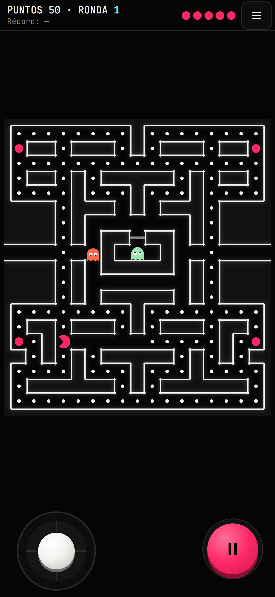

# Capítulo 5 · Tu primera app en Polkadot

En este capítulo construyes tu primera app en Polkadot: un juego de laberinto para celular que corre dentro de Polkadot Desktop
o de la Polkadot App y guarda el mejor puntaje en un contrato. Es **tu** versión, en **tu** repo,
con **tu** contrato `Leaderboard`. Este capítulo es la práctica del [capítulo 4](./04-vibe-coding.md):
vas a pedirle cada parte a tu agente con prompts cortos, una fase a la vez.

---

## 1. Qué vas a construir



Tu primera app en Polkadot: un juego tipo Pac-Man para el celular, a tu manera.

- **Tu juego** corre dentro de la Polkadot App.
- **Tu repo:** lo construyes con IA, fase por fase.
- **Tu contrato** guarda el mejor puntaje, y lo despliegas tú.
- **Tu `.dot`:** lo publicas en tu propio nombre.

Las reglas las decides tú en la [fase 0](#5-define-tu-juego); la muestra tiene las suyas
([Las decisiones de la muestra](#las-decisiones-de-la-muestra)).

Qué es una app en el Host y por qué corre en un `.dot`: [capítulo 1](./01-como-funciona-polkadot.md).

---

## 2. El proyecto de muestra

Es solo una muestra: sirve para ver cómo luce la estructura de un proyecto terminado. No la copias;
construyes la tuya en tu repo. El juego terminado, Polka-Man, vive en la carpeta `game/` del curso:
lo lees, lo juegas y lo comparas con el tuyo.

```text
polkadot-devnet-workshop/
├── package.json            scripts dev, build, test y test:red (llaman a game/)
├── pnpm-workspace.yaml     packages: [game] y el override de @parity/truapi 0.13.1
├── contrato/               Leaderboard.sol y sus pruebas (capítulo 3)
├── prompts/                prompts de ejemplo, de 00-define-tu-juego.md a revision.md
└── game/
    ├── AGENTS.md           reglas para el agente
    ├── index.html, vite.config.js
    └── src/
        ├── engine/         lógica del juego sin pantalla: laberinto, reglas, fantasmas
        ├── render/         dibuja en el canvas
        ├── input/          teclado, swipe y D-pad
        ├── components/     HUD, ranking, fin de partida y username
        ├── contract/       dirección, ABI y lecturas del contrato
        ├── hub/            conexión con el Host: cuenta, gas y firmas
        └── lib/            mensajes de error y formato
```

Por qué está así:

- **La lógica no toca la pantalla.** `engine/` solo calcula; así se prueba con tests sin abrir el
  navegador.
- **Todos los números en un archivo.** Vidas, velocidades y puntaje viven en `engine/rules.ts`.
  Cambiar la dificultad es cambiar una línea.
- **El laberinto es texto.** Un arreglo de filas con `#` para paredes, `.` para bolitas y `o` para
  bolitas especiales. Se lee a ojo, la IA lo edita sin errores y el diff se entiende. Un test revisa
  que no haya callejones sin salida, porque los fantasmas no dan media vuelta.
- **La dificultad sube por ronda con tope.** Los fantasmas van un poco más rápido cada ronda, pero
  nunca tan rápido como el jugador: con control táctil sería imposible escapar en una recta.
- **El contrato va aparte y con tests.** `contract/`, `hub/` y `lib/` tienen sus propias pruebas con
  datos falsos, sin red.

`game/AGENTS.md` le dice al agente qué puede tocar en la muestra
([capítulo 4, sección 10](./04-vibe-coding.md#10-agentsmd)). Tu `AGENTS.md` lo arma tu agente en la
fase 1; el de la muestra es un ejemplo, no se copia.

### Las decisiones de la muestra

Son las decisiones de la muestra; tú tomas las tuyas en la fase 0.

| Regla | Así lo decidió la muestra |
|---|---|
| Vidas | 5. Pierdes una al chocar con un fantasma; con 0, fin de la partida |
| Bolita | 10 puntos |
| Bolita especial (las 4 rosas de las esquinas) | 50 puntos y los fantasmas se asustan: te los puedes comer |
| Fantasmas comidos en un mismo susto | 200, 400, 800 y 1600 puntos |
| Ronda | Termina al vaciar el laberinto; las bolitas vuelven y empieza la siguiente |
| Velocidad de los fantasmas | +5 % cada ronda, con tope por debajo de la del jugador |
| Número de fantasmas | Empieza en 2 y sale uno más cada 3 rondas, hasta 6 |
| Marcador | El mejor puntaje se guarda en el contrato `Leaderboard` |

### Juega la muestra

**En un navegador normal, solo el juego.** Desde la raíz del clon del curso
([capítulo 2, paso 9](./02-entorno.md#paso-9--haz-fork-clónalo-y-verifica-todo)):

```bash
pnpm install
pnpm test    # opcional, sin red
pnpm dev
```

Abre en tu PC la URL que muestra `pnpm dev` (`http://127.0.0.1:5173`). Para verlo en ancho de
teléfono usa el modo dispositivo del navegador: F12 y luego Ctrl+Shift+M (en macOS, Cmd+Option+I y
Cmd+Shift+M). Prueba:

- Moverte con el teclado, o con swipe y D-pad en modo dispositivo.
- Comer bolitas y bolitas especiales, y comerte a los fantasmas asustados.
- Chocar con un fantasma y perder vidas hasta el fin de la partida.
- Vaciar el laberinto y ver que cada ronda se pone más difícil.

Aquí ves el ranking, pero guardar no funciona: conectar, el permiso de gas y guardar solo funcionan
publicada en un `.dot` y abierta desde el Host ([sección 8](#8-publica-en-tu-dot)).

**La versión terminada en el Host.** El organizador publica la muestra en `polka-man.dot`, conectada
a su propio contrato. Ábrela desde la Polkadot App o Polkadot Desktop: ahí ves conectar, guardar un
récord y el ranking. Así debe verse la tuya al final. **POR VERIFICAR**: disponible cuando el
organizador lo publique.

Juega 5 minutos y anota 3 cosas que harías distinto.

---

## 3. Cómo vas a trabajar

Cada fase sigue el mismo ciclo:

**Pensar → Preguntar → Decidir → Pedir → Revisar → Commit**

| Paso | Qué haces | Dónde se explica |
|---|---|---|
| Pensar | Lees "Antes de pedir" y piensas escenarios: celular, pestaña en segundo plano, doble toque, red lenta | Esta guía |
| Preguntar | Si no sabes algo, usas el prompt "Si no sabes": opciones con pros y contras y una recomendación, sin código | Esta guía |
| Decidir | Escribes tus decisiones en `SPEC.md` | [Capítulo 4, sección 5](./04-vibe-coding.md#5-specs) |
| Pedir | Pegas el prompt corto en modo supervisado; el agente da su plan y pregunta lo que falte | [Sección 2](./04-vibe-coding.md#2-anatomía-de-un-prompt), [sección 9](./04-vibe-coding.md#9-agentes) |
| Revisar | Pruebas a mano, el prompt de tests y casos raros, `git diff` | [Sección 6](./04-vibe-coding.md#6-casos-de-prueba), [sección 14](./04-vibe-coding.md#14-cómo-supervisar-a-la-ia) |
| Commit | Un commit por fase y `git push` | [Sección 7](./04-vibe-coding.md#7-pasos-chicos-y-commits) |

Casi todos los prompts llevan tres frases. Son el hábito que practicas:

1. "Lee `SPEC.md` y `AGENTS.md`." El contexto vive en archivos, no en el prompt.
2. "Si te falta algún dato o hay que decidir algo que no está en `SPEC.md`, pregúntame antes de
   escribir código." La IA no decide por ti.
3. "Primero dime tu plan." Revisas antes de que toque archivos.

Cada archivo de [`prompts/`](../prompts/) tiene cuatro partes:

- **Antes de pedir:** 2 a 4 decisiones que te tocan a ti, con un ejemplo de respuesta.
- **El prompt:** 12 líneas o menos. Los números del juego no van en el prompt: están en `SPEC.md`.
- **Si no sabes:** un prompt para pedir opciones con pros y contras, sin código.
- **Al terminar, revisa:** pruebas a mano, el prompt de tests y el commit.

Si no sabes algo, no lo dejes al azar: pídele opciones. Y después de cada fase, usa los prompts de
[`revision.md`](../prompts/revision.md), sobre todo "¿Qué decidiste tú que no estaba en SPEC.md ni
en mi prompt?" ([capítulo 4, sección 3](./04-vibe-coding.md#3-prompt-malo-vs-bueno)).

Un ejemplo de este juego:

```text
Malo: Haz que haya fantasmas.

Bueno: Lee SPEC.md y AGENTS.md. Agrega los fantasmas que dice SPEC.md, cada uno con su
forma de perseguir. Si uno toca al personaje, se pierde una vida. Si te falta algún dato
o hay que decidir algo que no está en SPEC.md, pregúntame antes de escribir código.
Primero dime tu plan.
```

El malo deja que la IA decida cuántos fantasmas, cómo persiguen y qué pasa al chocar. El bueno le da
dónde leerlo y le pide preguntar lo que falte.

---

## 4. Crea tu repo

Tu juego va en un repo nuevo, no en el clon del curso. Desde una terminal (igual en PowerShell,
macOS y Linux):

```bash
cd polkadot-devnet-workshop      # donde lo clonaste en el capítulo 2
cd ..
mkdir mi-juego
cd mi-juego
git init
```

`mi-juego` debe quedar junto a `polkadot-devnet-workshop`, en la misma carpeta. Así tus prompts
pueden decir "el proyecto de muestra está en `../polkadot-devnet-workshop/game`". Abre `mi-juego` en
Kiro.

Instala la skill del hackatón ([capítulo 4, sección 12](./04-vibe-coding.md#12-skills) y
[sección 13](./04-vibe-coding.md#13-skills-recomendadas)) y haz tu primer commit:

```bash
npx skills@1.7.2 add https://github.com/BrandonFilth/polkadot-products-devnet --skill polkadot-products-devnet
git add .
git commit -m "skill del hackatón"
gh repo create mi-juego --public --source=. --push
```

`gh repo create` crea el repo en tu cuenta de GitHub y sube el commit
([capítulo 2, paso 5](./02-entorno.md#paso-5--conecta-tu-terminal-con-github) y
[tu primer commit](./02-entorno.md#tu-primer-commit)). Puedes usar otro nombre en lugar de
`mi-juego`; tu juego no tiene que llamarse Polka-Man.

Pendientes **POR VERIFICAR**:

- Que el agente pueda leer `../polkadot-devnet-workshop/game` fuera de tu carpeta. Si no puede, abre
  las dos carpetas en el mismo workspace de Kiro o pégale la URL del archivo en GitHub.
- Cómo trata Git en Windows la carpeta de enlace `.kiro/skills/`. Si aparece duplicada o da error,
  agrégala a `.gitignore`.
- Que `npx skills` no deje `node_modules/` en la carpeta. Si `git status` lo muestra antes del
  `git add .`, crea primero un `.gitignore` con la línea `node_modules`.

---

## 5. Define tu juego

Antes de escribir código, le pides a tu agente que **te haga preguntas**: todo lo que
necesita saber para no dejar puntos vacíos ni decisiones arbitrarias. Es la parte que más cambia el
resultado.

Qué esperar:

- Preguntas de pocas en pocas: cuántas vidas, qué pasa al chocar, qué ve el jugador sin red.
- Preguntas que no habías pensado. Esa es la idea: descubrir lo que no habías decidido.
- Cuando no sepas, responde "no sé" y pídele opciones con pros y contras. Tú eliges.

El resultado es `SPEC.md`, con las secciones del [capítulo 4, sección 5](./04-vibe-coding.md#5-specs)
y los casos de la [sección 6](./04-vibe-coding.md#6-casos-de-prueba), más dos nuevas:

- **Reglas y números:** una tabla con cada regla y su valor (vidas, puntaje por bolita,
  velocidades, tiempos, tope). Los prompts no llevan números: el agente los lee de aquí.
- **Decisiones por fase:** una línea por decisión que tomes en cada fase ("Fase 4: al chocar se
  conservan las bolitas"). Si una decisión cambia un número, actualiza también la tabla.

Prompt y revisión: [`prompts/00-define-tu-juego.md`](../prompts/00-define-tu-juego.md). Al terminar,
`git add SPEC.md`, commit y `git push`.

---

## 6. Las fases 1 a 5

| # | Fase | Qué tienes al terminar | Se prueba en | Tiempo |
|---|---|---|---|---|
| 0 | [Define tu juego](../prompts/00-define-tu-juego.md) | `SPEC.md` sin huecos | — | 15–20 min |
| 1 | [Tu proyecto](../prompts/01-proyecto.md) | Proyecto que arranca, `AGENTS.md`, un canvas y un test | Navegador | 20–25 min |
| 2 | [Laberinto y movimiento](../prompts/02-laberinto.md) | Laberinto y personaje con teclado, swipe y D-pad, con pausa | Navegador | 30–35 min |
| 3 | [Bolitas, puntaje y rondas](../prompts/03-puntos.md) | Comer bolitas, HUD y nueva ronda al vaciar | Navegador | 20–25 min |
| 4 | [Fantasmas y vidas](../prompts/04-fantasmas.md) | Fantasmas, vidas y pantalla de fin | Navegador | 30–40 min |
| 5 | [Bolitas especiales y dificultad](../prompts/05-poder-y-dificultad.md) | Fantasmas asustados y dificultad por ronda con tope | Navegador | 25–35 min |
| 6 | [Tu contrato y el ranking](../prompts/06-tu-contrato.md) | Top 10 de tu contrato | Navegador | 25–30 min |
| 7 | [Publica en tu .dot](../prompts/07-publica.md) | Tu juego en tu `.dot`, abierto desde el Host | Host | 15–20 min |
| 8 | [Guarda tu récord](../prompts/08-guarda-tu-record.md) | Conectar, permiso de gas y guardar con una firma | Host | 30–40 min |

En total, de 3.5 a 4.5 horas (**POR VERIFICAR** con un ensayo). Un commit y un `git push` por fase.
Los errores típicos de la IA en este stack están en el
[capítulo 4, sección 15](./04-vibe-coding.md#15-errores-comunes-de-la-ia-en-este-stack).

### Fase 1 · Tu proyecto

Proyecto Vite + TypeScript en tu carpeta, con las versiones de la skill y tu `AGENTS.md`
([prompt](../prompts/01-proyecto.md)). Piensa: tu carpeta ya tiene `SPEC.md` y la skill; ¿qué pasa si
el agente la "limpia"? Error típico: crea el proyecto encima y borra lo que ya tenías, o sube
`node_modules/` a GitHub. `git status` te lo muestra antes del commit.

### Fase 2 · Laberinto y movimiento

El laberinto en el canvas y el personaje que se mueve con teclado, swipe y D-pad
([prompt](../prompts/02-laberinto.md)). Piensa: ¿qué pasa si el jugador pide girar justo antes del
cruce? Error típico: la pausa se quita sola al volver a la pestaña.

### Fase 3 · Bolitas, puntaje y rondas

Comer bolitas, sumar puntaje, el HUD y la nueva ronda ([prompt](../prompts/03-puntos.md)). Piensa:
¿qué pasa si el jugador pasa dos veces por el mismo lugar? Error típico: borra las bolitas del
laberinto original y la ronda 2 empieza vacía.

### Fase 4 · Fantasmas y vidas

Fantasmas que persiguen, vidas y pantalla de fin ([prompt](../prompts/04-fantasmas.md)). Piensa:
¿qué pasa si dos fantasmas te tocan al mismo tiempo? Error típico: usa un azar sin control y los
tests fallan a veces sí y a veces no, o pinta un fantasma del mismo color que el personaje.

### Fase 5 · Bolitas especiales y dificultad

Fantasmas asustados que te puedes comer y dificultad que sube por ronda
([prompt](../prompts/05-poder-y-dificultad.md)). Piensa: ¿qué pasa si comes una segunda bolita
especial mientras los fantasmas siguen asustados? Error típico: la velocidad crece sin tope y en la
ronda 10 los fantasmas son más rápidos que tú.

---

## 7. Tu contrato y el ranking

Fase 6 ([prompt](../prompts/06-tu-contrato.md)). Tu juego lee el top 10 de **tu** contrato
`Leaderboard`, el del [capítulo 3, sección 13](./03-smart-contracts.md#13-el-contrato-del-juego).

- **Reusar o desplegar otro.** Puedes usar el que desplegaste en el capítulo 3 o desplegar uno nuevo
  con Remix ([capítulo 3, sección 17](./03-smart-contracts.md#17-despliégalo)). Un contrato nuevo
  empieza con el ranking vacío.
- **Dirección y ABI.** Copia `contrato/Leaderboard.sol` del curso a `contrato/` de tu repo y pega la
  ABI de Remix en `src/contract/leaderboard.abi.json` ([capítulo 3, sección 14](./03-smart-contracts.md#14-la-abi)).
  La dirección se la das al agente en el prompt y debe quedar en un solo archivo.
- **La cuenta de MetaMask es otro jugador.** Si en el capítulo 3 llamaste `submitScore` desde
  MetaMask, ese récord ya aparece en tu ranking. Tu cuenta en tu `.dot` es distinta
  ([capítulo 3, sección 16](./03-smart-contracts.md#16-tus-tres-cuentas)).
- **El contrato no sabe si el puntaje es legítimo.** Cualquiera puede llamar `submitScore` sin jugar
  ([capítulo 3, sección 10](./03-smart-contracts.md#10-lo-que-un-contrato-no-puede-saber)).

Leer el ranking no necesita firma: se prueba con `pnpm dev` en el navegador.

---

## 8. Publica en tu .dot

Fase 7 ([prompt](../prompts/07-publica.md)). Antes de publicar, el agente revisa que tu proyecto
esté listo, sin cambiar archivos. Después sigues este ciclo.

**Qué se prueba dónde.** `pnpm dev` sirve para un navegador normal: ves el juego, juegas y lees el
ranking por el ETH-RPC; la muestra indica que está fuera del Host (la tuya, desde la fase 8). Ni Polkadot Desktop ni la Polkadot
App se conectan a `localhost`. Todo lo que pasa por el Host (Conectar, firmas, permiso de gas en
PGAS y guardar récord) se prueba con la app **publicada en un dominio `.dot`** y abierta
desde el Host
([skill, `app-sdk.md`](https://github.com/BrandonFilth/polkadot-products-devnet/blob/main/skills/polkadot-products-devnet/references/app-sdk.md)).
Las fases 1 a 6 se prueban en el navegador. Para las fases 7 y 8 publicas en tu `.dot` con el ciclo
de abajo.

> El Host deriva una cuenta por dominio: tu cuenta en tu `.dot` es distinta de la que tienes en la
> app de un compañero ([capítulo 3, sección 16](./03-smart-contracts.md#16-tus-tres-cuentas)).

### Probar dentro del Host: publica en tu .dot

Ni Polkadot Desktop ni la Polkadot App se conectan a `localhost`: para probar en el Host publicas el
juego en tu `.dot`. **Es el mismo método con el que publicas tu app al final del hackatón**; el
capítulo 6 (próximamente) amplía la compra del nombre, el manifest y la renovación. No necesitas
sesión, frase de recuperación ni keystore: la única firma es la del `contenthash`, en tu teléfono.
Fuente: la skill
([`publicar.md`, sección 2](https://github.com/BrandonFilth/polkadot-products-devnet/blob/main/skills/polkadot-products-devnet/references/publicar.md)).
Comprobado el 2026-10-18 con `pad` 0.16.7.

Ciclo: cambias → `pnpm build` → subes con `pad` → copias el CID → lo pegas en tu `.dot` → abres tu
`.dot` en el Host. Cada build da un CID nuevo.

1. Una sola vez: compra tu nombre en la Polkadot App desde `dotns.dot` (9 caracteres o más). El
   nombre es de la cuenta de tu teléfono.
2. Desde la raíz del repo, `pnpm build`. El bundle queda en `dist`.
3. Desde la raíz del repo, sube el bundle (unos 3.5 minutos).

   Windows (PowerShell):

   ```powershell
   function pad { $env:PAD_UPDATE_CHECK = '0'; pnpm dlx --ignore-scripts @polkadot-community-foundation/polkadot-app-deploy@0.16.7 @args }
   $tmp = 'tmp' + (-join ((Get-Date -Format 'yyyyMMddHHmmss').ToCharArray() | ForEach-Object { [char](97 + [int]"$_") })) + '.dot'
   pad .\dist $tmp --env devnet --js-merkle --no-manifest
   ```

   macOS o Linux:

   ```bash
   pad() { PAD_UPDATE_CHECK=0 pnpm dlx --ignore-scripts @polkadot-community-foundation/polkadot-app-deploy@0.16.7 "$@"; }
   tmp="tmp$(date +%Y%m%d%H%M%S | tr '0-9' 'a-j').dot"
   pad ./dist "$tmp" --env devnet --js-merkle --no-manifest
   ```

   La primera línea define el atajo para esa terminal. Corre las tres líneas en cada subida: la
   segunda genera un nombre temporal nuevo.

   Para publicar el proyecto de muestra, sigue la [sección 11](#11-publica-la-muestra-en-tu-dot).
4. Terminó bien si ves `Storage signer: pool fallback (no session)`, `Using pool account N`,
   `Verified on-chain`, el aviso de despliegue completo y la última línea `CID: bafy…`. Ese es el CID
   raíz: cópialo. Las líneas `bafkrei…` son los trozos.
5. Opcional, sin el Host: `https://<nombre-temporal>.dev-dot.li` muestra el bundle.
6. En la Polkadot App (o en Desktop) abre `dotns.dot` → Profile → tu nombre → Edit, pega el CID en
   `contenthash` y firma en el teléfono.
7. Abre tu nombre desde el Host. En la fase 7 revisa que cargan el juego y el ranking; en la fase 8,
   Conectar, permiso de gas y guardar récord.

Por qué cada parte:

- `--env devnet`: sin él, `pad` usa otra red (`paseo-next-v2`).
- `--js-merkle`: no necesitas el binario de IPFS Kubo.
- `--no-manifest`: `pad` ignora cualquier `polkadot-app-deploy.config.ts` y usa el nombre que le das.
- Nombre temporal: `pad` siempre registra el nombre que recibe; queda del worker compartido de `pad`
  y no se vuelve a usar.
- Letras en lugar de dígitos: DotNS solo acepta 0 o 2 dígitos al final del nombre.
- `PAD_UPDATE_CHECK=0`: evita que `pad` ofrezca actualizarse después de un fallo.

Si algo falla:

| Síntoma | Qué hacer |
|---|---|
| `pool account N … is not authorized (or its authorization expired)` | Esa cuenta del pool venció en Bulletin. Corre otra vez la misma línea `pad`: elige al azar una de las 10 cuentas sin revisar su autorización. La organización mantiene autorizadas las 10 durante el evento |
| El nombre ya tiene dueño | Genera otro `$tmp` (segunda línea) y repite |
| Falla por propietario con tu propio nombre | Nunca le pases a `pad` el nombre de tu teléfono: `pad` firma con su worker. Dale el nombre temporal y pega el CID a mano |
| No aparece `Storage signer: pool fallback (no session)` o pide aprobar en el teléfono | Hay una sesión de `pad` guardada. Corre `pad logout` y repite |
| `Previous deploy did not exit cleanly. Continuing.` o `Previous deploy was interrupted` | Inofensivo |
| `A newer version of polkadot-app-deploy is available (0.16.7 → 0.20.0)` | Ignóralo; no actualices (la versión está fija en 0.16.7) |

Notas:

- Nunca le pases tu propio nombre a `pad`; solo el nombre temporal.
- La organización autorizó las 10 cuentas del pool con 1000 transacciones y 1000 MB cada una (unos
  10 GB en total).
- Bulletin borra el contenido a los ~14 días: vuelve a publicar antes de la demo o la evaluación.
- Icono y descripción (manifest) son opcionales y se ven en el capítulo 6; el formato está **POR
  VERIFICAR**.

---

## 9. Guarda tu récord

Fase 8 ([prompt](../prompts/08-guarda-tu-record.md)). Esto es lo que tu app debe hacer al tocar
«Guardar récord», y por qué:

1. **Simular.** Antes de pedir la firma, pregunta al contrato si aceptaría el puntaje. Si lo va a
   rechazar, muestra el motivo y **no pide firma**
   ([capítulo 3, sección 15](./03-smart-contracts.md#15-simular-antes-de-enviar)).
2. **Una sola firma.** Mientras el jugador firma, los botones quedan deshabilitados: el Host atiende
   una firma a la vez.
3. **Releer.** Vuelve a leer el récord del contrato, unas cuantas veces si hace falta, porque la red
   puede ir un poco atrás.

El gas se paga en PGAS. Al conectar, tu app pide al Host un permiso de gas
([skill, `app-sdk.md`](https://github.com/BrandonFilth/polkadot-products-devnet/blob/main/skills/polkadot-products-devnet/references/app-sdk.md)).
Estados que tu app debe manejar:

| Respuesta al permiso de gas | Qué debe pasar |
|---|---|
| Aceptado | La cuenta queda conectada, sin mensaje de error |
| Rechazado | La cuenta queda conectada; un mensaje explica que sin el permiso no se puede guardar y que puede tocar Conectar otra vez |
| No disponible o sin respuesta | La cuenta queda conectada; el permiso se vuelve a pedir al guardar |

Otros casos: fuera del Host, con una firma en curso, sin cuenta, un puntaje que no supera el récord
(sin firma) y un récord enviado que la red todavía no muestra. Así los resuelve la muestra, como
ejemplo: «Abre el juego dentro de Polkadot Desktop o de la Polkadot App para guardar tu récord. Aquí
puedes jugar y ver el ranking.» y «Récord enviado. Puede tardar unos segundos en aparecer.» Tus
textos los decides tú.

Cada cuenta es un jugador distinto: tu `.dot`, un `.dot` temporal y MetaMask tienen cada uno su
propio récord ([capítulo 3, sección 16](./03-smart-contracts.md#16-tus-tres-cuentas)). Más detalle en
[`errores-comunes.md`](https://github.com/BrandonFilth/polkadot-products-devnet/blob/main/skills/polkadot-products-devnet/references/errores-comunes.md)
de la skill. El comportamiento de los permisos dentro de Desktop 0.1.3 y de la Polkadot App está
**POR VERIFICAR**.

**Reto opcional: username.** Si te sobra tiempo, el final de
[`08-guarda-tu-record.md`](../prompts/08-guarda-tu-record.md) agrega un username: de 3 a 16
caracteres, solo `a-z`, `0-9` y `_`, único en tu contrato.

---

## 10. Si te atoras y problemas comunes

Sube por esta escalera, en orden:

1. **Vuelve al último commit bueno.** `git restore <archivo>` o `git restore .` descarta los cambios
   sin commit. No se puede deshacer
   ([capítulo 4, sección 7](./04-vibe-coding.md#7-pasos-chicos-y-commits)).
2. **Pide diagnóstico, no arreglo.** Usa el [prompt 4 de `revision.md`](../prompts/revision.md#4-diagnóstico-antes-de-arreglar)
   con el error exacto.
3. **Compara con la muestra.** Usa el [prompt 5 de `revision.md`](../prompts/revision.md#5-compara-con-la-muestra).
4. **Último recurso, solo para el contrato (fases 6 y 8).** Parte de un `git status` limpio, con el
   commit de la fase 6 hecho:
   1. Copia `game/src/contract/`, `game/src/hub/` y `game/src/lib/` del curso a `src/` de tu repo.
   2. Vuelve a poner **tu** ABI: `git checkout -- src/contract/leaderboard.abi.json` (la copia trae
      la ABI de la muestra en la misma ruta).
   3. Borra `src/contract/leaderboard.red.test.ts`: hace lecturas reales por red y haría que
      `pnpm test` dependa de la red.
   4. En `src/contract/config.ts` cambia `LEADERBOARD_ADDRESS` a la dirección de **tu** contrato y
      `PRODUCT_DOMAIN` a **tu** nombre `.dot`.
   5. Si `pnpm build` o `pnpm test` fallan al importar el `.json`, pídele al agente que agregue
      `"resolveJsonModule": true` en `compilerOptions` de tu `tsconfig.json`. Si fallan por otra
      razón, usa el prompt 4 de `revision.md` con el error exacto.
   6. `pnpm test` y `pnpm build` deben pasar **antes** de pedirle al agente que conecte tu interfaz
      a esa parte. Commit: "contrato desde la muestra".

   Que esta copia compile en un repo nuevo está **POR VERIFICAR**. El motor del juego no se copia:
   es la parte que construyes tú.

<details>
<summary><b>Problemas comunes</b></summary>

- **El ranking no carga.** Las lecturas van por el ETH-RPC del devnet
  (`https://eth-rpc-testnet.polkadot.io`). Revisa tu conexión y toca «Reintentar».
- **No puedo guardar desde el navegador.** Guardar necesita el Host: publica tu juego en tu `.dot` y
  ábrelo desde Polkadot Desktop o la Polkadot App
  ([sección 8](#probar-dentro-del-host-publica-en-tu-dot)). El Host no se conecta a `localhost`.
- **La IA cambió `package.json`, `pnpm-lock.yaml` o `pnpm-workspace.yaml`.** Descarta esos cambios
  con `git restore package.json pnpm-lock.yaml pnpm-workspace.yaml` y pídele que no los toque
  ([capítulo 4, sección 15](./04-vibe-coding.md#15-errores-comunes-de-la-ia-en-este-stack)).
- **Los tests de una fase anterior fallan después de un prompt.** No dejes que la IA los borre o
  los salte. Pídele la causa y que corrija el código.
- **En el proyecto de muestra, `pnpm dev` dice que el puerto 5173 está ocupado.** Cierra la otra
  terminal que corre `pnpm dev`.

</details>

---

## 11. Publica la muestra en tu .dot

Una práctica guiada del ciclo completo de publicación, sin tocar tu juego: publicas el proyecto de
muestra tal cual en **tu** nombre `.dot`.

1. Desde la raíz del repo del curso, `pnpm build`. La muestra queda en `game\dist`.
2. Publica con el ciclo de la [sección 8](#probar-dentro-del-host-publica-en-tu-dot) (la función
   `pad` y un `$tmp` nuevo), usando `.\game\dist` en lugar de `.\dist` (en macOS o Linux,
   `./game/dist`):

   ```powershell
   pad .\game\dist $tmp --env devnet --js-merkle --no-manifest
   ```

3. Copia el CID `bafy…` de la última línea.
4. En `dotns.dot` → Profile → tu nombre → Edit, pégalo en el `contenthash` de **tu** `.dot` y firma
   en el teléfono.
5. Abre tu `.dot` en el Host y compáralo con `polka-man.dot`.

La muestra lee la dirección del contrato en `game/src/contract/config.ts`. En tu `.dot` ves el ranking
del contrato de la muestra, a menos que pongas ahí la dirección de tu `Leaderboard`
([capítulo 3, sección 17](./03-smart-contracts.md#17-despliégalo)) y vuelvas a construir. Tu cuenta en
tu `.dot` es otro jugador ([capítulo 3, sección 16](./03-smart-contracts.md#16-tus-tres-cuentas)).

Si algo falla, usa la tabla de la [sección 8](#probar-dentro-del-host-publica-en-tu-dot).

---

👉 Capítulo 6 · Publica tu app (próximamente)
