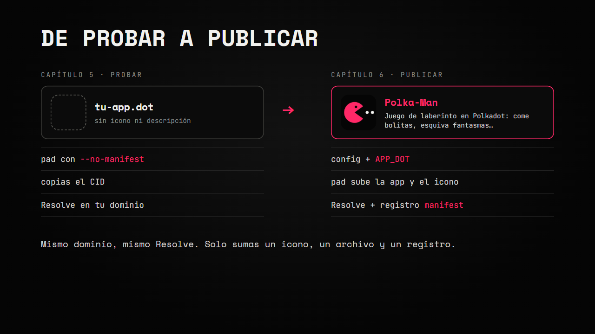
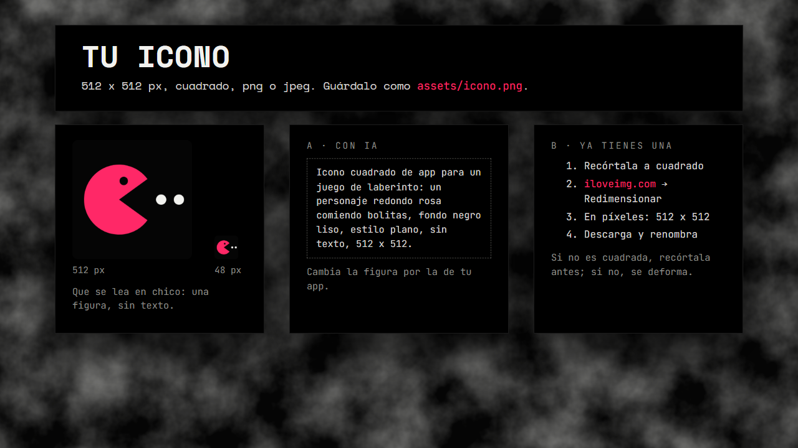
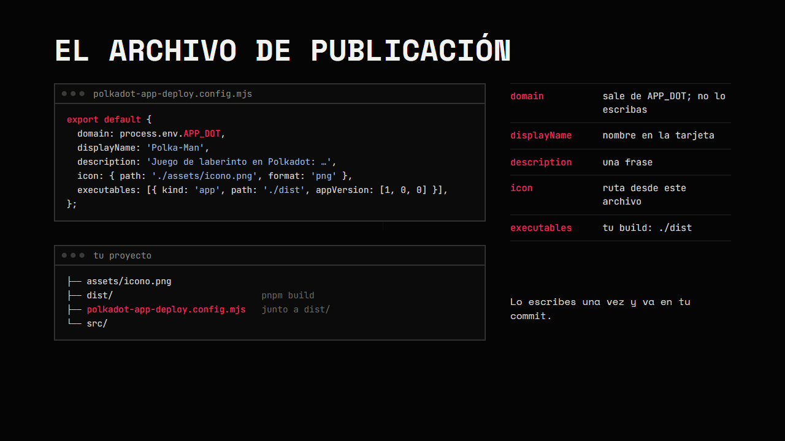
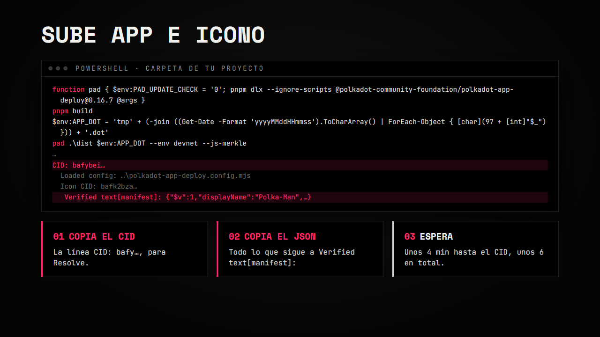
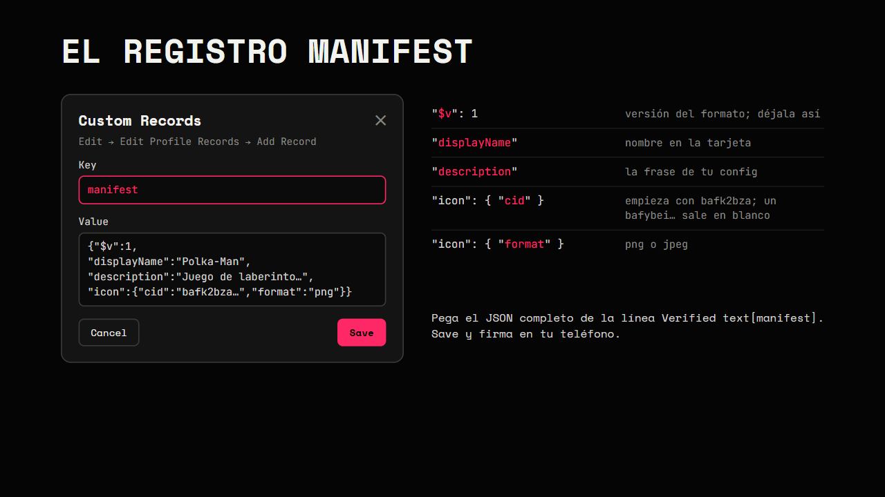
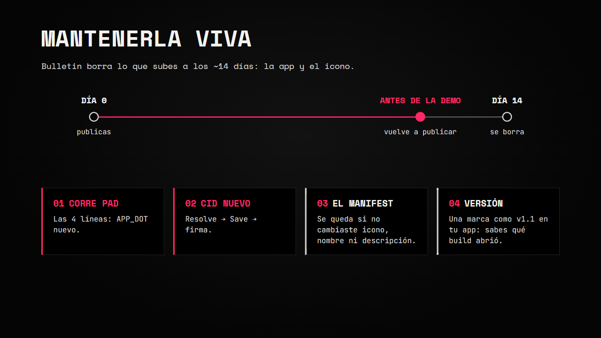

# Capítulo 6 · Publica tu app

En el [capítulo 5](./05-el-juego.md) publicaste tu juego en tu `.dot` para probarlo dentro del Host.
Aquí haces la versión final: la misma app, en el mismo dominio, ahora con **icono, nombre y
descripción** en su tarjeta. Al final sabes mantenerla viva hasta la demo y compartirla.

Comprobado con `pad` 0.16.7 en Products Devnet, con Polka-Man en `polka-man.dot`, en Polkadot Desktop
y en la Polkadot App para Android.

---

## 1. Qué cambia al publicar



| | Capítulo 5 · probar | Capítulo 6 · publicar |
|---|---|---|
| Comando | `pad … --no-manifest` con un nombre temporal | `pad` con un archivo de publicación y la variable `APP_DOT` |
| Qué sube | El bundle | El bundle y el icono |
| Qué copias | El CID | El CID y el JSON del manifest |
| En tu dominio | Resolve con el CID | Resolve con el CID y un registro `manifest` |
| En el Host | Tu dominio, sin icono ni descripción | La tarjeta con icono, nombre y descripción |

Todo pasa en tu **dominio principal**, el que compraste en el capítulo 5
([Compra tu dominio .dot](./05-el-juego.md#compra-tu-dominio-dot-una-sola-vez)). No necesitas
sesión, frase de recuperación ni keystore: las únicas firmas son las tuyas, en el teléfono.

---

## 2. Antes de publicar

Revisa tu proyecto antes de la versión final:

- La dirección de **tu** contrato, no la de la muestra, en un solo archivo.
- Sin datos de prueba ni atajos de depuración (puntajes falsos, botones ocultos, `console.log` de más).
- Se ve bien en un teléfono, sin barras ni partes cortadas.
- Sin secretos en el repo: ni `.env`, ni frases de recuperación, ni llaves.
- `git status` limpio: todo lo que publicas tiene su commit.
- `pnpm test` y `pnpm build` pasan.

Para la revisión con el agente usa el prompt de la fase 7
([`prompts/07-publica.md`](../prompts/07-publica.md)): revisa sin cambiar archivos y te dice qué falta.

Lo que subes es público: cualquiera puede descargar tu bundle.

---

## 3. Tu icono



- **Tamaño:** 512 x 512 px, cuadrado.
- **Formato:** png o jpeg.
- **Legible en chico:** el Host lo muestra pequeño. Una figura clara, sin texto.
- **Dónde:** guárdalo como `assets/icono.png` en tu proyecto (si es jpeg, `assets/icono.jpg`).

**Opción A · Generarlo con IA.** Pide un icono con un prompt corto y concreto, por ejemplo:

```text
Icono cuadrado de app para un juego de laberinto: un personaje redondo rosa comiendo
bolitas, fondo negro liso, estilo plano, sin texto, 512 x 512.
```

Cambia la figura y los colores por los de tu app. Si la imagen no sale de 512 x 512, sigue la opción B.

**Opción B · Ya tienes una imagen.** Redimensiónala con
[iloveimg](https://www.iloveimg.com/es/redimensionar-imagen#resize-options,pixels):

1. Si no es cuadrada, recórtala primero a cuadrado (en iloveimg, Recortar imagen). Si no, se deforma.
2. Abre Redimensionar imagen y sube tu imagen.
3. Elige **En píxeles** y escribe 512 de ancho y 512 de alto.
4. Redimensiona, descarga el archivo y guárdalo como `assets/icono.png`.

El icono de la muestra está en [`game/assets/icono.png`](../game/assets/icono.png).

---

## 4. El archivo de publicación



Crea `polkadot-app-deploy.config.mjs` en la carpeta de tu proyecto, junto a `dist/`. Este es el de la
muestra ([`game/polkadot-app-deploy.config.mjs`](../game/polkadot-app-deploy.config.mjs)):

```js
// Publicación con icono y manifest. El dominio sale de la variable APP_DOT (ver contenido/06-publicar.md).
export default {
  domain: process.env.APP_DOT,
  displayName: 'Polka-Man',
  description: 'Juego de laberinto en Polkadot: come bolitas, esquiva fantasmas y guarda tu récord en la blockchain.',
  icon: { path: './assets/icono.png', format: 'png' },
  executables: [{ kind: 'app', path: './dist', appVersion: [1, 0, 0] }],
};
```

| Campo | Qué es |
|---|---|
| `domain` | El nombre al que sube `pad`. Déjalo como `process.env.APP_DOT`: cada subida usa un nombre temporal nuevo y `pad` exige que este campo sea igual al nombre que le pasas |
| `displayName` | El nombre de tu app en la tarjeta |
| `description` | Una frase sobre tu app |
| `icon` | La ruta de tu icono, desde la carpeta de este archivo, y su formato (`png` o `jpeg`) |
| `executables` | Tu build: `./dist`, la carpeta que deja `pnpm build`. `kind` y `appVersion` déjalos así |

Lo escribes **una vez** y va en tu commit. `pad` lo encuentra solo: lo busca en la carpeta del build y
en las de arriba. Antes de subir nada, revisa que el dominio sea válido y que el icono exista.

---

## 5. Sube app e icono



Desde la carpeta de tu proyecto. En el repo del curso, la muestra se publica desde la raíz con
`.\game\dist` (`./game/dist` en macOS o Linux) en lugar de `.\dist`.

Windows (PowerShell):

```powershell
function pad { $env:PAD_UPDATE_CHECK = '0'; pnpm dlx --ignore-scripts @polkadot-community-foundation/polkadot-app-deploy@0.16.7 @args }
pnpm build
$env:APP_DOT = 'tmp' + (-join ((Get-Date -Format 'yyyyMMddHHmmss').ToCharArray() | ForEach-Object { [char](97 + [int]"$_") })) + '.dot'
pad .\dist $env:APP_DOT --env devnet --js-merkle
```

macOS o Linux:

```bash
pad() { PAD_UPDATE_CHECK=0 pnpm dlx --ignore-scripts @polkadot-community-foundation/polkadot-app-deploy@0.16.7 "$@"; }
pnpm build
export APP_DOT="tmp$(date +%Y%m%d%H%M%S | tr '0-9' 'a-j').dot"
pad ./dist "$APP_DOT" --env devnet --js-merkle
```

Es el ciclo del capítulo 5 con dos cambios: el nombre temporal va en la variable `APP_DOT` (la lee
el archivo de publicación; en macOS y Linux hace falta `export`) y ya no lleva `--no-manifest`. Corre
las cuatro líneas en la misma terminal en cada subida: la tercera genera un nombre nuevo.

Tarda **unos 4 minutos hasta el CID y unos 6 en total** (más o menos un minuto más la primera vez,
mientras se descarga `pad`). Corre `pad` sin tuberías (`| Tee-Object` y similares) para leer bien
la salida. Terminó bien si ves estas líneas:

```text
CID: bafybei…
  Loaded config: …\polkadot-app-deploy.config.mjs
  Icon CID: bafk2bza…
   Verified text[manifest]: {"$v":1,"displayName":"Polka-Man",…}
```

Copia dos cosas:

1. **El CID** de la línea `CID: bafy…`: va en Resolve.
2. **El JSON** de la línea `Verified text[manifest]:`, desde la primera `{` hasta la última `}`: va
   en el registro `manifest`.

`pad` también registra `app.<nombre-temporal>.dot`. Es del nombre temporal; tu dominio no lo necesita.

---

## 6. Pégalo en tu dominio

En la Polkadot App (o en Desktop) abre `dotns.dot` → Profile → pestaña My Domains → la fila de **tu**
dominio.

**El CID, con Resolve.** Es el mismo paso del capítulo 5:

1. Toca Resolve. Se abre "Resolve to IPFS".
2. Pega el CID (`bafy…`) en "IPFS Hash or Gateway URL".
3. Toca Save y firma en el teléfono.


**El manifest, como registro.**



1. En la misma fila, toca Edit → Edit Profile Records → pestaña Custom Records → Add Record.
2. Llave (key): `manifest`.
3. Valor (value): el JSON que copiaste, completo.
4. Guarda y firma en el teléfono.

El JSON de la muestra:

```json
{"$v":1,"displayName":"Polka-Man","description":"Juego de laberinto en Polkadot: come bolitas, esquiva fantasmas y guarda tu récord en la blockchain.","icon":{"cid":"bafk2bzaced2hft4itrualux3gngkbh7xuvctwxxn24c565bcqyf23fkokonkm","format":"png"}}
```

| Campo | Qué es |
|---|---|
| `$v` | Versión del formato. Déjalo en `1` |
| `displayName` | El nombre de la tarjeta, de tu config |
| `description` | La descripción de la tarjeta, de tu config |
| `icon.cid` | El CID de tu icono. Empieza con `bafk2bza`; un CID `bafybei…` deja el icono en blanco |
| `icon.format` | `png` o `jpeg` |

Si los acentos del JSON copiado salen raros (por ejemplo `r├®cord`), corrígelos a mano para que el
texto quede igual al de tu config.

---

## 7. Comprueba

Abre la Polkadot App o Polkadot Desktop y busca tu dominio. La tarjeta muestra tu icono, tu nombre y
tu descripción; al abrirla carga tu app. Prueba lo de siempre: el juego, el ranking, Conectar y
guardar un récord con una firma.

> Android: si la app ya estaba en tus marcadores (bookmarks), puede seguir mostrando la tarjeta
> anterior. Quita el marcador, busca la app otra vez y vuelve a agregarla. Ya está reportado.

---

## 8. Mantenerla viva



Bulletin borra lo que subes a los ~14 días: el bundle y el icono. Vuelve a publicar antes de la
demo o la evaluación, y cada vez que cambies tu app:

1. Corre las cuatro líneas de la [sección 5](#5-sube-app-e-icono). La tercera da un `APP_DOT` nuevo.
2. Pega el CID nuevo con Resolve, Save y firma ([sección 6](#6-pégalo-en-tu-dominio)).
3. El registro `manifest` se queda como está si no cambiaste el icono, el nombre ni la descripción: el
   mismo icono vuelve a subirse con el mismo CID. Si cambiaste alguno, edita el registro con el JSON
   nuevo.
4. Pon una marca de versión visible en tu app (por ejemplo `v1.1` en la pantalla de inicio). Así
   sabes qué build abrió el Host.

Con el archivo de publicación en tu proyecto, usa este comando también para las pruebas del ciclo
del capítulo 5. `pad` lee la config aunque pases `--no-manifest`; sin `APP_DOT` definida, termina con
`Deployment failed (not retryable): Invalid product config …` después de subir (según el código de
`pad` 0.16.7).

---

## 9. Compártela

- **En el Host:** `tu-app.dot`, en la Polkadot App o en Desktop.
- **En el navegador:** `https://tu-app.dev-dot.li`, para verla sin el Host. Conectar y firmar solo
  funcionan dentro del Host.
- **El código:** tu repo en GitHub, con un `README.md` corto: qué es tu app en una frase, cómo
  abrirla (`tu-app.dot`), la dirección de tu contrato con su enlace a
  [Blockscout](https://blockscout-testnet.polkadot.io/) y cómo correrla (`pnpm install`, `pnpm dev`).

Antes de compartirla, ábrela desde otro teléfono, con otra cuenta, y guarda un récord.

---

## 10. Si algo falla

| Síntoma | Qué hacer |
|---|---|
| `pool account N … is not authorized (or its authorization expired)` | Corre otra vez la línea `pad`: elige al azar otra cuenta del pool |
| El nombre ya tiene dueño | Corre otra vez la línea de `APP_DOT` y después la de `pad` |
| `Error: domain required (e.g. my-app.dot)` | `APP_DOT` no existe en esta terminal. Corre la línea de `APP_DOT` y repite |
| `Error: Invalid product config at …` con `product config domain must be a non-empty dotNS name ending in one of: .dot, .paseo` | Le pasaste un nombre a mano y `APP_DOT` no está definida. Corre la línea de `APP_DOT` y pásale `$env:APP_DOT` (`"$APP_DOT"` en macOS o Linux) a `pad` |
| `Config domain '…' (in …) does not match deploy domain '…'` | El nombre que le pasaste a `pad` no es el de `APP_DOT`. El bundle subió pero el manifest no se escribió: repite con `$env:APP_DOT` como argumento |
| El icono sale en blanco | En el registro, `icon.cid` debe empezar con `bafk2bza`. Copia otra vez el JSON de la línea `Verified text[manifest]:` |
| En Android sale la tarjeta anterior | Quita el marcador, busca la app otra vez y vuelve a agregarla ([sección 7](#7-comprueba)) |
| Se abre la versión anterior de la app | Cierra la app del Host y vuelve a abrirla. Tu marca de versión te dice cuál cargó |
| `A newer version of polkadot-app-deploy is available (0.16.7 → …)` | Ignóralo; la versión está fija en 0.16.7 |
| Falla por propietario con tu propio dominio | Nunca le pases tu dominio a `pad`: solo el nombre temporal de `APP_DOT`. Tu dominio se actualiza a mano con Resolve y el registro |

Los demás avisos de `pad` (`Previous deploy did not exit cleanly`, `pad logout`) están en la tabla
del [capítulo 5](./05-el-juego.md#probar-dentro-del-host-publica-en-tu-dot).

---

👉 [Capítulo 7 · Hackatón](./07-hackaton.md)
