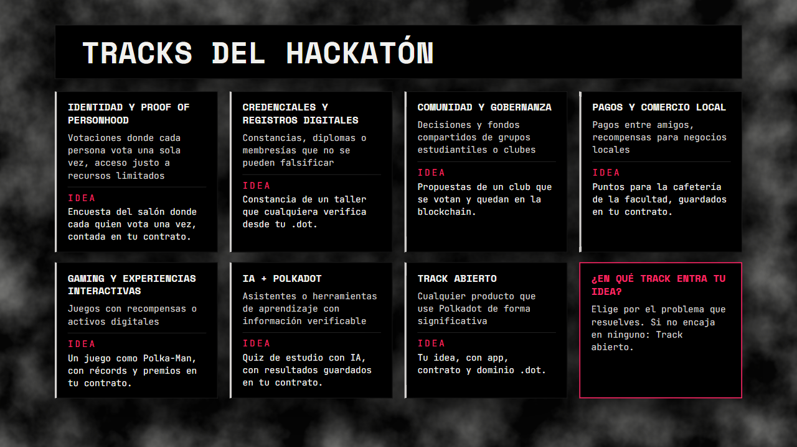

# Capítulo 7 · Hackatón

En 8 horas, cada equipo construye y publica una mini app que resuelva un problema real, y la
presenta en el Demo Day. Aquí ves el reto, los tracks y en cuál entra tu idea.

---

## 1. El reto

Construye un producto que resuelva un problema real de la vida universitaria o cotidiana usando
Polkadot. Parte de una necesidad que veas en tu facultad, tu grupo, tu familia o tu comunidad.

No se busca una demo técnica. Tu equipo debe poder explicar qué problema resuelve, para quién lo
resuelve y por qué Polkadot hace mejor la solución.

---

## 2. Los tracks

| Track | Ejemplos del programa | Una idea con lo del curso |
| :---- | :---- | :---- |
| Identidad y Proof of Personhood | Votaciones donde cada persona vota una sola vez, acceso justo a recursos limitados | Encuesta del salón donde cada quien vota una vez, contada en tu contrato. |
| Credenciales y registros digitales | Constancias, diplomas o membresías que no se pueden falsificar | Constancia de un taller que cualquiera verifica desde tu .dot. |
| Comunidad y gobernanza | Decisiones y fondos compartidos de grupos estudiantiles o clubes | Propuestas de un club que se votan y quedan en la blockchain. |
| Pagos y comercio local | Pagos entre amigos, recompensas para negocios locales | Puntos para la cafetería de la facultad, guardados en tu contrato. |
| Gaming y experiencias interactivas | Juegos con recompensas o activos digitales | Un juego como Polka-Man, con récords y premios en tu contrato. |
| IA + Polkadot | Asistentes o herramientas de aprendizaje con información verificable | Quiz de estudio con IA, con resultados guardados en tu contrato. |
| Track abierto | Cualquier producto que use Polkadot de forma significativa | Tu idea, con app, contrato y dominio .dot. |

---

## 3. Cómo elegir tu track

1. Parte del problema que resuelves, no de la tecnología.
2. Elige el track que mejor describe ese problema.
3. Si encaja en dos, elige el principal.
4. Si no encaja en ninguno, va en **Track abierto**.

En cualquier track, tu idea es lo mismo que hiciste en el curso: una app, un contrato y un
dominio `.dot`.

---

## 4. Qué entregas

1. Una mini app publicada que cualquiera puede abrir desde la Polkadot App o el navegador.
2. El repositorio de código en GitHub.
3. Una presentación y demo en vivo de 5 minutos en el Demo Day.

---

## 5. Cómo se evalúa

1. **Problema y Utilidad:** ¿Qué problema real resuelve el producto?
2. **Integración con Polkadot:** ¿Qué funcionalidades de Polkadot usa y qué valor agrega?
3. **Implementación Técnica:** Calidad y funcionamiento de la implementación.
4. **Experiencia de Usuario:** Facilidad de uso y claridad de la experiencia.
5. **Potencial de Producto:** Posibilidad de seguir desarrollándose después del evento.
6. **Presentación y Demo:** Capacidad del equipo para explicar y demostrar su solución.

---

## 6. Cómo la construyes

Con el mismo método del [capítulo 5](./05-el-juego.md) y el [capítulo 6](./06-publicar.md), usando
los prompts de [`prompts/`](../prompts/).

---

👉 [Volver al inicio](../README.md)
